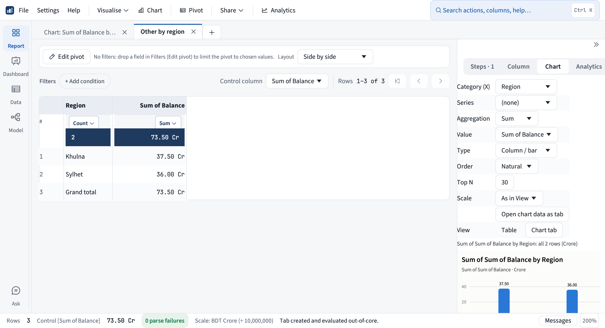
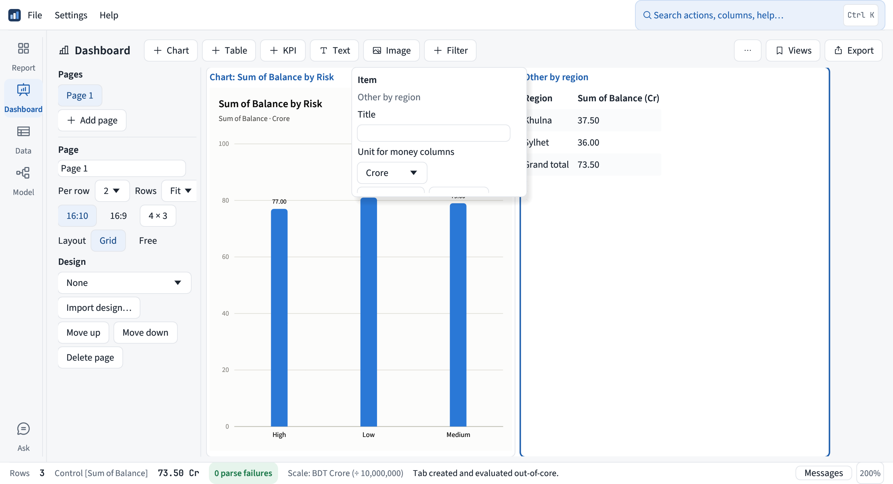
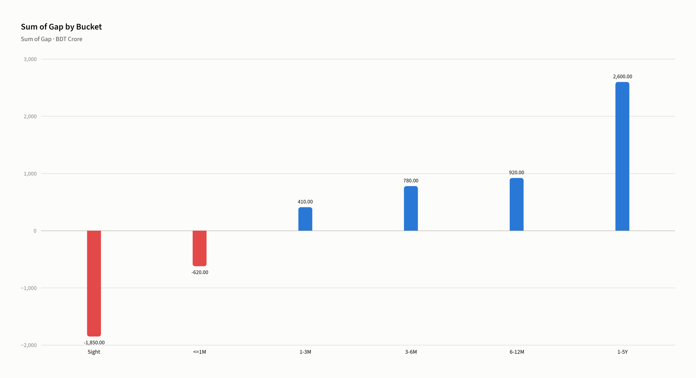
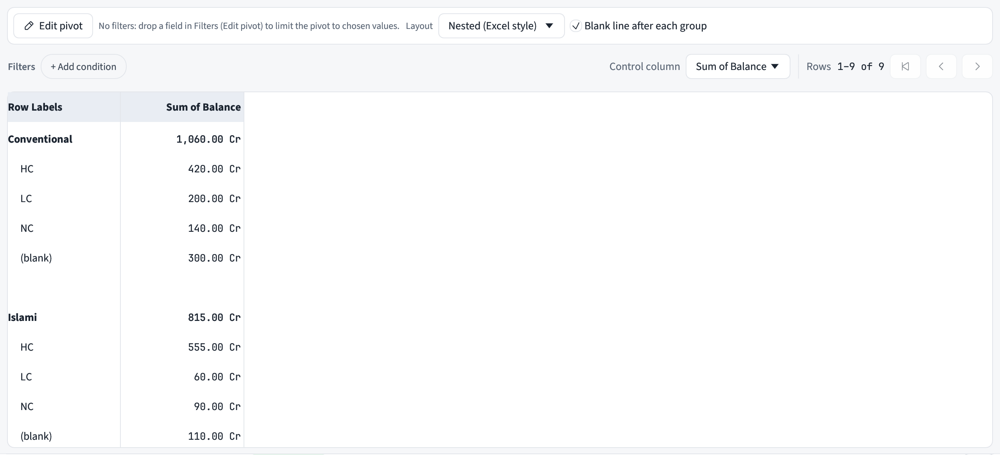
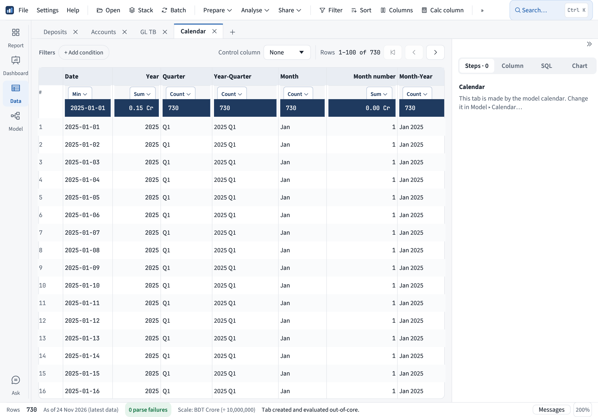
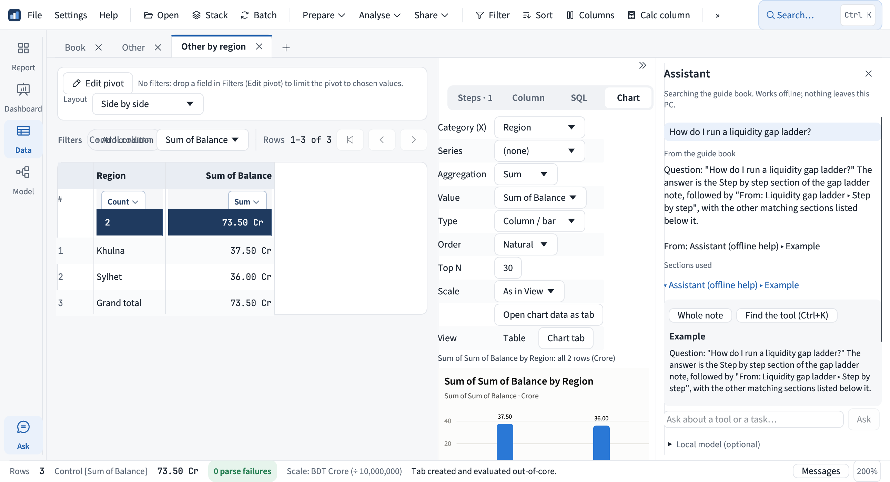

# MicroParquet

A small, fast, portable desktop workstation for CSV and Parquet files, built for bank treasury, ALM, credit-risk and finance work in Bangladesh.

MicroParquet opens core-banking extracts of millions of rows on an ordinary laptop. You clean and shape them with recorded steps, then run the calculations behind ALCO packs and Bangladesh Bank returns: liquidity gaps, IRRBB, LCR/NSFR, loan classification and provisioning, IFRS 9 ECL, FTP and month-on-month variance. It is a single executable. It needs no installation, no database and no internet connection, and nothing leaves the machine.

> **Status:** v1.14.0, fourteen development phases complete (data tools, ALM and risk, charts, a linked model, dashboards and reports, planning and forecasting, and an offline assistant). Outputs feed regulatory work, so the rule is to **fail loudly**. A blank, unreadable or unmapped value stops a tool with a message. The app never quietly treats it as zero.

---

## Screenshots

All pictures are drawn by the program's own automated tests on small **demo data** (not real bank data), in the light theme; every one also has a dark version in [`docs/guide/img/`](docs/guide/img/).

| | |
| --- | --- |
|  **Report view:** pivots and charts, with the side panel for chart, steps and analytics. |  **Dashboard:** pages of charts, tables, KPI cards, text and images, exported to HTML, PowerPoint and PDF. |
|  **Banking chart templates:** the liquidity gap ladder, with the finding written as the title. |  **Pivot builder:** side-by-side or Excel-style nested layout. |
|  **Model view:** links between tabs, one shared calendar, the as-of date and measures. |  **Assistant:** answers from the guide book, names its section, never calculates; works offline. |

---

## Download

Portable builds are attached to each [GitHub Release](../../releases):

| Platform | File | How to run |
| --- | --- | --- |
| Windows 10/11 (x64) | `MicroParquet-Windows-x64-Portable.zip` | Unzip anywhere (a USB stick works) and run `MicroParquet.exe`. No admin rights needed. |
| macOS (Apple Silicon) | `MicroParquet-macOS-AppleSilicon-App.zip` | Unzip and open `MicroParquet.app`. The first time, right-click ▸ Open, because the build is ad-hoc signed. |

On first start the app creates a `portable_data` folder next to itself. It holds your settings, saved schemas, rule and parameter files, curves, profiles, saved runs and report packs, and the masking key. **Back this folder up, and never commit it to a repository.**

---

## What it does

### Data handling
- **Fast at any size.** Out-of-core Polars engine with a background worker, so the UI stays responsive on large files. CSV ↔ Parquet conversion runs one file at a time or as a recursive folder batch with a log.
- **Schema & Ingestion.** Typed columns (IDs keep leading zeros), D/M/Y dates, Dr/Cr and bracket negatives, and parse-failure counts. Columns can be renamed at load time, and PII masking uses a per-install key. Saved schemas are applied automatically to files with matching headers.
- **Recorded steps.** Filter (with a value picker), multi-level sort with custom lists and a built-in **Tenor** order (1m, 100D, 1y…), calc and conditional columns, join, stack, SQL editor, clean line breaks and pivot tables. Every step can be edited, moved, switched off, saved as a macro, replayed headless, or exported as a Python script.
- **Checks.** Summary row (Sum, W.Avg and more), column inspector with distributions, hygiene audit, and a data-quality scorecard (Red/Amber/Green with a GL control total).
- **Exports.** Parquet, CSV (numbers Excel reads as numbers), multi-tab Excel in Thousand/Lakh/Million/Crore, and PDF with title, orientation and page size. Split export comes with a row-and-total manifest; clipboard copies paste as numbers.

### Treasury & ALM
- Maturity bucketer (SLP / LCR / custom) and rate profile.
- Liquidity gap ladder with limits, behavioural CASA, and a TDRR early-withdrawal stress.
- Behaviour profile: core/volatile deposits within the BB IRRBB caps, plus CPR and TDRR.
- ΔNII with repricing dates, separate betas for rises and falls, and floors; duration, DV01 and ΔEVE.
- Dated yield curves and FTP at origination date, with a curve fingerprint on every result.
- Month-on-month variance with a volume/rate/mix split and template-based commentary.

### Regulatory risk
- **IRRBB:** cash-flow ladder in the 19 BB buckets, and the six BB shock scenarios with ΔEVE, loss as % of Tier 1, the 15% outlier test and ΔNII. Follows the BRPD *Guidelines on IRRBB*, 13 April 2021.
- **LCR / NSFR** from GL balances through a map file you control (DOS Circular 01/2015 structure).

### Loans & credit
- Classification by overdue period (BRPD Circular 15/2024), with an override that can only make a grade worse.
- BB provisioning and Base for Provision, CL migration matrix, two-period reconcile, CL-1 summary from a template.
- IFRS 9 staging and ECL (BRPD Circular 06/2026) against the regulatory provision, with the shortfall to the Loan Loss Reserve.
- Limit utilisation, over-limit and undrawn CCF.

### Islamic window
- Mudaraba profit distribution by the weightage / PSR method. The app only calculates: every parameter comes from a dated file that must hold the Shariah Supervisory Committee's approved values.

### Model, dashboards and planning (Phases 9 to 14)
- **One window, four views.** Report (pivots and charts), Dashboard, Data (files, steps, single-table tools) and Model. A collapsible side panel and a Ctrl+K search reach every tool.
- **A linked model.** Link tabs like tables of a database (branch, product and GL masters; keys of two columns; duplicate keys listed so they can be fixed at source), share one calendar, and measure balances and flows properly: closing, opening and average daily balance, MTD / QTD / YTD, prior period and same period last year, rolling 3 and 12 months, moving averages. Ratios (yield, cost of funds, NIM) take Act/365, Act/360 or Act/Act.
- **Charts and dashboards.** A chart studio with many forms and banking templates; drill-down and "Show rows" behind any number; dashboards with KPI cards, page filters, cross-filtering, saved views, a grid or free layout and imported page designs; HTML reports with drill-down (a small-file option for email), PowerPoint with real editable charts, and PDF pages.
- **Plan against actual.** Budget and target tables linked to the data, with actual less plan and % achieved; target bands with red, amber and green zones, bullet and gauge visuals; variance bridge (volume, mix and rate that add up exactly); top movers; chart notes.
- **Forecasting.** Trend + seasonality, Holt-Winters, growth / run-off and ARIMA with an automatic back-test, 80% and 95% bands, outlier handling and manual adjustments, plus what-if scenarios (rate shift and growth) that are always labelled as not actual.
- **Offline assistant.** A panel in every view that answers from the built-in guide book and shows the section it used. It never calculates a number. An optional small local model (a 1 to 3 GB GGUF file copied in once) can phrase the answers; it runs on the PC only. See the [Assistant note](docs/guide/assistant.md).

### Reporting & automation
- Saved tool runs, which re-run any result tab with new inputs.
- **Report packs**: pick this month's files and the cutoff, and get one Excel workbook. Its Cover sheet records every input file's fingerprint and every rule and parameter file used.
- Headless command line for scheduled runs (below).

---

## Documentation

- **User guide:** [`docs/guide/`](docs/guide/README.md). One note per tool, each with fixed sections (ten for the older tools, eight for the newer ones): what it does, when to use it, before you start, the columns you need, step by step, what you get, how to check it, a worked example, messages and fixes, and limits. Every worked example is produced by an automated test, so the numbers in the guide are the numbers the program gives.
- **Design and specifications:** `docs/phase1-spec.md` … `docs/phase14-decisions.md`, with progress notes and accepted deviations; UI design references are in `docs/design/`.

---

## Before you rely on the numbers

No regulatory rate, factor or bank policy is written into the code. All of them live in dated files under `portable_data`, of three kinds:

| Kind | Examples | What to do |
| --- | --- | --- |
| **Circular files** (BB numbers with their source) | IRRBB shocks and NMD caps (2021-04-13), CL overdue thresholds (2025-04-01), IFRS 9 staging (2026-03-08) | Check they are still current; add a newer dated file when a circular changes. |
| **Sample files** (illustrative; a yellow banner shows) | CL-1 template, LCR/NSFR GL map, ECL parameters, IFRS 9 bank policy, Mudaraba PSR file, DQ rules | Replace them with your bank's own values and set `"sample": false`. |
| **Bank files** | CL code map, segment and loan-category maps, provision rules, behaviour profiles, betas, curves, gap limits | Fill in your own codes, curves and policies. |

The full list is in Chapter 8 of the guide book.

---

## Command line (headless)

```text
# Replay a saved macro on a file and export
MicroParquet --headless --macro-file steps.mpq.json --input loans_oct.csv --export-xlsx loans_oct.xlsx

# Run a report pack
MicroParquet --headless --pack monthly --slot Loans=loans_oct.csv --slot Deposits=deposits_oct.csv \
             --cutoff 2026-10-31 --export-xlsx alco_oct.xlsx
```

Other exports: `--export-parquet`, `--export-csv`, `--export-pdf`. `--allow-parse-failures` exports even when the control column has unreadable values (they are still reported).

---

## Building from source

Requires the Rust stable toolchain.

```bash
cargo build --release      # first build compiles Polars: 10–20 minutes
cargo test                 # 1,400+ tests, including headless UI render and click tests
```

Never run `cargo clean` unless you need to; the Polars build takes a while. `CLAUDE.md` describes the layout, the rules (no `unwrap` on user data, `#[serde(default)]` on every new field, fail loudly) and the domain conventions.

| Path | Contents |
| --- | --- |
| `src/engine.rs` | Ingestion, schema inference, step compiler |
| `src/banking.rs` and the tool modules | ALM, IRRBB, LCR/NSFR, credit, ECL, Islamic window |
| `src/ui/` | egui interface |
| `src/exporters.rs`, `src/batch.rs` | Exports and batch conversion |
| `assets/` | Fonts and the built-in BB rule files |
| `tests/` | Calculation, regression and UI tests |

Built with Rust 2021, [Polars](https://pola.rs) 0.43, [egui/eframe](https://github.com/emilk/egui) 0.29, rust_xlsxwriter and printpdf. Third-party licences are in [`THIRD_PARTY_NOTICES.md`](THIRD_PARTY_NOTICES.md).

---

## Privacy and data

- Everything runs locally and nothing is sent anywhere: no telemetry, no update check. The only network use is the optional assistant model, which MicroParquet starts on this PC and talks to over the loopback address (127.0.0.1) only.
- The repository holds **synthetic test data only**. Never commit real customer data or anything from `portable_data`.
- PII masking uses an HMAC key created per installation. Export a backup of the key; without it, masked tokens cannot be reproduced on another machine.

---

## Disclaimer

MicroParquet is an independent tool. It is not affiliated with or endorsed by Bangladesh Bank or any bank. It follows the cited circulars as its author reads them, and the sample parameter files are illustrative only. Results must be reviewed by a qualified person, and checked against your bank's own policies and the current circulars, before they are used in any regulatory return or decision.

## Licence

MicroParquet is released under the [MIT License](LICENSE). Bundled third-party components keep their own licences (see [`THIRD_PARTY_NOTICES.md`](THIRD_PARTY_NOTICES.md)).
