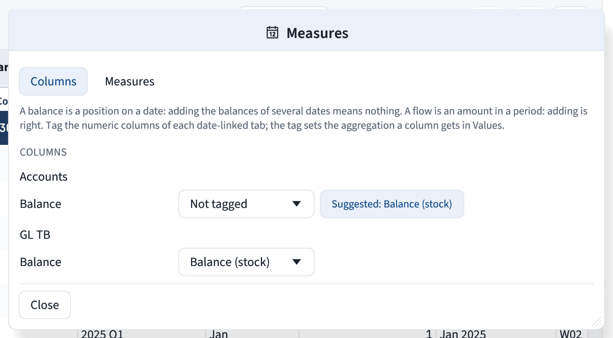
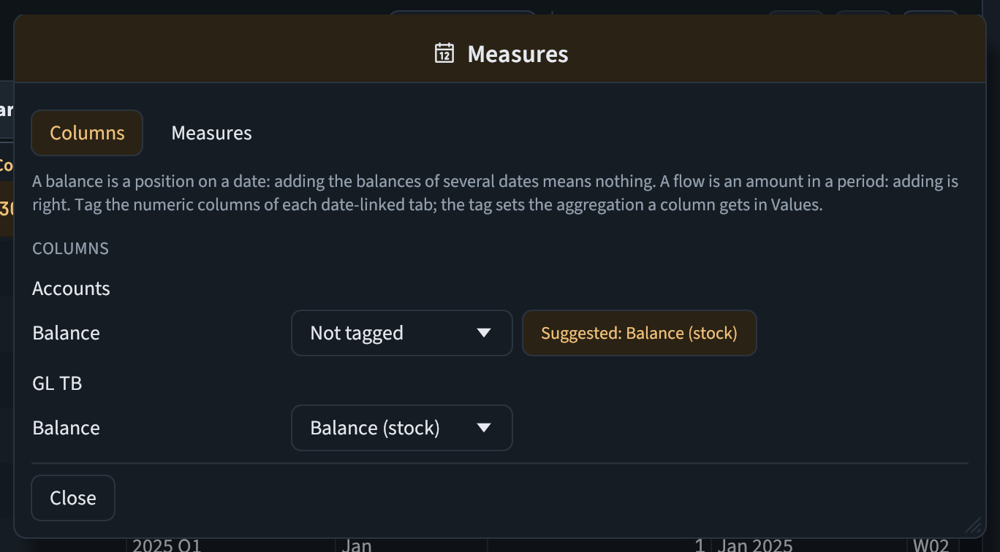
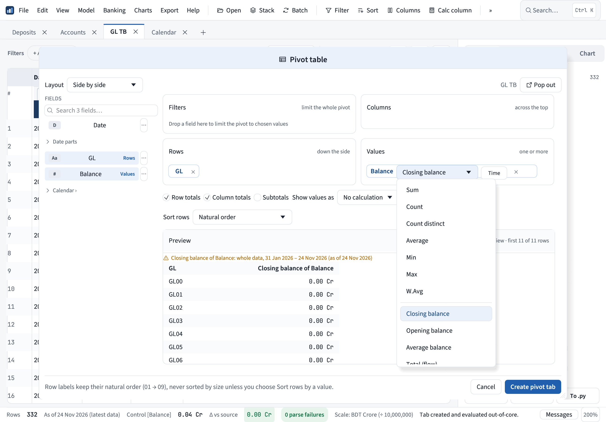
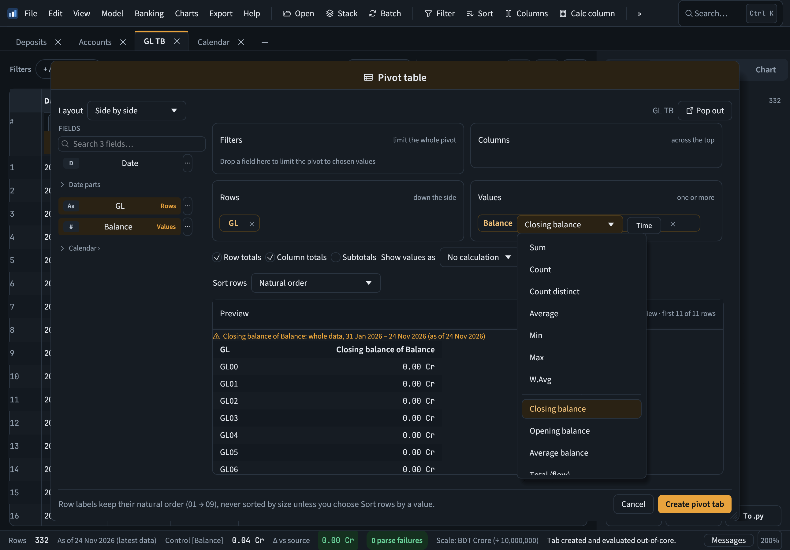
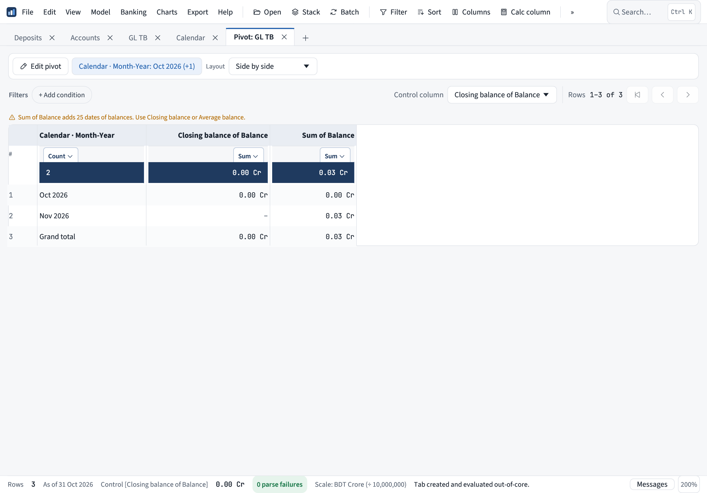
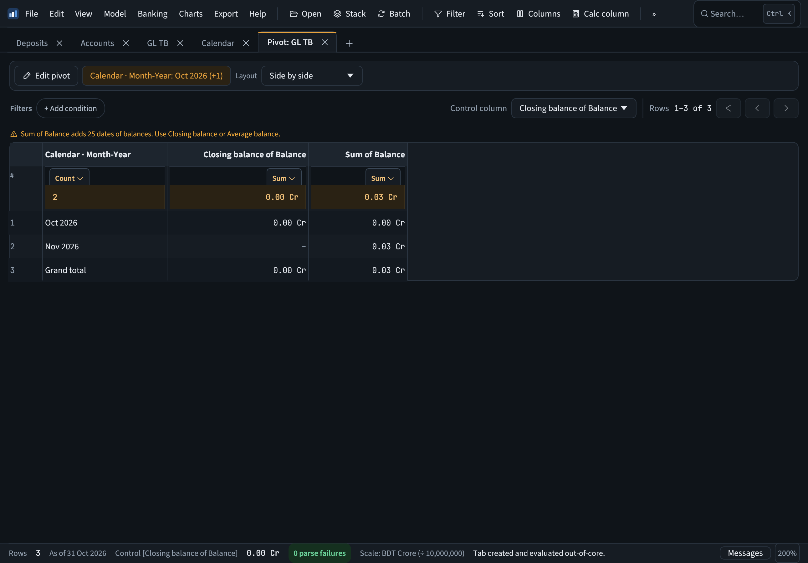
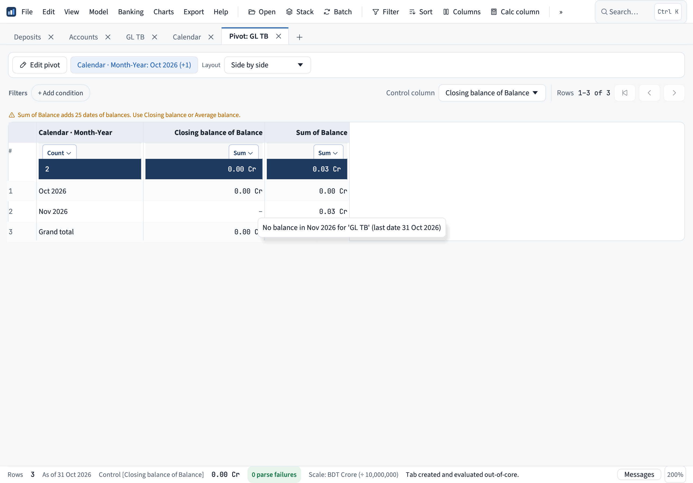
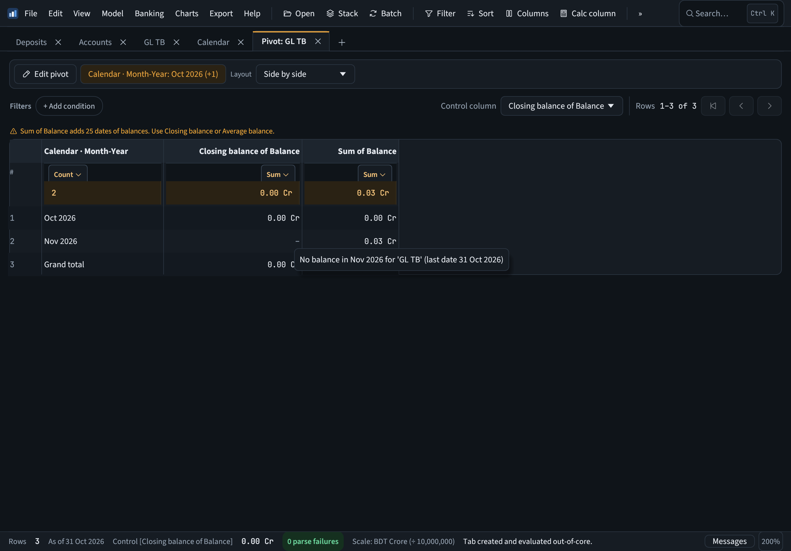

# Balances and flows

## 1. What it does

Treats a balance as what it is, a position on a date, and a flow as an amount in a period. For a tab with a date link, each number column can be tagged Balance (stock), Flow or YTD balance, and a value in a pivot or chart can be a **Closing balance**, **Opening balance**, **Average balance**, **Total (flow)**, **Period amount (YTD balance)**, **Count at closing**, **Distinct count at closing** or **W.Avg at closing**. A subtotal, a Total column and the Grand total are worked out from their own rows and their own period: a balance is never added across dates.

## 2. When to use it

- Any pivot or chart that groups by month, quarter or year a column of balances (deposits, advances, a trial balance) or of flows (interest, disbursements, recoveries).
- Whenever the tab has several dates: a plain Sum of a balance over 23 month-ends adds 23 balances, which no report wants.

## 3. How to use it

1. Turn on the model calendar and link the tab's date column ([Shared calendar](model-calendar.md)).
2. **Model ▸ Measures… ▸ Columns**: tag each number column. A name that looks like a balance (Balance, Outstanding) or a flow (Interest, Income, Disbursed) shows a "Suggested" button; nothing is tagged until you click it. A trial balance's income and expense GLs, which add up from the start of the fiscal year, are tagged **YTD balance**.
3. In the Pivot dialog add the column to Values. The tag sets the aggregation it gets; the aggregation box on the value lists the rest.
4. Put "Calendar › Month-Year" (or Year-Quarter, Fiscal year) in Rows. A heading names what it is: "Closing balance of Balance", "Average of month-ends of Balance", "Total of Interest", "Period amount of Income (YTD)".
5. A blank cell says why when you point at it: "No balance in Nov 2026 for 'Accounts' (last date 31 Oct 2026)". A blank is never a 0.

**Carry-forward.** A day with no rows (Friday, Saturday, a holiday) takes the last balance before it: the average of a daily tab counts every calendar day, each at the balance of the last date on or before it. A tab that has one date a month is a **month-end** tab: its average is the average of the month-ends, and the heading says so ("Average of month-ends of Balance").

**Why income GLs are a YTD balance.** A trial balance shows an income GL as the amount since the start of the fiscal year (10, then 25, then 45). The income of a month is the difference between its closing and the closing before it. **Period amount** does that, and starts again from nothing in a new fiscal year.

## 4. Example

**A daily tab.** The balance is 100 on 1 Nov and 130 on 3 Nov; 2 Nov has no row. Closing is the last date, 130. The average counts 2 Nov at 100: (100 + 100 + 130) / 3 = 110. Nothing is before 1 Nov, so the opening is blank. A plain Sum, 230, is the trap: it is three dates added.

| Calendar · Month-Year | Closing balance of Balance | Average balance of Balance | Opening balance of Balance | Sum of Balance |
| --- | ---: | ---: | ---: | ---: |
| Nov 2026 | 130.00 | 110.00 | (blank) | 230.00 |
| Grand total | 130.00 | 110.00 | (blank) | 230.00 |

Test: `m3_a_daily_tab_closes_at_the_last_balance_and_the_average_carries_the_balance_over_the_missing_day`

**A month-end tab.** 31 Jan = 100, 28 Feb = 120, 31 Mar = 140, 30 Apr = 150. Q1's average is the mean of its three month-ends; the Grand total's is the mean of the four, not the sum and not the mean of the quarters. Q2 opens at the balance of 31 Mar.

| Calendar · Year-Quarter | Average of month-ends of Balance | Closing balance of Balance | Opening balance of Balance |
| --- | ---: | ---: | ---: |
| 2026 Q1 | 120.00 | 140.00 | (blank) |
| 2026 Q2 | 150.00 | 150.00 | 140.00 |
| Grand total | 127.50 | 150.00 | (blank) |

Test: `m3_a_month_end_tab_averages_its_month_ends_and_says_so_in_the_heading`

**A YTD balance.** Income in the trial balance: 10 at 31 Jan, 25 at 28 Feb, 45 at 31 Mar. The income of each month is the difference. With a fiscal year from February, 31 Jan is in the year before, so February starts from nothing.

| Month-end | Income in the trial balance (since the start of the fiscal year) | Period amount, fiscal year from January | Period amount, fiscal year from February |
| --- | ---: | ---: | ---: |
| Jan 2026 | 10.00 | 10.00 | 10.00 |
| Feb 2026 | 25.00 | 15.00 | 25.00 |
| Mar 2026 | 45.00 | 20.00 | 20.00 |

Test: `m3_a_ytd_balance_gives_the_movement_of_each_period_and_a_new_fiscal_year_starts_from_nothing`

## 5. What it refuses and why

- A time aggregation outside a project, on a tab with no date link, or on a date part: refused in words, with what to do.
- An ordinary Sum or Count of a column tagged Balance, over rows of more than one date, is not refused. It shows a banner and a chart note: "Sum of Balance adds 23 dates of balances. Use Closing balance or Average balance." Untagged columns and old pivots have no banner and the same numbers.
- A blank, with its reason, where the period has no date, or no balance before it ("No balance on or before 1 Jan 2025. Add that date's data or start later.").

## 6. Python export

Refused for a step that uses a time aggregation: "Python export can't follow links between tabs yet. Use the Join tool to copy the column, or export the result tab."

## 7. Saved in

The tags are in the project's model (`column_kinds`). The aggregation is part of the pivot or chart value (macro, project, saved chart). Old pivots and charts have none and load unchanged.

## 8. Related tools

[Shared calendar](model-calendar.md) · [Time intelligence](time-intelligence.md) · [Measures and ratios](measures-and-ratios.md) · [Date grouping](date-grouping.md) · [Pivot table](pivot.md)
