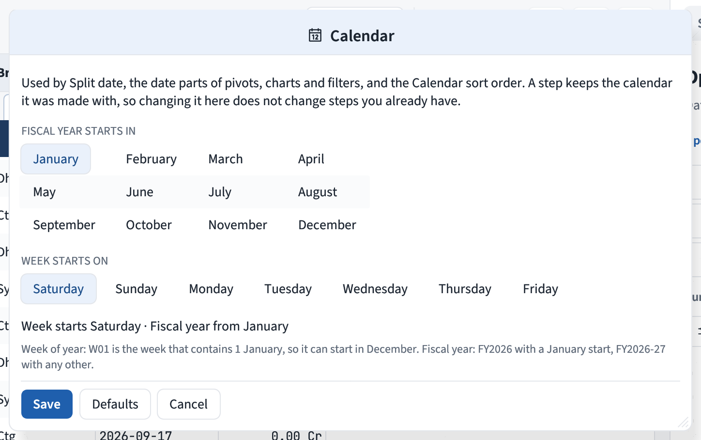
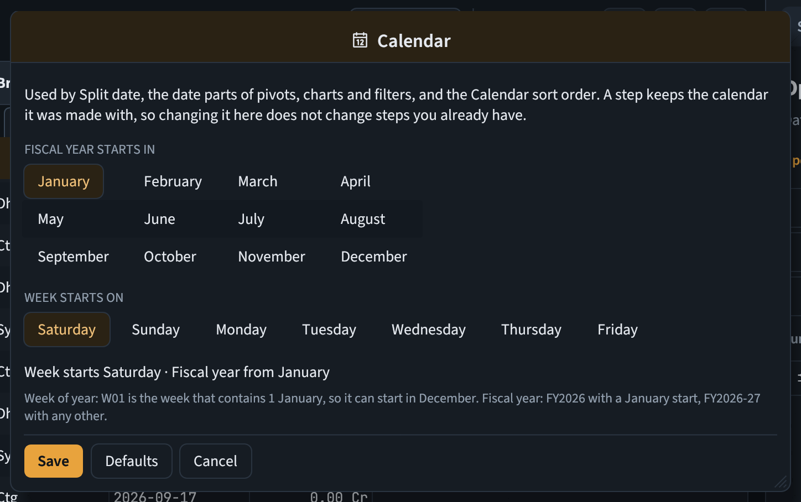

# Calendar settings

## 1. What it does

Sets two things every date feature needs: the first day of the week and the first month of the fiscal year. The defaults are **Saturday** and **January**, which fit a Bangladesh bank's working week and a calendar-year fiscal year. Split date, the date parts of pivots, charts and filters, and the Calendar sort order all use them, so one report never has two meanings of "week" or "FY".

## 2. When to use it

- Your bank's fiscal year starts in July (FY2025-26) and quarter columns must say FQ1 for July to September.
- Weeks are counted from another day (for example Sunday) in a return or a pack.
- You want to know exactly what "W03" or "FY2025-26" means before you quote it.

## 3. How to use it

1. Choose View ▸ "Calendar…" (or Ctrl+K and type "calendar").
2. Under "Fiscal year starts in" pick the month (January to December).
3. Under "Week starts on" pick the day (Saturday to Friday).
4. Click "Save". The status line says "Calendar saved: Week starts Saturday · Fiscal year from January. Steps you already have keep their own calendar." "Defaults" puts back January and Saturday; "Cancel" leaves things as they were.
5. Every dialog that uses date parts shows the same line ("Week starts Saturday · Fiscal year from January") so you can see which calendar a new step will copy.

The rules, in one place:

- **Week starting** is the first day of the week on or before the date.
- **Week of year**: W01 is the week that contains 1 January, so it can start in the previous December. A year whose 1 January falls on the last day of a week can reach W54.
- **Fiscal year**: with a January start it is the calendar year, written FY2026. With any other start it is written FY2026-27: the year it starts in, then the last two digits of the year it ends in. **Fiscal quarter** is FQ1 to FQ4 and **Fiscal month** is 1 (the first month of the fiscal year) to 12.

## 4. Example

15 January 2026 is a Thursday. The same date under four calendars:

| Week starts / fiscal year from | Week starting | Week of year | Fiscal year | Fiscal quarter | Fiscal month |
| --- | --- | --- | --- | --- | --- |
| Saturday / January | 2026-01-10 | W03 | FY2026 | FQ1 | 1 |
| Monday / January | 2026-01-12 | W03 | FY2026 | FQ1 | 1 |
| Saturday / July | 2026-01-10 | W03 | FY2025-26 | FQ3 | 7 |
| Sunday / April | 2026-01-11 | W03 | FY2025-26 | FQ4 | 10 |

Test: `w8_the_calendar_examples_are_what_the_calendar_core_gives`

The Calendar order puts month names, day names, quarters and "Aug 2026" labels in the order you read them. The days follow the week start:

| Labels | In Calendar order |
| --- | --- |
| Mar, Jan, Feb | Jan, Feb, Mar |
| Mon, Sat, Fri | Sat, Mon, Fri |
| Mon, Sat, Fri | Mon, Fri, Sat |

Test: `w8_the_calendar_examples_are_what_the_calendar_core_gives`

The first two rows use a Saturday week, the last a Monday week.

## 5. What it refuses and why

- A fiscal start month outside 1 to 12 (a hand-edited `settings.json`): "The fiscal year start month is 13. It must be 1 (January) to 12 (December). Set it again in View ▸ Calendar…". It is never rounded to a nearby month.
- Changing the calendar does not rewrite old results: a step, pivot, chart or filter made earlier keeps the calendar it copied, so a saved macro or project gives the numbers it gave before. To use the new calendar on an old step, edit the step and save it.

## 6. Python export

The Calendar and Ranges orders are written into the script as plain Python functions that rank labels the same way as the app, and the date parts use the copied week start and fiscal month. The tests run them with `python3` and compare.

## 7. Saved in

- `settings.json`: the two choices (defaults January and Saturday when the file has none).
- Each step, pivot, chart or filter that uses a date part: its own copy.
- A project or macro: through those steps, not as a setting.

## 8. Related tools

[Split date](split-date.md) · [Date grouping](date-grouping.md) · [Custom sort lists](custom-sort-lists.md) · [Filter](filter.md) · [Pivot table](pivot.md)
