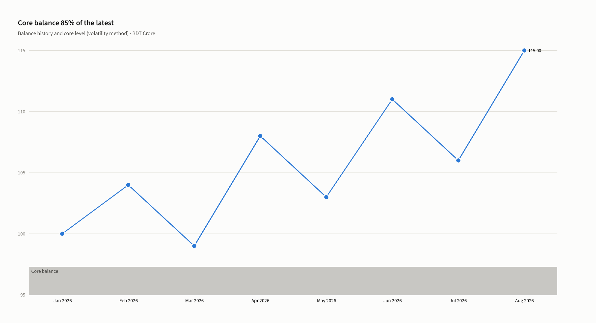
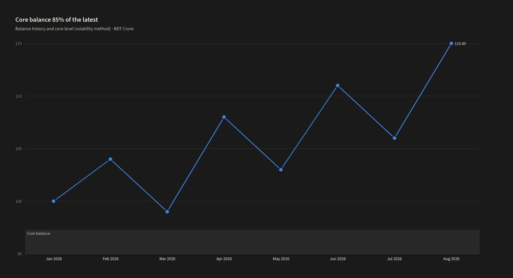

# Chart: Behaviour profile

## 1. What it does

Shows a deposit's balance history as a line with the core level as a shaded band from zero.

## 2. When to use it

- You support a core / volatile split of current and savings deposits.

## 3. Before you start

- A tab with a date column (typed as a Date) and a balance column, at least three month-ends (see [Behaviour profile](behaviour-profile.md)).

## 4. Columns you need

| Column | Required? | Notes |
| --- | --- | --- |
| Date | Yes | Typed as a Date. |
| Balance | Yes | A number column. |

## 5. Step by step

1. Open the history tab and choose Charts ▸ "Chart this result".
2. Change anything you like in the studio (type, order, scale, titles, reference lines); a takeaway you type replaces the finding as the title.
3. Export to HTML (a page that works offline), Export to Excel (a native chart beside the numbers) or Copy as Python from the buttons under the chart; a report pack can carry the chart too.

## 6. What you get

- A line of the balances with the value at its end and the core level as a band.
- The title: "Core balance 85% of the latest".

## 7. Check your result

- The core level is the volatility-method core balance; the percentage is of the latest balance.

## 8. Worked example

Eight month-ends (Crore):

| Month | Jan | Feb | Mar | Apr | May | Jun | Jul | Aug |
| --- | --- | --- | --- | --- | --- | --- | --- | --- |
| Balance | 100 | 104 | 99 | 108 | 103 | 111 | 106 | 115 |

The latest balance is 115; the core level is 85% of it.

The title the template writes (a fixed rule, no AI): **Core balance 85% of the latest**

## 9. Common messages and fixes

- "Behaviour profile: the core level needs at least 3 month-ends of history; the tab has 2."
- "Behaviour profile: the tab needs a date column (typed as a Date) and a balance column."

## 10. Limits and assumptions

- The tab must hold all its rows on the page.
- The band is the core level from zero, not a confidence range.
