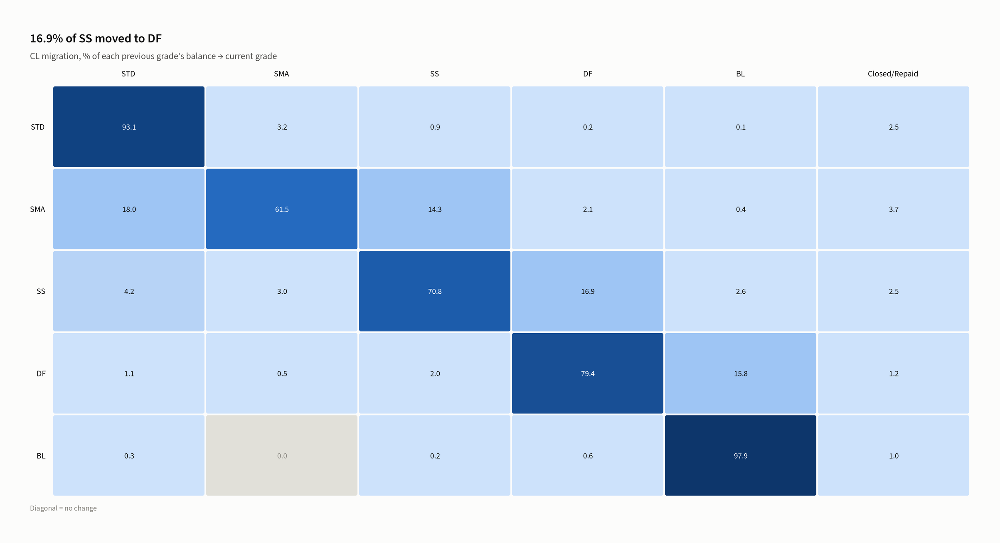
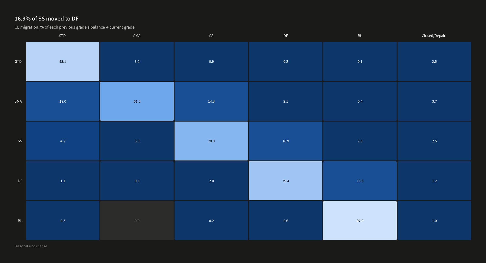

# Chart: CL migration

## 1. What it does

Draws the CL migration matrix as a heatmap of the percentage of each previous grade's balance: a row is where last month's grade went. Every grade pair is a cell (STD, SMA, SS, DF, BL, then Closed/Repaid), a pair with no balance is a 0.0 cell in the lowest colour step with its label.

## 2. When to use it

- You review upgrades and downgrades between two month-ends.
- You need the share of a grade that moved on, not only the amounts.

## 3. Before you start

- Build the CL migration matrix first (see [CL migration matrix](cl-migration.md)).
- In the HTML export the same data is also a Sankey (Preview in browser).

## 4. Columns you need

| Column | Required? | Notes |
| --- | --- | --- |
| Previous grade | Yes | Rows: STD, SMA, SS, DF, BL in CL order. |
| STD … BL, Closed/Repaid | Yes | Balances by current grade; New accounts are not a previous grade. |

## 5. Step by step

1. Open the result tab of the tool (below), then choose Charts ▸ "Chart this result" (or Charts ▸ New chart ▸ "Banking templates" and the card). The chart's own table opens as a tab when the chart needs numbers the tab does not hold as columns. Tool: CL migration matrix.
2. Read across a row: the cells add up to 100%.
3. Change anything you like in the studio (type, order, scale, titles, reference lines); a takeaway you type replaces the finding as the title.
4. Export to HTML (a page that works offline), Export to Excel (a native chart beside the numbers) or Copy as Python from the buttons under the chart; a report pack can carry the chart too.

## 6. What you get

- A heatmap: rows are the previous grade, columns the current grade, one hue (blue), white text on the dark steps and ink on the pale ones; in the dark theme low values use the darkest step.
- The title names the largest downgrade as "<x>% of <grade> moved to <grade>" (one decimal).

## 7. Check your result

- Each row of the shares adds up to 100.
- A cell on the diagonal is balance that stayed in its grade; below it (to the right) is a downgrade.

## 8. Worked example

The Phase 4 V2 example: account A1 STD 100 to SMA, A2 SS 50 to DF, A3 STD 30 closed, A4 new STD 20.

| Previous grade | STD | SMA | SS | DF | BL | Closed/Repaid |
| --- | --- | --- | --- | --- | --- | --- |
| STD | 0.0 | 76.9 | 0.0 | 0.0 | 0.0 | 23.1 |
| SS | 0.0 | 0.0 | 0.0 | 100.0 | 0.0 | 0.0 |

100 of the 130 STD balance went to SMA (76.9%) and 30 closed (23.1%); all of SS went to DF. Only rows with a previous balance are drawn.

The title the template writes (a fixed rule, no AI): **100.0% of SS moved to DF**

## 9. Common messages and fixes

- "CL migration: the tab has no column 'Previous grade'. Open the result of CL migration matrix first."
- "CL migration: the matrix has no grade rows. Build the CL migration matrix first."

## 10. Limits and assumptions

- The percentages are of the previous grade's balance; a blank cell would mean a percentage of a zero total (the template draws 0.0 for a pair with no balance).
- The largest downgrade is the largest off-diagonal move to a worse grade.
