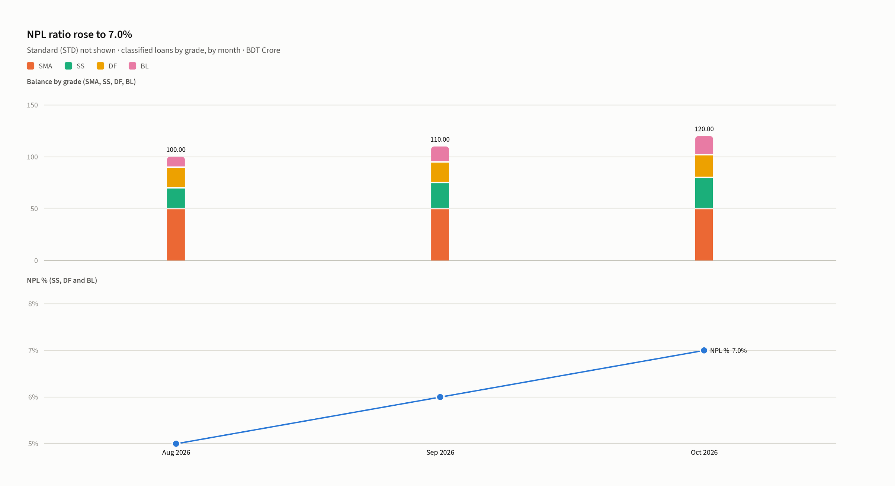
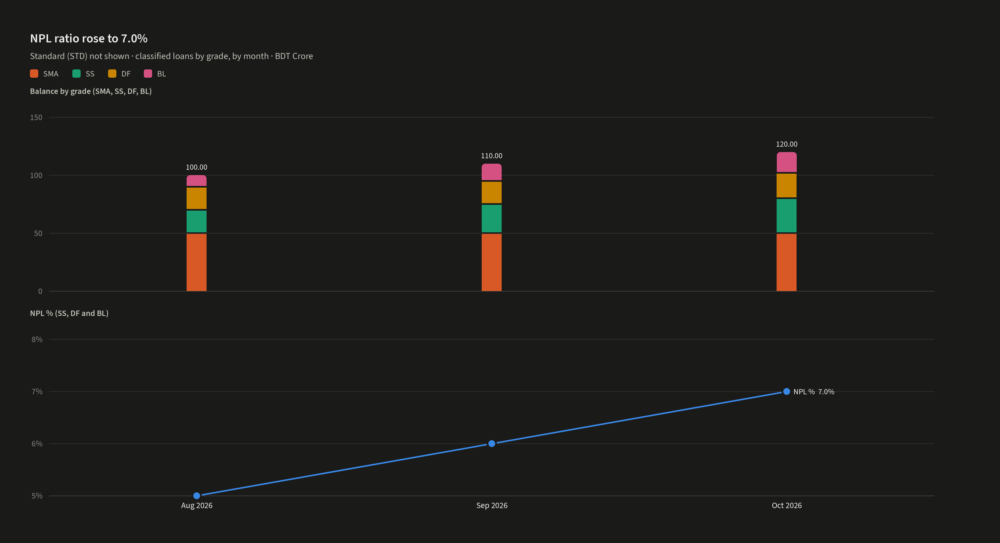

# Chart: Classified trend

## 1. What it does

Shows how classified loans moved over months: stacked columns of SMA, SS, DF and BL by month (Standard is not shown, the subtitle says so) over the NPL ratio as a second panel.

## 2. When to use it

- ALCO or the board watches the NPL ratio month by month.
- You need to see which grade is growing.

## 3. Before you start

- A tab with one row per month and grade: a month column, a grade column (STD, SMA, SS, DF, BL) and a balance column. Pivot the stacked month-end tabs first (see [Stack](stack.md) and [Pivot table](pivot.md)).
- The tab must hold all its rows on the page (the template reads them at once).

## 4. Columns you need

| Column | Required? | Notes |
| --- | --- | --- |
| Month | Yes | A date or text; the months are put in date order. |
| Grade | Yes | STD, SMA, SS, DF, BL. |
| Balance (or outstanding, amount) | Yes | A number column. |

## 5. Step by step

1. Open the result tab of the tool (below), then choose Charts ▸ "Chart this result" (or Charts ▸ New chart ▸ "Banking templates" and the card). The chart's own table opens as a tab when the chart needs numbers the tab does not hold as columns. Tool: a pivot or stack of months by grade.
2. Read the columns and the NPL % line below.
3. Change anything you like in the studio (type, order, scale, titles, reference lines); a takeaway you type replaces the finding as the title.
4. Export to HTML (a page that works offline), Export to Excel (a native chart beside the numbers) or Copy as Python from the buttons under the chart; a report pack can carry the chart too.

## 6. What you get

- Stacked columns by grade over the months (SMA, SS, DF, BL; segments separated by a 2 px gap, the total of the stack on top) and an NPL % panel.
- The NPL % is (SS + DF + BL) ÷ all grades including STD; the title says whether it rose or fell: "NPL ratio rose to 7.0%".

## 7. Check your result

- The NPL % of a month equals (SS+DF+BL) divided by its total of all five grades.
- STD is in the NPL denominator even though it is not drawn.

## 8. Worked example

Three month-ends (balances in BDT):

| Month | STD | SMA | SS | DF | BL | NPL % |
| --- | --- | --- | --- | --- | --- | --- |
| Aug 2026 | 900 | 50 | 20 | 20 | 10 | 5.0 |
| Sep 2026 | 890 | 50 | 25 | 20 | 15 | 6.0 |
| Oct 2026 | 880 | 50 | 30 | 22 | 18 | 7.0 |

NPL = (30 + 22 + 18) ÷ 1,000 = 7.0% in October.

The title the template writes (a fixed rule, no AI): **NPL ratio rose to 7.0%**

## 9. Common messages and fixes

- "Classified trend: the tab needs a month column, a grade column (STD, SMA, SS, DF, BL) and a balance column. Pivot the stacked months by grade first."
- "this tab has N rows and the template reads them all at once. Make a pivot with one row per month and grade (or per month-end) first, then chart that."

## 10. Limits and assumptions

- Grade codes other than STD, SMA, SS, DF and BL are left out.
- The ratio is a share of the balance column you chose, not of the provision base.
