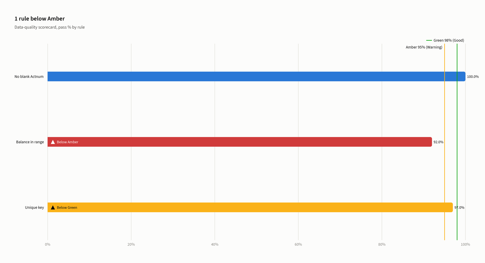
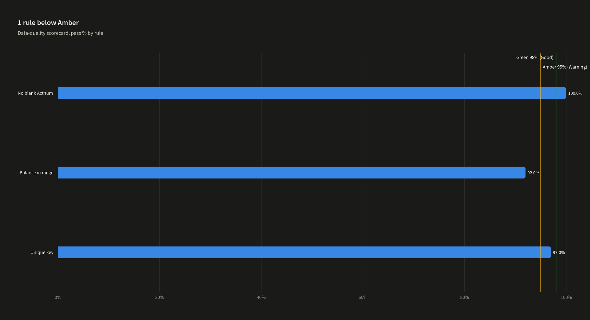

# Chart: Data quality

## 1. What it does

Shows the pass percentage of each data-quality rule as horizontal bars with the Green and Amber thresholds. A rule below Amber is drawn in the critical colour with an icon and "Below Amber"; between Amber and Green the warning colour and "Below Green"; the others keep the default colour.

## 2. When to use it

- You report which rules fall below the thresholds.

## 3. Before you start

- Run the data-quality scorecard first (see [Data-quality scorecard](data-quality-scorecard.md)).

## 4. Columns you need

| Column | Required? | Notes |
| --- | --- | --- |
| Rule | Yes | The overall row is left out. |
| Pass % | Yes | A control total has no pass % and is not a bar. |
| Rows failing | Yes | Detects the scorecard. |

## 5. Step by step

1. Open the result tab of the tool (below), then choose Charts ▸ "Chart this result" (or Charts ▸ New chart ▸ "Banking templates" and the card). The chart's own table opens as a tab when the chart needs numbers the tab does not hold as columns. Tool: Data-quality scorecard.
2. Change anything you like in the studio (type, order, scale, titles, reference lines); a takeaway you type replaces the finding as the title.
3. Export to HTML (a page that works offline), Export to Excel (a native chart beside the numbers) or Copy as Python from the buttons under the chart; a report pack can carry the chart too.

## 6. What you get

- One bar per rule with its value at the tip or inside its end; Green and Amber as vertical lines with labels that never overlap.
- The title: "<n> rules below Amber" (or "No rule is below Amber").

## 7. Check your result

- A bar below the Amber line has the words "Below Amber"; the colour is never alone.

## 8. Worked example

A scorecard:

| Rule | Pass % |
| --- | --- |
| No blank Actnum | 100.0 |
| Balance in range | 92.0 |
| Unique key | 97.0 |

With the default thresholds (Green 98%, Amber 95%): Balance in range is below Amber; Unique key is between Amber and Green.

The title the template writes (a fixed rule, no AI): **1 rule below Amber**

## 9. Common messages and fixes

- "Data quality: no rule has a pass %. Run a rule that checks rows (control totals only have a pass or fail)."

## 10. Limits and assumptions

- The thresholds are the rule set's; a report pack uses the defaults (98 and 95).
