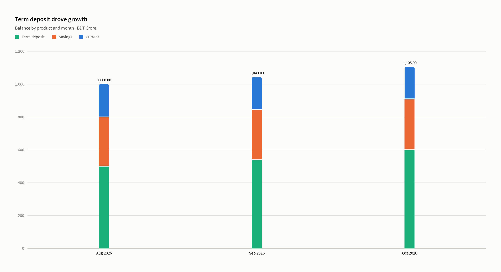
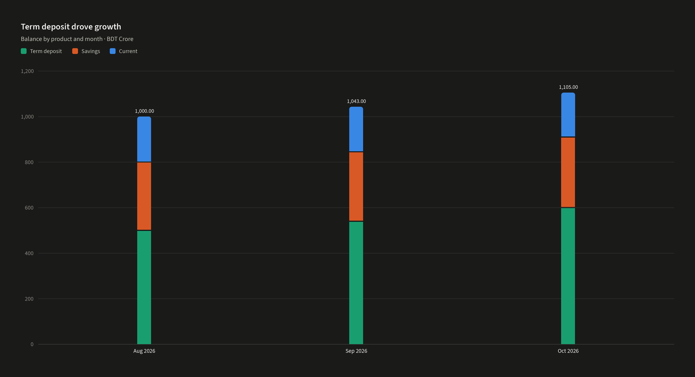

# Chart: Deposit / loan mix

## 1. What it does

Shows how a book's mix changed: stacked columns of product by month (the total on top). The HTML export can also draw it as a treemap.

## 2. When to use it

- You show deposits (or loans) by product over several months.

## 3. Before you start

- A tab with a month column, a product column and an amount (balance, outstanding or amount): a pivot of the months or a stack of month-end files.

## 4. Columns you need

| Column | Required? | Notes |
| --- | --- | --- |
| Month | Yes | A date, or text written day/month/year or year-month-day. The months are put in date order and written "Aug 2026" (two dates in one month keep the whole date, "15 Aug 2026"). |
| Product | Yes | More than 8 products: the rest fold into "Other". |
| Balance / outstanding / amount | Yes | A number column (never a guess among several). |

## 5. Step by step

1. Open the tab and choose Charts ▸ "Chart this result". The chart's own table (month, product, amount) opens as the tab "Chart: deposit mix".
2. Change anything you like in the studio (type, order, scale, titles, reference lines); a takeaway you type replaces the finding as the title.
3. Export to HTML (a page that works offline), Export to Excel (a native chart beside the numbers) or Copy as Python from the buttons under the chart; a report pack can carry the chart too.

## 6. What you get

- Stacked columns by month; each product keeps its colour whatever is filtered out.
- The title names the product with the largest increase: "Term deposit drove growth".

## 7. Check your result

- The total on top of a column is the month's sum of the products.

## 8. Worked example

Three months (Crore):

| Product | Aug 2026 | Sep 2026 | Oct 2026 |
| --- | --- | --- | --- |
| Term deposit | 500 | 540 | 600 |
| Savings | 300 | 305 | 310 |
| Current | 200 | 198 | 195 |

Term deposit grew by 100, Savings by 10; Current fell by 5.

The title the template writes (a fixed rule, no AI): **Term deposit drove growth**

## 9. Common messages and fixes

- "Deposit / loan mix: the tab needs a month column, a product column and an amount column (balance, outstanding or amount)."

## 10. Limits and assumptions

- One product only: use a line, not a stack.
