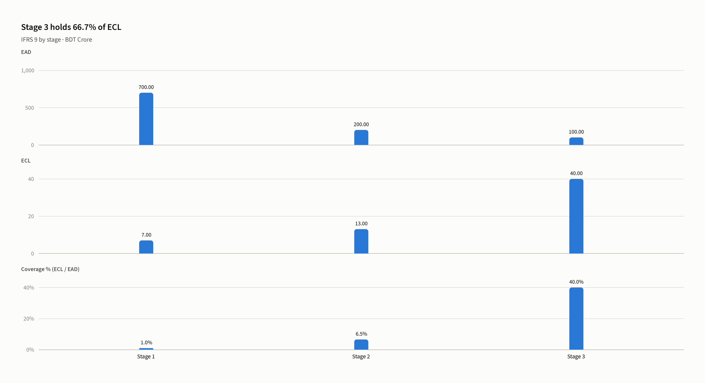
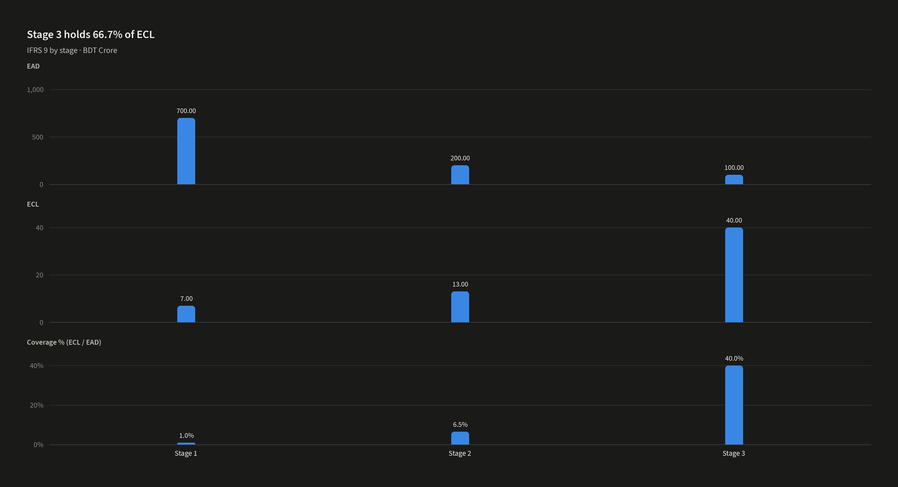

# Chart: ECL by stage

## 1. What it does

Shows where the expected credit loss is held: EAD, ECL and coverage % by stage in three linked panels (never a second axis).

## 2. When to use it

- You explain the IFRS 9 provision by stage to ALCO or the audit committee.

## 3. Before you start

- Build the IFRS 9 summary first (see [IFRS 9 ECL](ifrs9-ecl.md)).

## 4. Columns you need

| Column | Required? | Notes |
| --- | --- | --- |
| Section, Group | Yes | Rows with Section "Stage" are charted (Stage 1, 2, 3); the Total row is left out. |
| EAD, ECL | Yes | BDT. |

## 5. Step by step

1. Open the result tab of the tool (below), then choose Charts ▸ "Chart this result" (or Charts ▸ New chart ▸ "Banking templates" and the card). The chart's own table opens as a tab when the chart needs numbers the tab does not hold as columns. Tool: IFRS 9 summary.
2. Change anything you like in the studio (type, order, scale, titles, reference lines); a takeaway you type replaces the finding as the title.
3. Export to HTML (a page that works offline), Export to Excel (a native chart beside the numbers) or Copy as Python from the buttons under the chart; a report pack can carry the chart too.

## 6. What you get

- Panels of EAD, ECL and coverage % (ECL ÷ EAD) by stage, each with its own scale.
- The title: "Stage 3 holds 66.7% of ECL".

## 7. Check your result

- Coverage is ECL divided by EAD of the stage; the shares of ECL add up to 100%.

## 8. Worked example

The guide summary (BDT):

| Stage | EAD | ECL | Coverage % |
| --- | --- | --- | --- |
| Stage 1 | 700 | 7 | 1.0 |
| Stage 2 | 200 | 13 | 6.5 |
| Stage 3 | 100 | 40 | 40.0 |

ECL is 60 in all; Stage 3 holds 40 of it.

The title the template writes (a fixed rule, no AI): **Stage 3 holds 66.7% of ECL**

## 9. Common messages and fixes

- "ECL by stage: the summary has no stage rows. Build the IFRS 9 summary first."

## 10. Limits and assumptions

- The grade-group rows of the summary are not charted: use the table.
