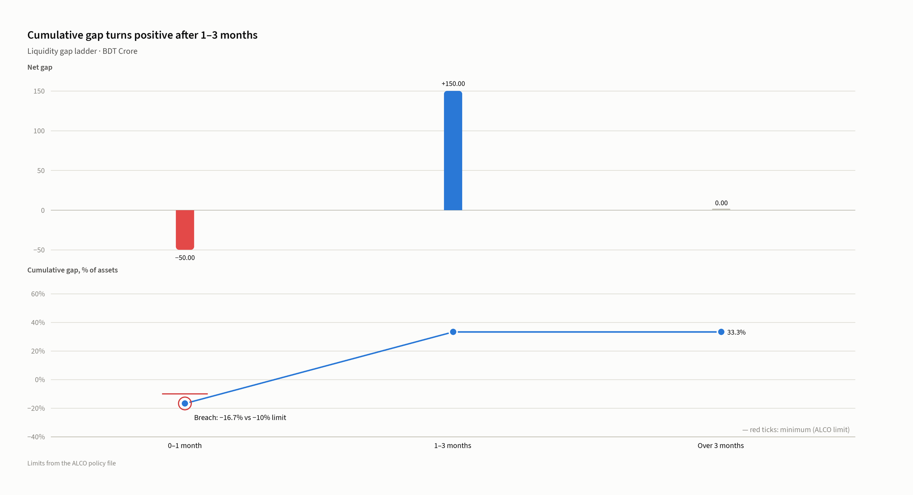
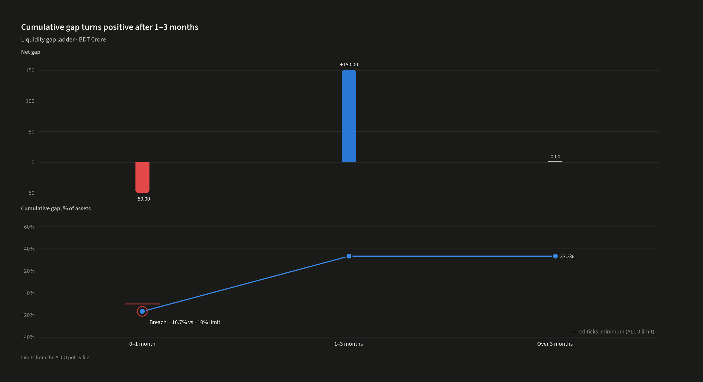

# Chart: Gap ladder

## 1. What it does

Draws the liquidity gap ladder the way ALCO reads it: net gap columns by maturity bucket (blue up, red down, from one zero line) over the cumulative gap as a percentage of total assets. A bucket whose cumulative gap is below its limit is ringed and written out ("Breach: −16.7% vs −10% limit"); the limit is a short red tick on that bucket.

## 2. When to use it

- The monthly structural liquidity profile goes to ALCO and the limits are in the policy file.
- You want the breach to be seen before the table is read.

## 3. Before you start

- Build the Liquidity gap ladder first (see [Liquidity gap ladder](gap-ladder.md)); the template reads its result tab.
- For the limit ticks, have the limits file of the bucket preset (`portable_data/gap_limits/<preset>.json`): without it the chart has no ticks and no note.

## 4. Columns you need

| Column | Required? | Notes |
| --- | --- | --- |
| Bucket | Yes | The bucket names in ladder order. The "Total" row and "Overdue assets (not in gap)" are not buckets and are left out. |
| Net gap | Yes | Inflows less outflows, BDT, shown in the chart's scale. |
| Cumulative gap % of total assets | Yes | A percentage already (−16.67 means −16.67%). |
| Cumulative gap limit % | No | The minimum allowed; a cumulative gap below it is a breach (equal is not). |

## 5. Step by step

1. Open the result tab of the tool (below), then choose Charts ▸ "Chart this result" (or Charts ▸ New chart ▸ "Banking templates" and the card). The chart's own table opens as a tab when the chart needs numbers the tab does not hold as columns. Tool: Liquidity gap ladder.
2. Look at the red ring and its label (if there is one) and the tick it names.
3. Change anything you like in the studio (type, order, scale, titles, reference lines); a takeaway you type replaces the finding as the title.
4. Export to HTML (a page that works offline), Export to Excel (a native chart beside the numbers) or Copy as Python from the buttons under the chart; a report pack can carry the chart too.

## 6. What you get

- Two linked panels on one shared bucket axis: net gap columns above, the cumulative gap % line below (never a second axis).
- A red tick at each bucket's limit, a ring on each breach and its text on the side away from the line, and one note under the plot: "red ticks: minimum (ALCO limit)".
- The title is a finding: "Cumulative gap turns positive after <bucket>", or "Cumulative gap stays negative to <last bucket>".

## 7. Check your result

- The column heights are the ladder's Net gap column; the line points are its Cumulative gap % column.
- A ringed bucket has a cumulative gap % below the tick; one equal to the limit is not ringed.
- Hover a column or a point for the exact value, the bucket and the number of rows.

## 8. Worked example

The Phase 4 example of the gap ladder: assets of 100 (due in 15 days) and 200 (due in 60 days), liabilities of 150 and 50, total assets 300, and a limit of −10% on the first bucket.

| Bucket | Net gap | Cumulative gap % of total assets | Limit % |
| --- | --- | --- | --- |
| 0–1 month | −50.00 | −16.67 | −10.00 |
| 1–3 months | 150.00 | 33.33 |  |
| Over 3 months | 0.00 | 33.33 |  |

The first bucket is below its limit by 6.7 points: it is ringed and labelled. The cumulative gap turns positive in the second bucket.

The title the template writes (a fixed rule, no AI): **Cumulative gap turns positive after 1–3 months**

## 9. Common messages and fixes

- "Gap ladder: the tab has no column 'Bucket'. Open the result of Liquidity gap ladder first." The active tab is not the ladder result.
- "Gap ladder: the ladder has no bucket with a net gap and a cumulative gap %. Build the ladder with total assets above zero." With no assets there is no percentage.

## 10. Limits and assumptions

- The ticks and rings are drawn on the first panel that carries limits; the Excel chart shows them as a "Limit" column with dash markers and a "Breach" column (the ring is for the app and the HTML page).
- The limits are the ALCO's own numbers, read from your file; the chart never supplies one.
