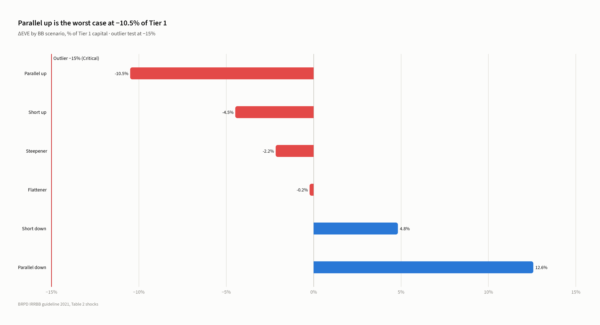
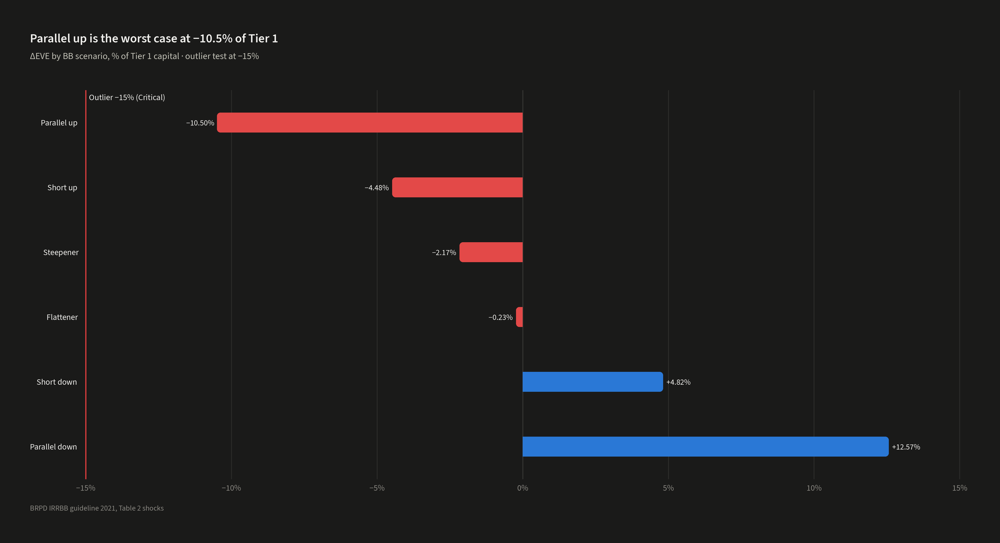

# Chart: IRRBB scenarios

## 1. What it does

Compares the six Bangladesh Bank IRRBB scenarios: horizontal bars of ΔEVE as a percentage of Tier 1 capital, sorted from the worst loss, red for a loss and blue for a gain, with the outlier line (15% by default) in the critical colour.

## 2. When to use it

- The IRRBB return goes to ALCO and the outlier test must be seen at a glance.

## 3. Before you start

- Run the six scenarios first (see [IRRBB (six scenarios)](irrbb-six-scenarios.md)), with a Tier 1 capital amount.

## 4. Columns you need

| Column | Required? | Notes |
| --- | --- | --- |
| Scenario | Yes | The six scenario names; the maximum, outlier and Tier 1 rows are used, not drawn. |
| EVE change | Yes | BDT; negative is a loss. |
| Loss % of Tier 1 | Yes | Used to check the outlier line. |
| "Tier 1 capital" row (Note) | Yes | The capital the percentages are of. |

## 5. Step by step

1. Open the result tab of the tool (below), then choose Charts ▸ "Chart this result" (or Charts ▸ New chart ▸ "Banking templates" and the card). The chart's own table opens as a tab when the chart needs numbers the tab does not hold as columns. Tool: IRRBB (six scenarios).
2. Compare the longest red bar with the outlier line.
3. Change anything you like in the studio (type, order, scale, titles, reference lines); a takeaway you type replaces the finding as the title.
4. Export to HTML (a page that works offline), Export to Excel (a native chart beside the numbers) or Copy as Python from the buttons under the chart; a report pack can carry the chart too.

## 6. What you get

- Bars with a signed label at the tip ("−10.50%", "+12.57%": a sign and two decimals) and the line "Outlier −15%" in the critical colour with its words.
- The title: "<Scenario> is the worst case at −10.5% of Tier 1".

## 7. Check your result

- Each bar is the scenario's EVE change divided by Tier 1; the worst scenario is the longest red bar.
- A bar crossing the outlier line is an outlier in the tool's test too.

## 8. Worked example

The guide example (Tier 1 capital 1,000,000; BDT):

| Scenario | EVE change | ΔEVE % of Tier 1 |
| --- | --- | --- |
| Parallel up | −104,969.17 | −10.50% |
| Short up | −44,832.32 | −4.48% |
| Steepener | −21,723.32 | −2.17% |
| Flattener | −2,309.54 | −0.23% |
| Short down | 48,236.10 | +4.82% |
| Parallel down | 125,684.16 | +12.57% |

No bar reaches −15%, so there is no outlier.

The title the template writes (a fixed rule, no AI): **Parallel up is the worst case at −10.5% of Tier 1**

## 9. Common messages and fixes

- "IRRBB scenarios: the results have no 'Tier 1 capital' row. Run the six scenarios again."
- "IRRBB scenarios: the results have no scenario with an EVE change."

## 10. Limits and assumptions

- The outlier percentage is read from the rule file of the run (15 by default); the chart does not choose it.
- ΔNII is in the result table, not in this chart.
