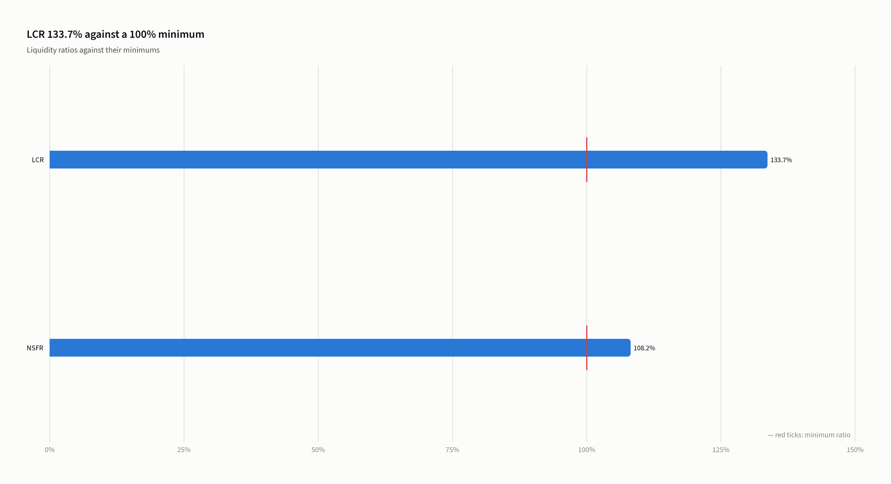
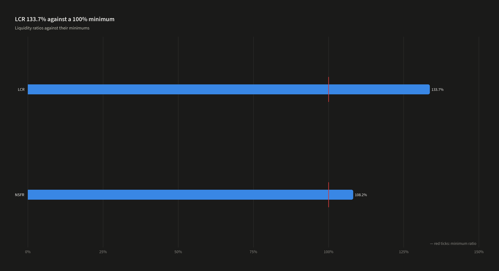
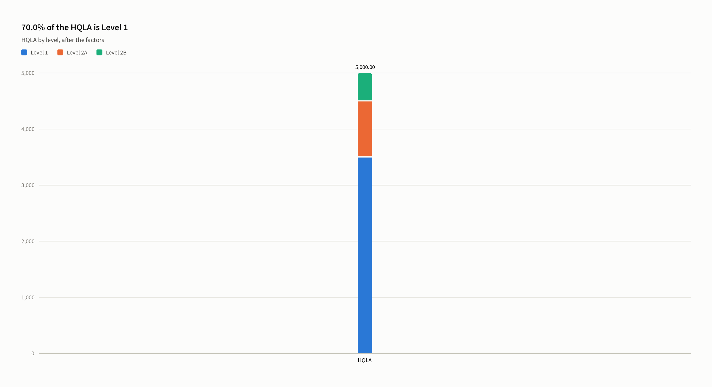
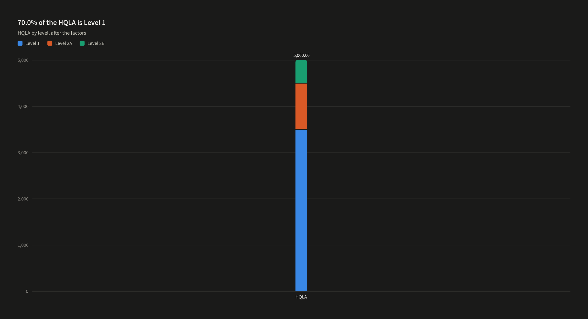

# Chart: LCR / NSFR

## 1. What it does

Shows the two liquidity ratios against their minimums (horizontal bars with a red tick at the minimum, a ring and words on a breach) and, when the summary has the level rows, the HQLA composition as a tall stacked bar of Level 1, 2A and 2B.

## 2. When to use it

- The liquidity return or the ALCO pack shows the LCR and NSFR.

## 3. Before you start

- Run the LCR / NSFR first (see [LCR / NSFR](lcr-nsfr.md)).

## 4. Columns you need

| Column | Required? | Notes |
| --- | --- | --- |
| Item, Value, Unit | Yes | The summary's rows: "LCR", "LCR minimum", "NSFR", "NSFR minimum" (a missing minimum is taken as 100). |
| Level 1 / 2A / 2B assets (after factors), the two cap adjustments | For the HQLA chart | Without them only the ratio chart is made. |

## 5. Step by step

1. Open the result tab of the tool (below), then choose Charts ▸ "Chart this result" (or Charts ▸ New chart ▸ "Banking templates" and the card). The chart's own table opens as a tab when the chart needs numbers the tab does not hold as columns. Tool: LCR / NSFR summary.
2. Read the bars against the red ticks; open "Chart: HQLA composition" for the make-up of the stock.
3. Change anything you like in the studio (type, order, scale, titles, reference lines); a takeaway you type replaces the finding as the title.
4. Export to HTML (a page that works offline), Export to Excel (a native chart beside the numbers) or Copy as Python from the buttons under the chart; a report pack can carry the chart too.

## 6. What you get

- Bars of the ratios (one decimal and %) with the minimum ticked; below it: "Breach: 92.0% vs 100% minimum" and a ring.
- The title: "LCR 133.7% against a 100% minimum".
- A second chart: one tall column, Level 1, Level 2A, Level 2B (and "Not counted (caps)" when the caps leave some out) — "70.0% of the HQLA is Level 1".

## 7. Check your result

- The bars equal the summary's LCR and NSFR rows; the column adds up to the stock before caps.
- A ratio below its minimum is ringed; one at the minimum is not (unless the map says "greater than").

## 8. Worked example

A summary (BDT):

| Item | Value |
| --- | --- |
| Level 1 assets (after factors) | 3,500.00 |
| Level 2A assets (after factors) | 1,000.00 |
| Level 2B assets (after factors) | 500.00 |
| HQLA after caps | 5,000.00 |
| LCR | 133.68 |
| NSFR | 108.20 |

Level 1 is 3,500 of 5,000: 70.0%.

The title the template writes (a fixed rule, no AI): **LCR 133.7% against a 100% minimum**

## 9. Common messages and fixes

- "LCR / NSFR: neither the LCR nor the NSFR has a value (the net cash outflows or the required stable funding are zero)."
- "LCR / NSFR: the tab has no column 'Item'. Open the result of LCR / NSFR summary first."

## 10. Limits and assumptions

- The HQLA chart is made only when the three level rows are in the summary.
- The minimums are the map file's; a sample map is marked on the summary, and the chart does not hide that.
