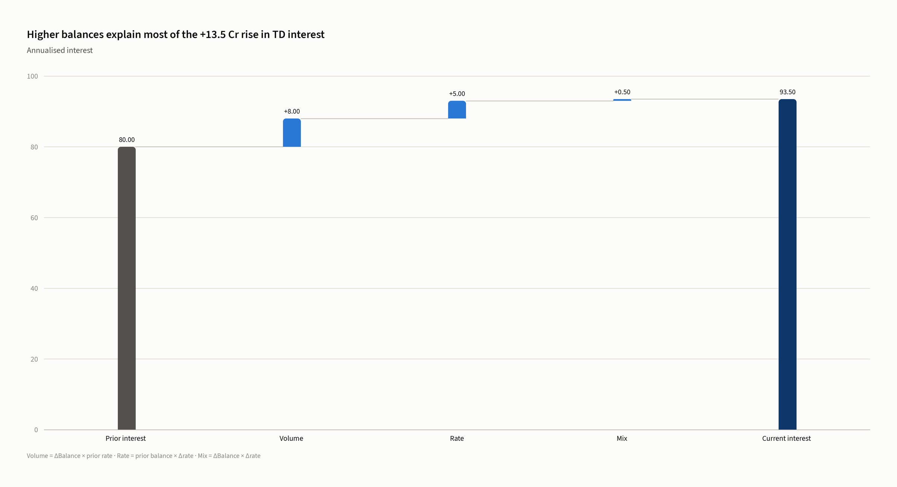
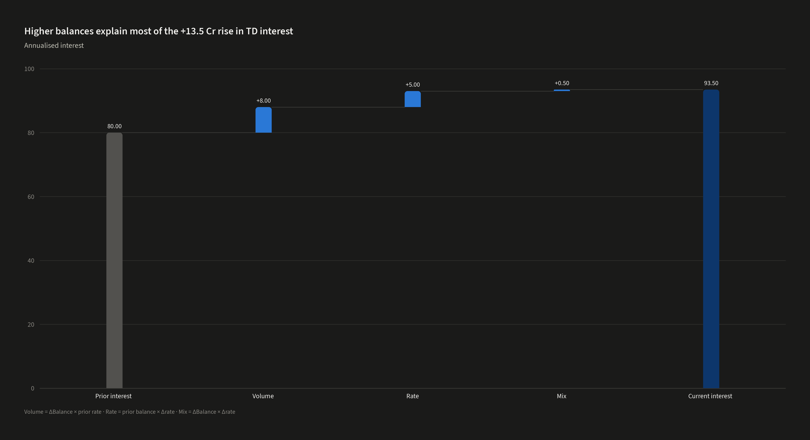
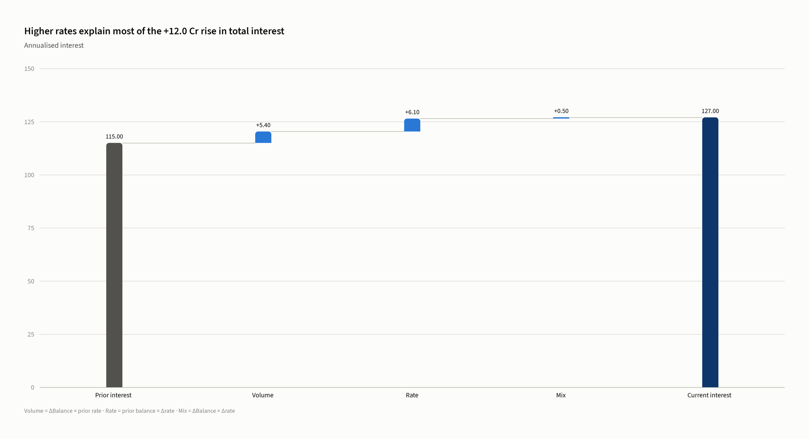
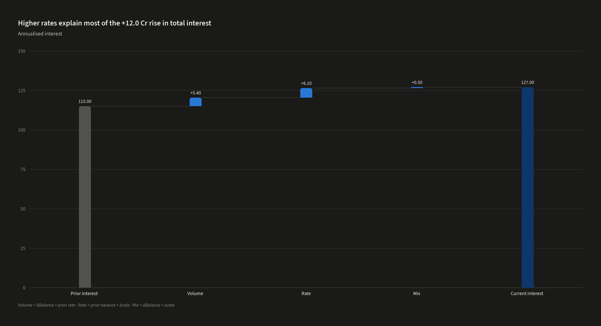
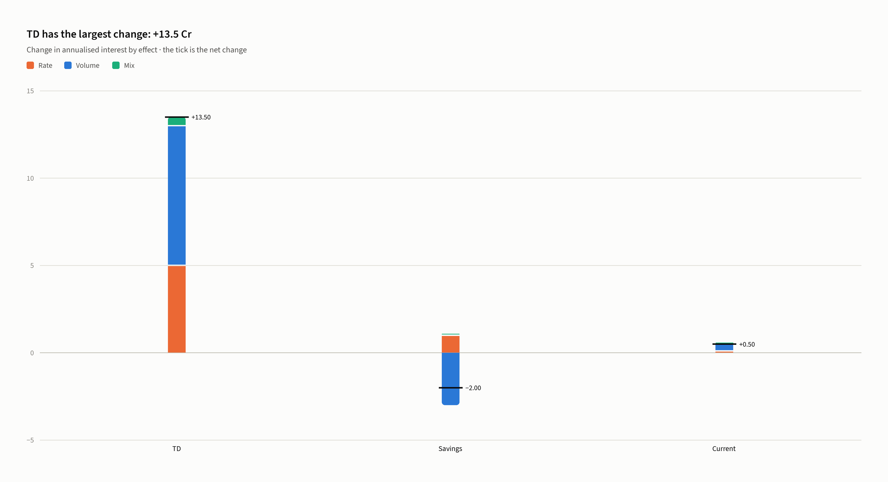
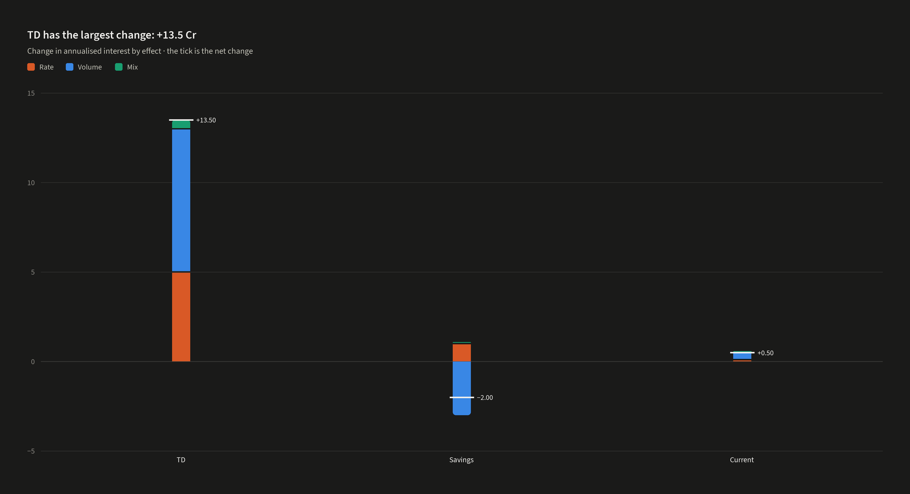

# Chart: NII bridge

## 1. What it does

Explains a month-on-month change in interest: a waterfall from the prior month's annualised interest through the volume, rate and mix effects to the current month's. With two or more products (keys) a second chart opens, "Chart: NII effects by key", with each key's three effects as stacked columns.

## 2. When to use it

- You write the MoM commentary and want the bridge beside it.
- You need to see which product drove the change.

## 3. Before you start

- Build the MoM variance first (see [MoM variance](mom-variance.md)). To bridge one product alone, filter the MoM tab to that product first: the bridge adds up the rows of the tab.

## 4. Columns you need

| Column | Required? | Notes |
| --- | --- | --- |
| Prev annual interest | Yes | Annualised interest of the earlier month. |
| Curr annual interest | Yes | Annualised interest of the later month. |
| Volume effect, Rate effect, Mix effect | Yes | Volume = ΔBalance × prior rate; Rate = prior balance × Δrate; Mix = ΔBalance × Δrate. |
| The key column (first) | Yes | The product or segment; a row called "Total" is not added twice. |

## 5. Step by step

1. Open the result tab of the tool (below), then choose Charts ▸ "Chart this result" (or Charts ▸ New chart ▸ "Banking templates" and the card). The chart's own table opens as a tab when the chart needs numbers the tab does not hold as columns. Tool: MoM variance.
2. Read the waterfall; with several products also open the "NII effects by key" tab it made.
3. Change anything you like in the studio (type, order, scale, titles, reference lines); a takeaway you type replaces the finding as the title.
4. Export to HTML (a page that works offline), Export to Excel (a native chart beside the numbers) or Copy as Python from the buttons under the chart; a report pack can carry the chart too.

## 6. What you get

- A waterfall: prior interest (grey), volume, rate and mix (blue up, red down, floating from the C0 bases), current interest (navy); every step labelled with its sign, and a connector between bars.
- The title names the product when the tab has one key ("... in TD interest") and says "total interest" when it has several. It names the largest effect when it is more than half of all the effects ("Higher balances explain most of the +13.5 Cr rise in TD interest"), else the largest effect without "most".
- A second chart of the effects by key, the largest change first (at most 12 keys).

## 7. Check your result

- Start + volume + rate + mix equals the end: a bridge that does not add up is refused, not drawn.
- In the by-key chart, a key's three effects add up to that key's change in interest.

## 8. Worked example

One product, TD (Crore):

| Product | Prev annual interest | Curr annual interest | Volume effect | Rate effect | Mix effect |
| --- | --- | --- | --- | --- | --- |
| TD | 80.00 | 93.50 | 8.00 | 5.00 | 0.50 |

80.00 → +8.00 → +5.00 → +0.50 → 93.50: the floating bases are 80.00, 88.00 and 93.00. With three products (TD, Savings, Current) the total bridge runs 115.00 → +5.40 → +6.10 → +0.50 → 127.00 and the second chart says "TD has the largest change: +13.5 Cr".

The title the template writes (a fixed rule, no AI): **Higher balances explain most of the +13.5 Cr rise in TD interest**

## 9. Common messages and fixes

- "NII bridge: the tab has no column 'Volume effect'. Open the result of MoM variance first."
- A waterfall refusal: "the end does not equal the start plus the steps" — check the MoM table's columns.

## 10. Limits and assumptions

- The by-key chart is the effects, not one waterfall per key: filter the tab to a key for that key's waterfall.
- The step labels follow the chart's scale (Crore, Lakh …); the title writes the change in the same scale.
