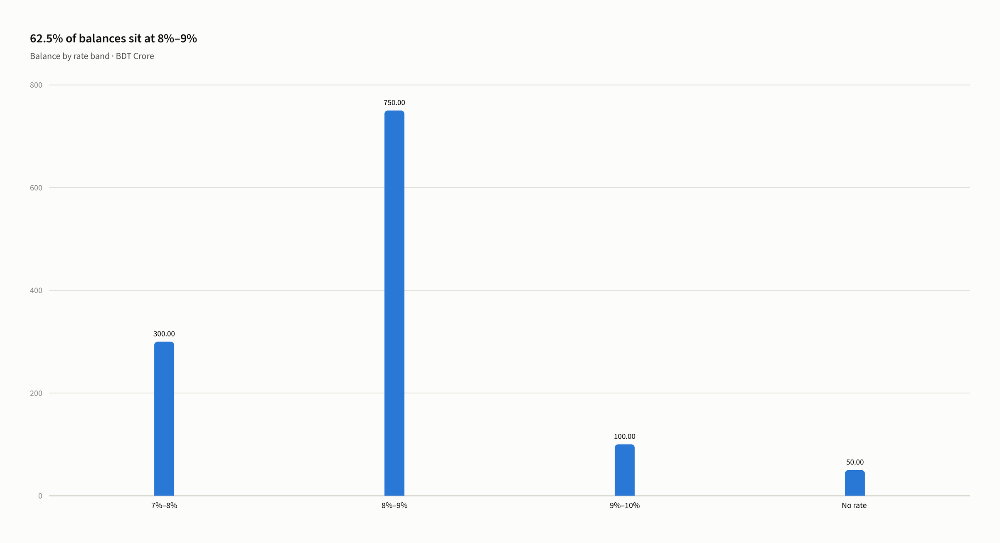
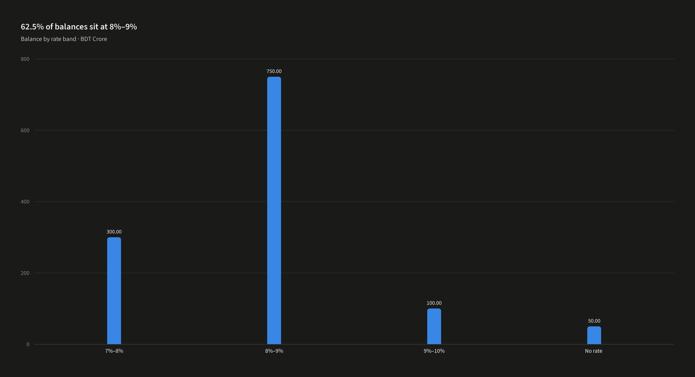

# Chart: Rate profile

## 1. What it does

Shows how much of a book sits at each interest-rate band: columns of balance by band, in band order, with "No rate" last. It works with plain labels ("8%–9%") and with numbered ones ("09. 8%–9%").

## 2. When to use it

- You show the repricing or rate concentration of a book.

## 3. Before you start

- Put the rate column into bands with Banking ▸ Rate profile first (see [Rate profile](rate-profile.md)).

## 4. Columns you need

| Column | Required? | Notes |
| --- | --- | --- |
| The rate band column | Yes | A column whose name has "rate band" or "rate profile". |
| Balance / outstanding / amount | Yes | A number column. |

## 5. Step by step

1. Open the banded tab and choose Charts ▸ "Chart this result".
2. Change anything you like in the studio (type, order, scale, titles, reference lines); a takeaway you type replaces the finding as the title.
3. Export to HTML (a page that works offline), Export to Excel (a native chart beside the numbers) or Copy as Python from the buttons under the chart; a report pack can carry the chart too.

## 6. What you get

- Columns in band order (not by size), each labelled at its tip.
- The title: "62.5% of balances sit at 8%–9%".

## 7. Check your result

- The shares of the bands add up to 100%.

## 8. Worked example

Balances by band (Crore):

| Rate band | Balance |
| --- | --- |
| 7%–8% | 300 |
| 8%–9% | 750 |
| 9%–10% | 100 |
| No rate | 50 |

750 of 1,200 is 62.5%.

The title the template writes (a fixed rule, no AI): **62.5% of balances sit at 8%–9%**

## 9. Common messages and fixes

- "Rate profile: the tab has no rate-band column. Add one with Banking ▸ Rate profile (rate bands) first."

## 10. Limits and assumptions

- The order is the band order, not by value. Plain labels are put in band order by the Ranges order (Below 0%, 0%, the bands, the top band, No rate); numbered labels sort by their number, as before.
- The title reads the band without its number in both forms: "… sit at 8%–9%". Whether the labels are numbered is the "Number the bands (09. 8%–9%)" tick box of the Rate profile dialog (see [Rate profile](rate-profile.md)).
