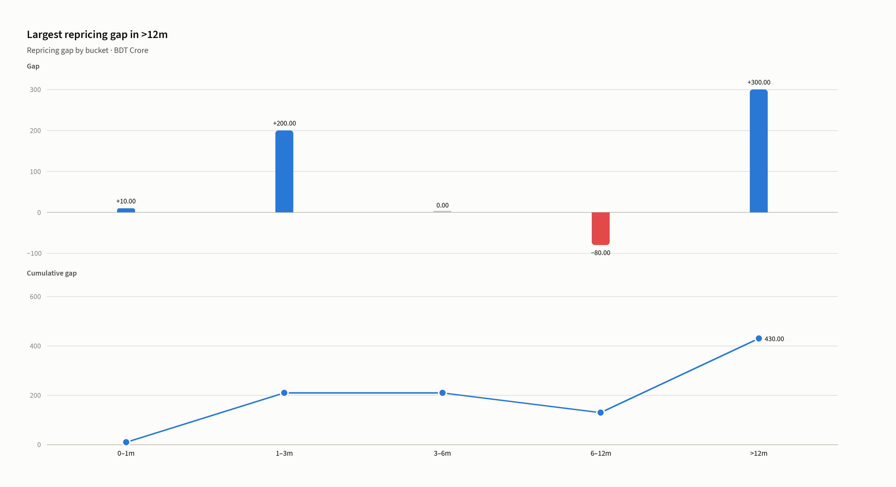
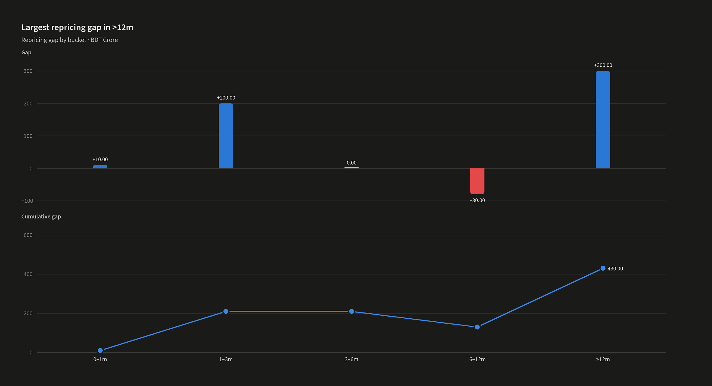

# Chart: Repricing gap

## 1. What it does

Shows where repricing risk sits: the gap of each repricing bucket as a column (blue where assets reprice first, red where liabilities do) with the cumulative gap as a second panel.

## 2. When to use it

- You explain the ΔNII result by where the repricing gap is.
- ALCO asks "which bucket carries the risk?".

## 3. Before you start

- Build the ΔNII repricing summary first (see [Interest-rate shock / ΔNII](rate-shock-nii.md)).

## 4. Columns you need

| Column | Required? | Notes |
| --- | --- | --- |
| Repricing bucket | Yes | Bucket names in order; the "Total" row is left out. |
| Gap | Yes | Assets less liabilities repricing in the bucket, BDT. |
| Cumulative gap | Yes | Running sum of the gap. |

## 5. Step by step

1. Open the result tab of the tool (below), then choose Charts ▸ "Chart this result" (or Charts ▸ New chart ▸ "Banking templates" and the card). The chart's own table opens as a tab when the chart needs numbers the tab does not hold as columns. Tool: ΔNII repricing summary.
2. Change anything you like in the studio (type, order, scale, titles, reference lines); a takeaway you type replaces the finding as the title.
3. Export to HTML (a page that works offline), Export to Excel (a native chart beside the numbers) or Copy as Python from the buttons under the chart; a report pack can carry the chart too.

## 6. What you get

- Linked panels: gap columns (diverging) over the cumulative gap line.
- The title names the bucket with the largest gap by size: "Largest repricing gap in <bucket>".

## 7. Check your result

- The columns equal the summary's Gap column; the line equals its Cumulative gap column.
- The title's bucket is the one with the largest absolute gap.

## 8. Worked example

A summary with five buckets (BDT, plain numbers):

| Repricing bucket | Gap | Cumulative gap |
| --- | --- | --- |
| 0–1m | 10 | 10 |
| 1–3m | 200 | 210 |
| 3–6m | 0 | 210 |
| 6–12m | −80 | 130 |
| >12m | 300 | 430 |

The >12m bucket is the largest (300).

The title the template writes (a fixed rule, no AI): **Largest repricing gap in >12m**

## 9. Common messages and fixes

- "Repricing gap: the tab has no column 'Gap'. Open the result of ΔNII repricing summary first."
- "Repricing gap: the summary has no repricing bucket with a gap. Build the ΔNII repricing summary first."

## 10. Limits and assumptions

- The ΔNII figure itself is not drawn: read it from the table.
