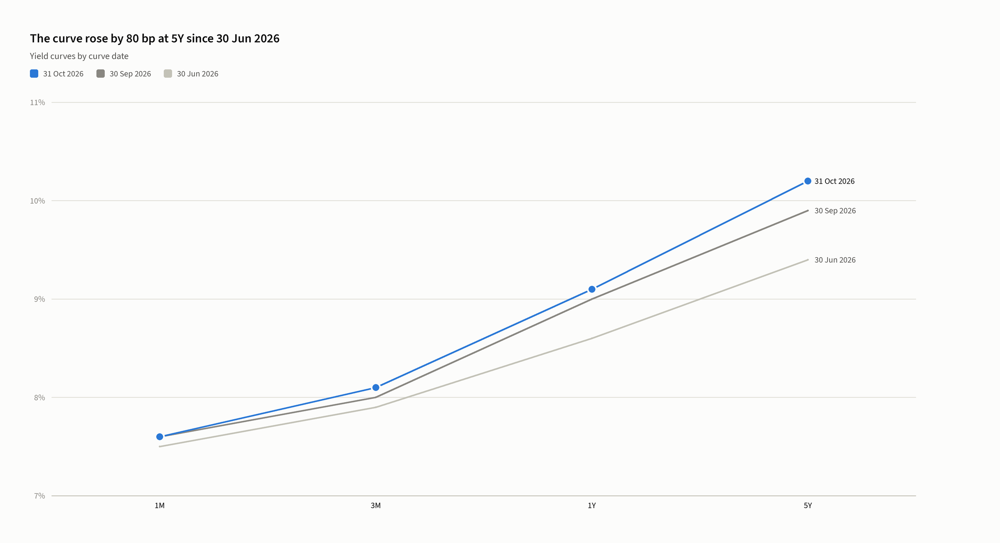
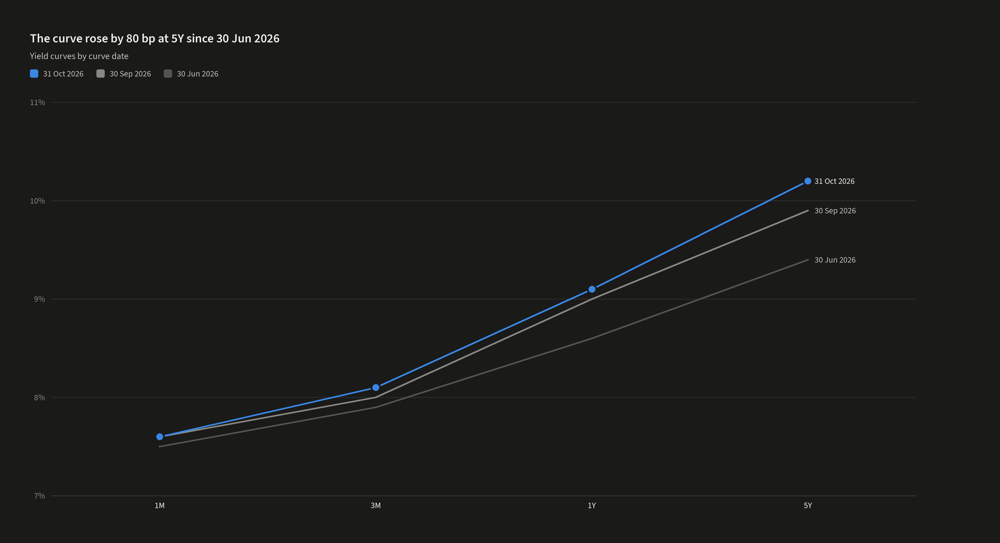

# Chart: Yield curves

## 1. What it does

Plots the stored curves by date: the latest curve in blue with markers, the older ones in two greys (the older the fainter); every curve is named at its right end, and a collision is nudged apart vertically. The rate axis starts one tick below the lowest rate.

## 2. When to use it

- You show how the FTP curve moved since an earlier month.

## 3. Before you start

- Import or type at least one curve in Banking ▸ Yield curves (see [Yield curves](yield-curves.md)). This template reads the curve store, not a tab: choose it from Charts ▸ New chart ▸ Banking templates.

## 4. Columns you need

| Source | Required? | Notes |
| --- | --- | --- |
| Curve store (`portable_data/curves`) | Yes | Each curve has a date and points (tenor in days, rate in %). Tenors are named 30D→1M, 365D→1Y … |

## 5. Step by step

1. Choose Charts ▸ New chart ▸ "Banking templates" ▸ "Yield curves".
2. Find the latest curve (blue) and compare its end with the older ones.
3. Change anything you like in the studio (type, order, scale, titles, reference lines); a takeaway you type replaces the finding as the title.
4. Export to HTML (a page that works offline), Export to Excel (a native chart beside the numbers) or Copy as Python from the buttons under the chart; a report pack can carry the chart too.

## 6. What you get

- Lines by curve date over the tenors in tenor order; the latest curve with 8 px markers, the older ones plain.
- The title: the tenor that moved most between the oldest and the latest curve, "The curve rose by 80 bp at 5Y since 30 Jun 2026" (or "fell"; "unchanged" below 0.5 bp).

## 7. Check your result

- The change in the title is the latest rate less the oldest at that tenor, ×100.
- With one curve the title says "One curve, dated <date>".

## 8. Worked example

Three curves (rates in %):

| Tenor | 30 Jun 2026 | 30 Sep 2026 | 31 Oct 2026 |
| --- | --- | --- | --- |
| 1M | 7.5 | 7.6 | 7.6 |
| 3M | 7.9 | 8.0 | 8.1 |
| 1Y | 8.6 | 9.0 | 9.1 |
| 5Y | 9.4 | 9.9 | 10.2 |

At 5Y the curve rose from 9.4% to 10.2%: 80 bp.

The title the template writes (a fixed rule, no AI): **The curve rose by 80 bp at 5Y since 30 Jun 2026**

## 9. Common messages and fixes

- "Yield curves: the curve store has no curve. Import or type a curve in Banking ▸ Yield curves first."
- "Yield curves are charted from the curve store: use Charts ▸ New chart ▸ Banking templates ▸ Yield curves." (from "Chart this result": the card is the way.)

## 10. Limits and assumptions

- Not offered as a report-pack item (it reads the store, not an item's table).
- Older curves cannot be re-coloured one by one in the studio; edit the colour map by choosing a highlight.
