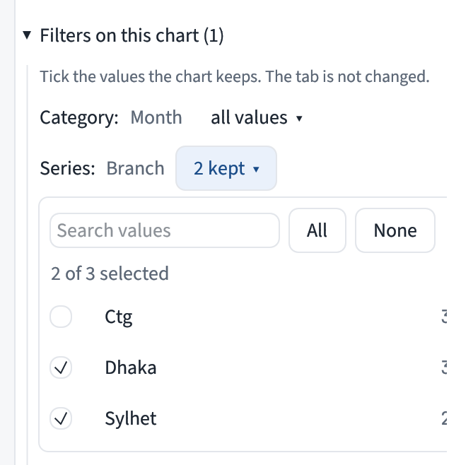
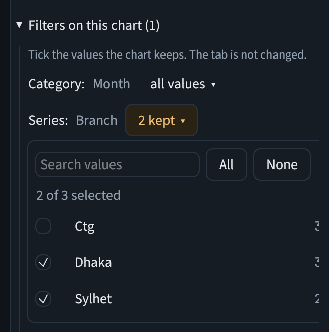
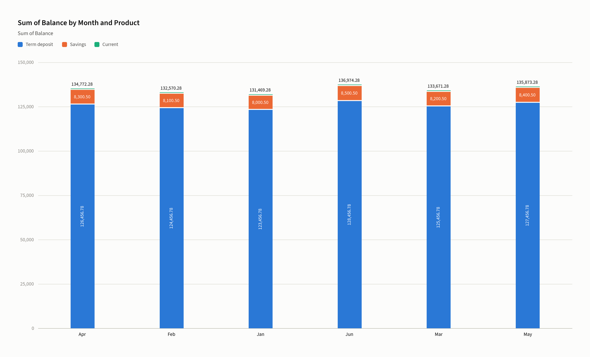
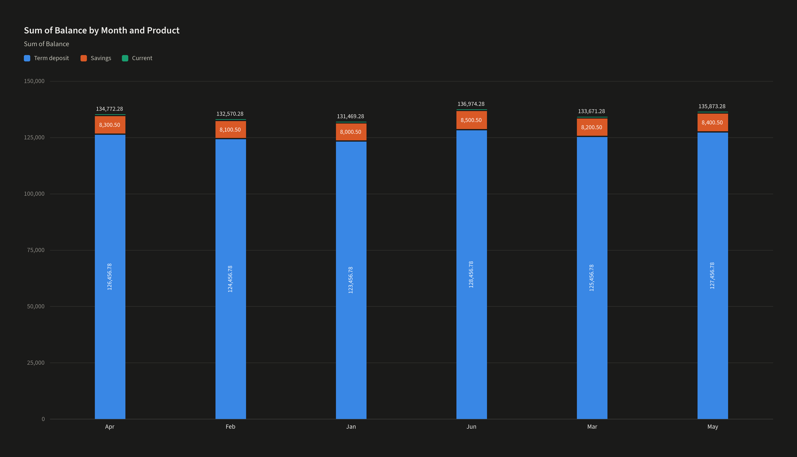

# Chart

(How to choose a chart, and one note for each banking template: [Charts: how to choose one](charts.md).)

## 1. What it does

Draws bars or a line of one number by one category, calculated over the whole tab after its steps (never just the rows on screen). Choose the category (X), an optional series (grouped bars, at most 8), the value and how to add it up (Sum, Count, Average, W.Avg, Min, Max). The x-axis shows the category names, the title says what was drawn and in which unit, and a tooltip gives the category, series, value and the number of rows behind it.

## 2. When to use it

- Balance by maturity bucket or term period for an ALCO pack.
- Number of accounts by branch or by classification grade.
- A weighted-average rate by product, to see which product is out of line.

## 3. Before you start

- Open the tab and apply the steps that shape it (filters, buckets). The chart reads the result.
- The value column must be a number (integer, decimal or whole number). If an amount is still Text, set it to a number in Schema & Ingestion first.
- If your categories have a fixed order (tenors, risk grades), make a list or use Tenor: see [custom sort lists](custom-sort-lists.md).

## 4. Columns you need

| Column role | Required? | Type the app needs | Example values | Notes |
| --- | --- | --- | --- | --- |
| Category (X) | Yes | Any | Term Period, Branch | Blank values are one category called (blank), always last. |
| Series | No | Any | Risk grade | More than 8 values: the 7 largest and "Other". |
| Value | For every aggregation except Count | Number | Balance, Rate | A Text, Date or other non-number column is refused with its type. |
| Weight | For W.Avg | Number | Balance | Rows without a value or a weight are left out; weights of both signs give a blank rate. |

## 5. Step by step

1. Click the "Chart" tab of the side panel on the right (or the Chart button of the toolbar, or Ctrl+K: "chart"). If the tab is not there, tick View ▸ Side panel ▸ "Chart". "Pop out" (where the app can open a second window) shows the chart in its own window, which you can move to another monitor; "Dock back" or closing that window returns it to the panel. The controls are in two columns in the narrow panel; in a narrow chart the x-axis names every second (or third…) category, and the tooltip has every name whole.
2. Choose "Category (X)". Optionally choose a "Series".
3. Choose "Aggregation" and, except for Count, the "Value" (for W.Avg also "by": the weight).
4. "Type" is Bar or Line.
5. "Order" is Natural, one of your lists, Tenor, or By value (largest first).
6. "Top N" keeps that many categories; the rest are added into "Other" (the totals stay whole). The default is 30.
7. "Scale" follows the value column's display format (Crore, Lakh, Million, Thousand or plain) unless you choose another.
8. "Open chart data as tab" puts the table behind the chart in a new tab, which can be exported to Excel or PDF.
9. The choices are kept for the tab (by its file name) for the next session.
10. "Export to HTML…" (also Export ▸ "Chart to HTML…") writes the chart as one web page. It has the title, subtitle and footnote, a Table switch, a light/dark switch and a toolbox with "Save as PNG", "Save as SVG" and "Data view". The page works offline and contains no web address: send it by e-mail or put it on a share.
11. "Preview in browser" writes the same page to a temporary file and opens it with your default browser. Sankey and Treemap are drawn only this way (the chart in the app says so).
12. "Advanced options (HTML only)" is a box for JSON that is merged over the page's ECharts option, for what the controls cannot do. It is checked as you type (a mistake is shown with its line and column); "Reset" clears it. The chart in the app and the Excel chart never use it.
13. "Export to Excel…" (also Export ▸ "Chart to Excel…") writes a workbook: the chart's numbers on a sheet and a native Excel chart beside them (editable in Excel and Power BI), in the same palette and Segoe UI. A waterfall is a stacked column with an invisible base series; a heatmap is the table under a three-colour scale; linked panels and small multiples are one chart each, one under the other; a bubble chart is written as a scatter, a stepped line as an ordinary line, and Sankey and treemap only as data, each with a note on the sheet.
14. Charts ▸ "Chart this result" (or Charts ▸ New chart ▸ "Banking templates") charts a tool's result the way a banker would draw it: the gap ladder, repricing gap, NII bridge (MoM variance), CL migration, IRRBB scenarios, LCR / NSFR, ECL by stage, data-quality scorecard, yield curves, rate profile, balance history, deposit / loan mix and classified trend. The chart's own table opens as a tab, the title is a finding worked out from the numbers by fixed rules (for example "Parallel up is the worst case at −10.5% of Tier 1"), and every setting stays editable; a takeaway you type replaces the finding.
15. Charts ▸ "Chart book (HTML)…" puts several saved charts of the active tab on one page: a title, the date and a two-column grid.
16. "Copy as Python" puts a script on the clipboard: the chart's numbers as a pandas DataFrame and matplotlib code in the same style (fonts, palette, marks, title), so you can carry on in Python (`pip install pandas matplotlib`). A Sankey and a treemap use plotly instead (`pip install plotly pandas`) and the script says so. The numbers are the chart's own table in the chart's scale; a flag at the top (`DARK`) switches the theme.
17. "Titles and look" also holds "Text size", "Reset colours", "Data labels" (Auto, All, Ends only, None, with decimals, unit and percent), and, for a donut, "Group small parts". They are explained with pictures in [Charts: how to choose one](charts.md), section 7a. A chart tab exported to PDF is written as the chart (Export ▸ PDF); the dialog's "Add the data table on the next page" adds the table.
18. A report pack can carry a chart on any of its items (see "Report packs"): the workbook gets the native chart on a sheet beside the item's, and the pack can write an HTML chart book.
19. **A chart tab stays linked to its source.** "Open chart data as tab" and "Open as tab" make a chart tab that remembers the tab it draws. It is calculated again when that tab's steps, filters or file change, and after a project opens. Its steps panel is read-only: "This tab draws a chart of 'Loans'. Change the data on that tab, or use Edit chart." **Edit chart** opens the studio on the source tab with the chart tab's choices and the banner "Editing chart tab 'Chart: …'": **Update chart tab** replaces them, **Open as new chart tab** makes another. If the source is closed the chart is dimmed and says so ("Reopen" brings back a file tab of the open project). A chart tab made by an older version has no source: it stays as it was and Edit chart opens it on its own table.
20. **Filters on this chart.** In the studio, the section "Filters on this chart" gives the Category, Series and Panels a value tick list ("Values", with search, All, None and the number of rows of each value) and "Add a filter on…" for any column (a date column has the "By" choice and comparisons, as in [Filter](filter.md)). Keep only this / Exclude this add to the same list, and each filter has a remove button. The filters apply before the numbers are added up; the source tab is unchanged; the subtitle says them ("Filtered: Bank = Conventional"); a kept item keeps its colour; every export, chart tab, project, drill and Show rows honours them. Unticking every value is refused ("the filter on 'Bank' has no value ticked, so it keeps no rows. Tick a value, or press All").

21. **Segment labels** (stacked and 100% stacked column and bar; "Titles and look"). Off is the default. On puts each segment's value inside it (the percent for 100% stacked): straight if it fits, else turned 90° on a column chart if it fits, else left out (it is still in the tooltip and the table). Text is white or dark by the segment's colour, never the series colour; the total on top stays. "Hide below" (default 5) leaves out the segments that are less than that share of their bar. It shows in the app, the HTML page (where a smaller page drops the labels that collide), the Excel chart and the PDF.

22. **Data table** (Off, Below the chart or Beside the chart; column, bar, line, area, heatmap, donut and histogram with one measure and no panels). The chart PDF, the chart book and the report-pack PDF print the chart's numbers (categories × series, with totals, in the chart's scale and order) on the same page; the HTML page shows the table open under the chart. See "A chart in a PDF" in [Charts: how to choose one](charts.md).
23. **Drill levels, colours and date parts.** "Drill levels" makes the chart clickable ([Drill-down](drill-down.md)); "Colours" picks a colour for one name ([Colours](colours.md)); the Category, Series and Panels pickers list the parts of a date column ([Date grouping](date-grouping.md)).

24. **Fields of the model** (in a project that has a model). The Category, Series, Panels and drill pickers list the lookup fields of the tab's links ("Branch master › Region") and its Calendar fields ("Calendar › Month-Year"), in calendar order. The Value list has the time aggregations (closing, average, YTD movement, …) with Window, Shift, Show and Partial period rows, and a "Measures" group with the tab's named measures and ratios; a chart of a time value or a measure equals the pivot of the same fields. A chart of a plain Sum of a column tagged Balance over several dates says so in its notes. See [Links between tabs](model-links.md), [Time intelligence](time-intelligence.md), [Balances and flows](balances-and-flows.md) and [Measures and ratios](measures-and-ratios.md).

## 6. What you get

A chart whose title reads like "Sum of Balance by Term Period: all 250 rows (Crore)". The x-axis names the categories (a long name is cut with "…", the tooltip has it whole). With Top N below the number of categories the title adds "top 3 of 5 categories". The table tab has one row per category (and series) with the value and "Rows".

## 7. Check your result

- The "all N rows" in the title is the row count of the tab: compare it with the status bar.
- The bars add up to the Sum in the Summary row of the tab (Top N keeps the total in "Other").
- Open the chart data as a tab and compare one line with a Pivot of the same fields.

## 8. Worked example

Input: eight loans.

| Term Period | Balance |
| --- | ---: |
| 6m | 500,000,000.00 |
| 1y | 300,000,000.00 |
| 1m | 100,000,000.00 |
| 100D | 50,000,000.00 |
| 3m | 200,000,000.00 |
| 1y | 100,000,000.00 |
| 6m | 250,000,000.00 |
| 1m | 80,000,000.00 |

Test: `guide_chart`

Sum of Balance by Term Period, Order Tenor, Top N 3: the three largest terms in term order, and the rest (1m and 100D) as "Other". The total is unchanged.

| Term Period | Sum of Balance | Rows |
| --- | ---: | ---: |
| 3m | 200,000,000.00 | 1 |
| 6m | 750,000,000.00 | 2 |
| 1y | 400,000,000.00 | 2 |
| Other | 230,000,000.00 | 3 |

Test: `guide_chart`

## 9. Common messages and fixes

- "Chart: Sum needs a number column, but 'Risk' is Text. …" Choose a number column, or Count.
- "Chart: choose the Value column for Sum …" Pick the value, or choose Count.
- "Chart: W.Avg needs a weight column." Choose one (usually Balance).
- "N group(s) have weights of both signs, so their weighted average is left blank." Check the sign of the weights.
- "The 5 series after the first 7 are drawn together as Other." More than 8 series: filter first to see them.

## 10. Limits and assumptions

- Top N ranks categories by the aggregated value, largest first; "Other" is calculated again from its own rows (an average of the rest is the average of its rows, not of averages).
- A category called "Other" in the data is kept apart from the rest ("Other categories").
- Count counts rows; the value column is not used.
- On a pivot table the subtotal and Grand total rows are not charted.
- The HTML page carries Apache ECharts 6.1.0 inside it (about 1 MB); a chart of 1,000 points is under 2 MB. A waterfall that does not add up and invalid advanced JSON stop the export with a message, and no file is written.
- The first chart of a tab picks the first text column and the first number column; change them as needed.
- A chart of lookup fields, Calendar fields, time values or measures needs the project's model, is not translated by "Copy as Python" ("Python export can't follow links between tabs yet. Use the Join tool to copy the column, or export the result tab."), and a chart tab made from it is calculated again when its source tab changes.
