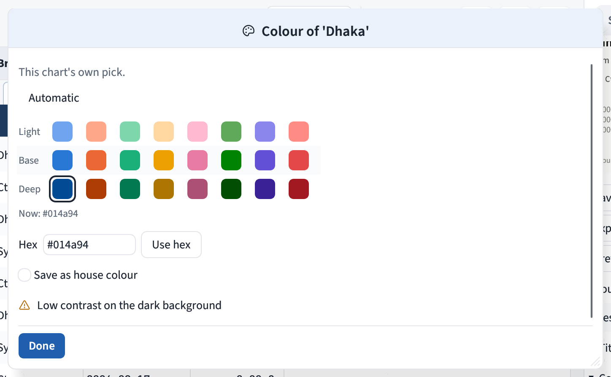
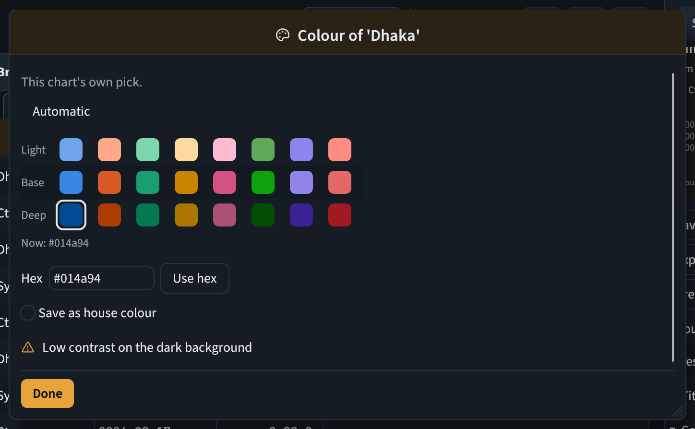
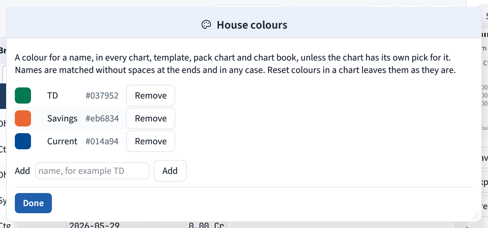
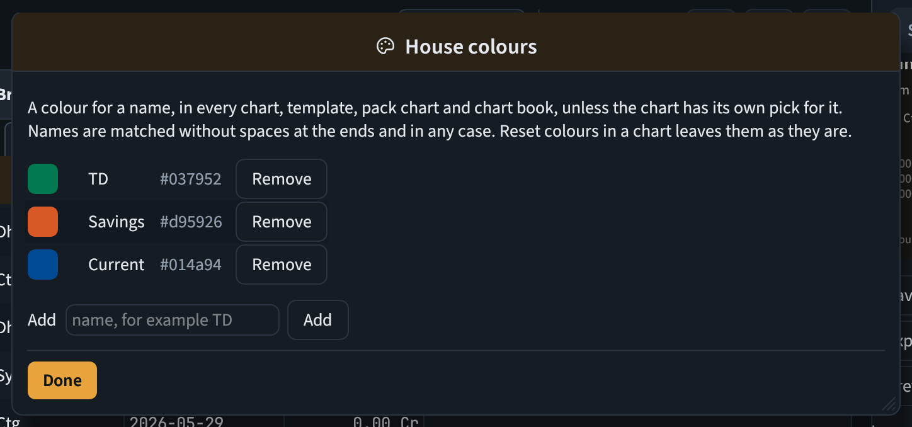

# Colours: pick a colour for one item, and house colours

## 1. What it does

Colours stay with a name: "TD" is the same colour on every chart. By default the app gives names the 8 colours of the palette in order. This lets you choose a colour for one item ("management asks for TD in green") and, with **house colours**, for the same name on every chart. The palette is not extended past 8 colours: more than about eight cannot be told apart, especially by colour-blind readers. Past 8 series use grey with direct labels, or "Top N + Other".

## 2. When to use it

- One product or bank must always be the same colour in every pack.
- A name the palette gives a poor colour to.
- A report that follows the bank's brand colours for a few names.

## 3. How to use it

1. In the Chart tab open "Colours". It lists the chart's names (series, or categories of a donut; a chart of one colour lists its measure, "Sum of Balance") with their swatch and a tag: "your pick" or "house colour".
2. Click a swatch, or right-click a mark and choose "Colour…". The picker opens.
3. Choose **Automatic** (the palette slot), one of the **24 swatches** (8 hues in three shades), or type a **hex** (#rrggbb) and click "Use hex".
4. Read the warnings under the picker. They are warnings, not refusals: the colour is your call.
5. Tick "Save as house colour" to make the pick count for that name on every chart. Click Done.
6. View ▸ "House colours…" lists them (swatch, name, hex, Remove), adds a name and changes one by its swatch.
7. "Reset colours" clears the chart's own picks and gives names the palette again. House colours stay.

The colour a name gets: **1.** the chart's own pick, **2.** the house colour, **3.** the automatic palette slot.

## 4. Example

The three shades of each hue. **Base** is the palette slot itself, so it follows the theme (it has a tested light and dark pair); **Light** and **Deep** are fixed colours, the same in both themes.

| Hue | Light | Base | Deep |
| --- | --- | --- | --- |
| Blue | #6ea5ee | slot 1 | #014a94 |
| Orange | #ffa889 | slot 2 | #ac3c01 |
| Green | #7dd6ac | slot 3 | #037952 |
| Amber | #ffd7a0 | slot 4 | #ad7502 |
| Pink | #ffb9d0 | slot 5 | #ac5074 |
| Dark green | #60a95a | slot 6 | #024e02 |
| Violet | #8a86eb | slot 7 | #3a2196 |
| Red | #fe8c85 | slot 8 | #a31921 |

Test: `w8_the_colour_tables_are_the_codes`

What the picker says for "TD" on a chart whose other items are Savings (Orange) and Current (Green):

| Pick for 'TD' (other items: Savings in Orange, Current in Green) | What the picker says |
| --- | --- |
| Deep Blue | Low contrast on the dark background |
| Base Orange | Hard to tell from 'Savings' |
| Light Amber | Low contrast on the light background |
| Deep Green | none |

Test: `w8_the_colour_tables_are_the_codes`

## 5. What it refuses and why

- A hex that is not a colour: "'#12' is not a colour. Write it as #rrggbb, for example #037952."
- A house colour with no name, or the name "Other" ("Other" is Top N's remainder and always has its own grey).
- A broken `house_colours.json` is refused at start-up with its line; charts then use the palette.
- The warnings, which do not refuse: **Hard to tell from 'Savings'** (too close to another item of the chart, in either theme), **Low contrast on the dark background** (or light; under 3:1 against the surface) and **This is a status colour**: green, amber and red mean good, warning and critical, and should not name an item. A Base pick is the palette itself and only gets the first warning. The warnings are also in the chart's footnote. Text never takes the item's colour.

## 6. Python export

"Copy as Python" colours a picked or house-coloured item with its colour. A chart with no picks gives the same script as before.

## 7. Saved in

- A chart's own picks: the chart (saved charts, chart tabs, projects and chart books).
- House colours: `portable_data/house_colours.json` next to the app: `[{"name": "TD", "pick": …}]`, names matched trimmed and in any case. A missing file means none.
- A filter or Top N never repaints a picked item.

## 8. Related tools

[Chart](chart.md) · [Charts: how to choose one](charts.md) (what the colours mean) · [Drill-down](drill-down.md) · [Report packs](report-packs.md)
