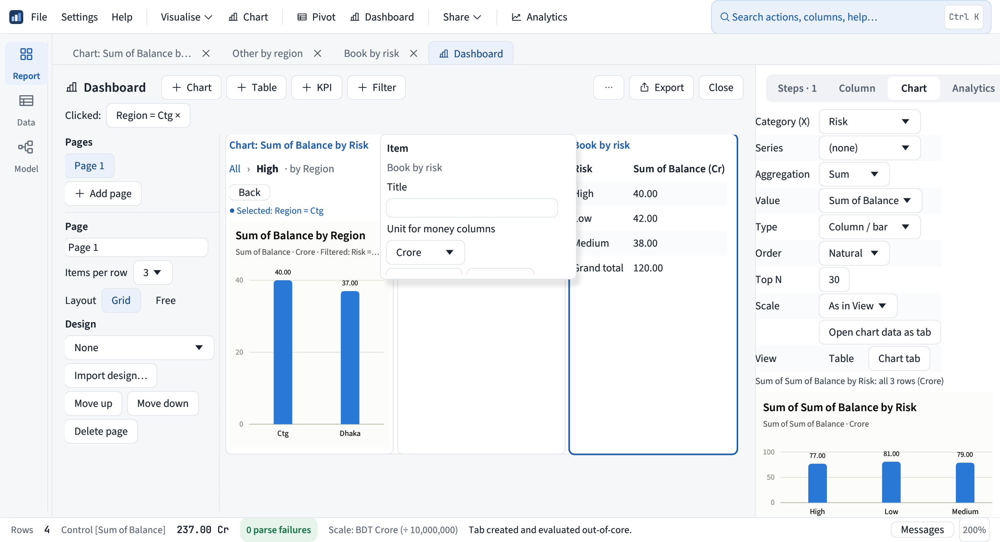
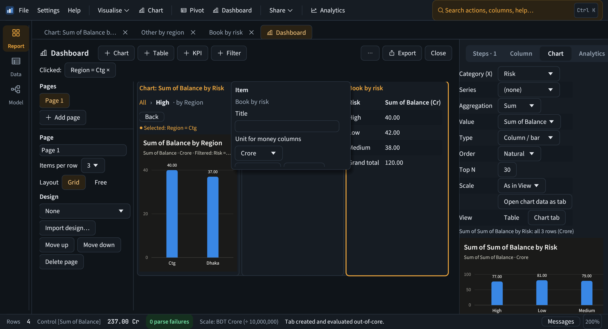

# Dashboard filters, clicks and drill

## 1. What it does

A page filter (Wing, Region, Month) and a click on a bar or a pivot row change what the other items on the page show. Each item is calculated again by its own tab's code with the extra condition, so the numbers are the ones you would get by filtering the tab by hand. Drill goes one level down inside one item (Region, then Branch) without touching the others.

## 2. When to use it

- One page for all wings: pick Islami in the filter and every item follows.
- "What is behind Dhaka?": click the Dhaka bar and read the product chart for Dhaka only.
- A chart tab with drill levels: walk from region to branch on the page.

## 3. How to use it

1. **Add filter**, then pick the tab, the field and a label. Several values can be allowed. A filter reaches the items that read the same data tab.
2. Choose values in the filter's dropdown. **Clear** removes every pick, the click and the drills.
3. Left-click a bar (or a pivot row label) to filter the page by it. The clicked item keeps all its bars and says "● Selected: Region = Dhaka"; a chip "Region = Dhaka ×" under the filters clears it. Click the same mark again to clear.
4. Right-click a mark for "Filter the page by this" and "Drill down". **Back** (or the breadcrumb) goes up a level.

## 4. Example

Eight accounts in three regions. Clicking the Dhaka bar changes the product chart to the Dhaka rows only:

| Product | All regions | After clicking Dhaka |
| --- | ---: | ---: |
| FDR | 260.00 | 150.00 |
| SB | 65.00 | 30.00 |

Test: `d3_clicking_dhaka_gives_the_product_bar_the_numbers_of_dhaka_rows_only_and_the_clicked_bar_keeps_all_its_marks`

## 5. What it refuses and why

- A click on "(Other)", a blank group, a date part or the grand total is refused with what to do instead (use a page filter for dates).
- An item on another data tab, even one linked to the same lookup, says "Filter 'Region' doesn't apply to this item" and shows its numbers unchanged.
- A saved pick that is no longer in the data stays, marked "(not in data)", and filters nothing silently.

## 6. Python export

None; the filters are a view of the page. The tab's own filters and steps are in its script.

## 7. Saved in

The project file: the page's filters and picks, the click and each item's drill path.

## 8. Related tools

[Dashboards](dashboards.md), [Filter](filter.md), [Drill-down](drill-down.md), [HTML report](export-html-report.md) (the file keeps the filters and the click).
