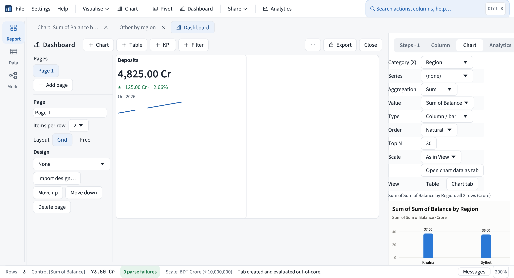
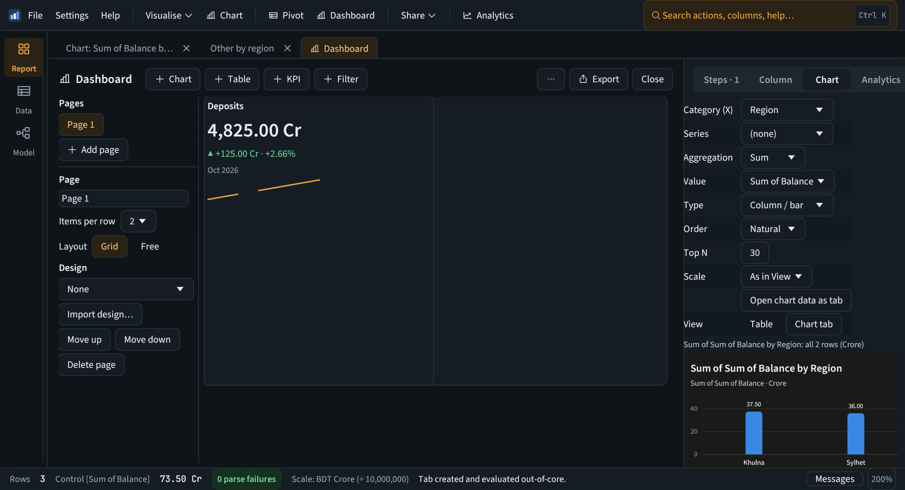

# Dashboard KPI cards

## 1. What it does

A KPI card shows one number from the model for the month of the as-of date, how it moved against an earlier month, and a small trend line of the last twelve months. The number comes from a named measure of the project (closing deposits, CASA ratio, yield) worked out by the pivot's own code. Limits colour the number; an arrow and a word ("up", "down", "unchanged") say the same thing without colour.

## 2. When to use it

- The headline numbers at the top of an ALCO page.
- A ratio you watch against a limit: amber below 80, red below 75.
- A rate where down is good (cost of deposits): the card is green when it falls.

## 3. How to use it

1. On a dashboard page press **Add KPI card** (or **Fill with KPI card** on an empty slot of a design).
2. Pick **Shows**, a named measure of the project. A card needs the model's Calendar and a measure; if either is missing the card says which.
3. Pick **Compare with**: Nothing, Prior period or Same period last year.
4. Pick **Good direction**: Up is good, Down is good or No judgement. It decides green and red for the change.
5. Choose the unit and decimals. Automatic means Crore for money and percent for a ratio.
6. **Add limit** (at most two): "Below 80.00 amber". The first limit that matches colours the number; "Below" is strictly below. Limits are in the card's unit.
7. Tick **Sparkline** for the last twelve months. A month that cannot be worked out is a gap in the line, never a zero.

## 4. Example

Closing deposits were 4,700.00 Cr in September and 4,825.00 Cr in October, up is good:

| Card | Number | Change | Arrow | Tone |
| --- | --- | --- | --- | --- |
| Closing deposits | 4,825.00 Cr | +125.00 Cr · +2.66% | ▲ up | good |

Test: `d2_closing_deposits_4825_cr_against_4700_cr_is_plus_125_cr_and_plus_2_66_percent_up_and_good`

A ratio moves in percentage points, and the good direction decides the tone:

| Card | Number | Change | Arrow | Tone |
| --- | --- | --- | --- | --- |
| Yield on loans, up is good | 11.00% | +0.50 pp | ▲ up | good |
| Cost of deposits, down is good | 6.00% | −0.40 pp | ▼ down | good |
| Cost of deposits, no judgement | 6.00% | −0.40 pp | ▼ down | neutral |

Test: `d2_a_yield_of_11_against_10_50_is_plus_0_50_pp_and_a_cost_of_funds_down_0_40_is_green_when_down_is_good`

## 5. What it refuses and why

- A month with no balance says so in words ("No balance in Nov 2026 for 'Accounts' (last date 31 Oct 2026)"); the number is a dash, never 0.
- An earlier value of zero gives the amount but no percent (a dash). No earlier value gives no change and no arrow.
- A change that rounds to nothing at the card's decimals is shown as ► unchanged.

## 6. Python export

None. The measure behind the card is in the Python script of its pivot tab.

## 7. Saved in

The project file, inside the dashboard item: measure, compare, direction, unit, decimals, limits, sparkline. Changing only the unit, decimals, limits or title does not calculate the card again.

## 8. Related tools

[Dashboards](dashboards.md), [Measures and ratios](measures-and-ratios.md), [Shared calendar](model-calendar.md), [HTML report](export-html-report.md), [PowerPoint](export-pptx.md).
