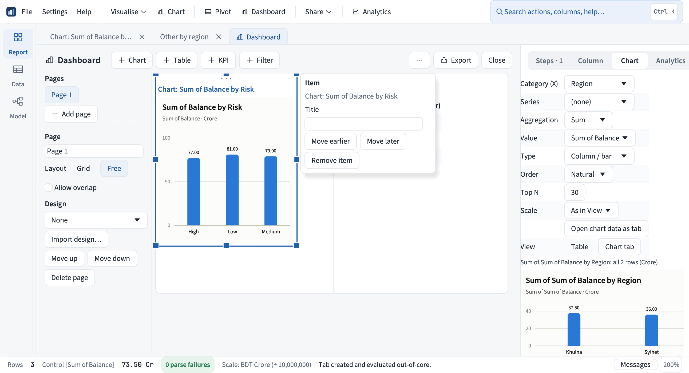
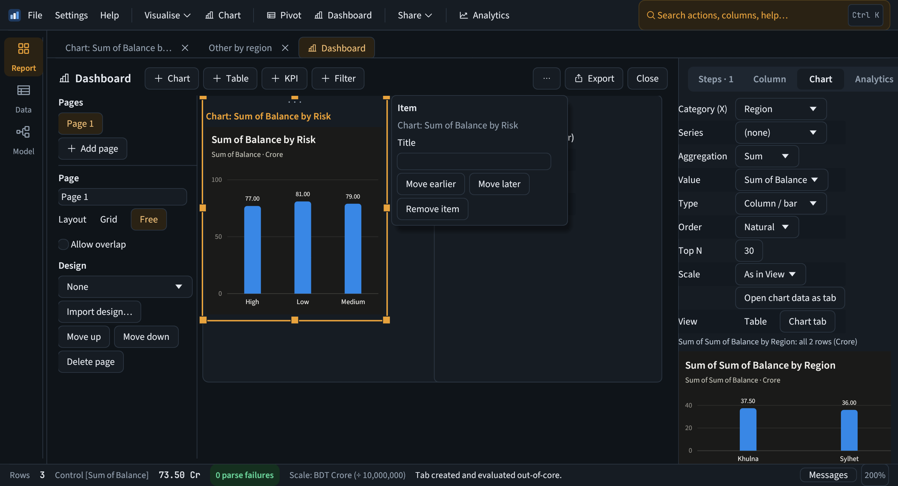

# Dashboard layouts

## 1. What it does

A page is a grid (items in order, one to four to a row, rows sharing the page height) or a Free page where each item sits where you put it and has its own size. The page is 1000 units wide; its height follows its shape.

## 2. When to use it

- Grid: a quick page that stays tidy by itself.
- Free: a page for print or a slide, with the big chart at the left and three cards on the right.

## 3. How to use it

1. Open **Page settings**. **Layout** shows Grid or Free; **Items per row** applies to Grid.
2. On a Grid page use **Move earlier / Move later** to order the items.
3. Choosing Free asks first: the dialog says what moves and **Switch layout** or **Keep layout** decides. Each item keeps its exact cell. Going back to Grid puts the items in order of their place and the page returns to its items-per-row.
4. On a Free page drag the three-dot bar above an item to move it and a corner to resize it. Arrow keys move the selected item; Shift+arrows resize it by 10. Places snap to 10 units.
5. **Allow overlap** lets items stack; off, a move onto another item stops at the last free place.

## 4. Example

Two items on a Free page. Dragging the second onto the first is not taken: it stays at the last place that was free, and with **Allow overlap** on it goes where you drop it. Switching to Grid with two to a row puts the items in the order of their places, and switching back to Free gives the same places for items that sat on the grid.

Test: `d4_items_may_not_overlap_unless_the_page_allows_it_and_a_blocked_drag_keeps_the_last_good_place`

## 5. What it refuses and why

- A place off the page is moved inside it; items cannot be smaller than the minimum size.
- A Free page with no 300 × 200 free place refuses a new item in words.
- A layout switch never loses an item.

## 6. Python export

None.

## 7. Saved in

The project file: layout, items per row, each Free item's place, and whether overlap is allowed (written only when set).

## 8. Related tools

[Dashboards](dashboards.md), [Designs](dashboard-templates.md), [PDF pages](export-pdf-pages.md) (a Free page keeps its positions).
