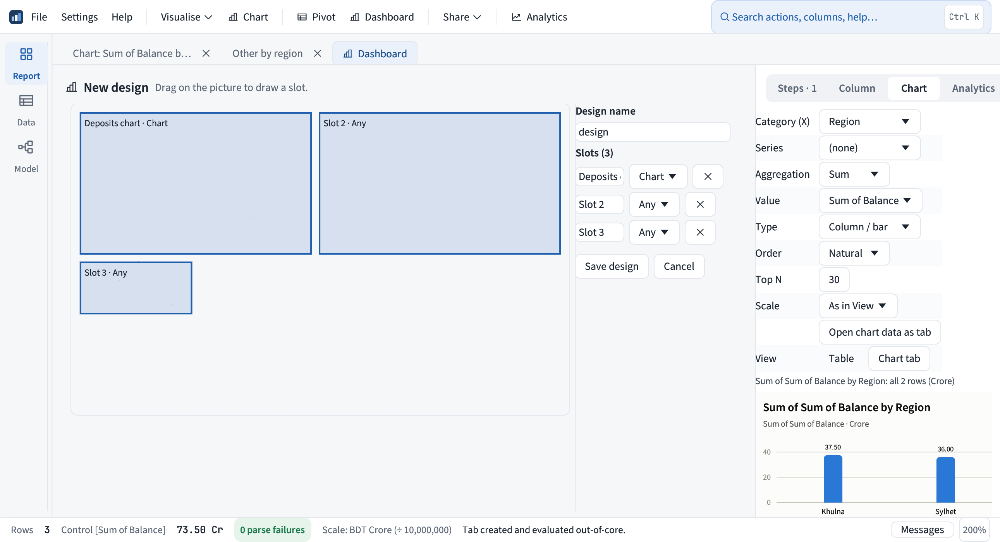
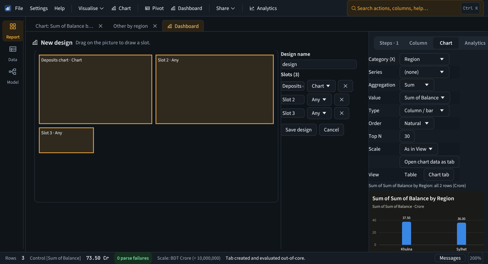

# Dashboard designs (template pictures)

## 1. What it does

A design is a picture (for example the bank's slide master drawn in PowerPoint and saved as PNG) with named places on it, called slots. A page that uses a design shows the picture behind its items, and each slot takes one item of the right kind: a chart, a pivot or a KPI card. The page takes the shape of the picture, so nothing is stretched.

## 2. When to use it

- A pack that must look like the bank's ALCO slides every month.
- A page whose cards always sit in the same four boxes.

## 3. How to use it

1. In the page settings press **Import design**, choose a PNG or JPEG, and give it a **Design name**. A picture over 2,000 pixels wide is made smaller; a JPEG is kept as a PNG.
2. **Drag on the picture to draw a slot.** Name it and choose its kind (chart, pivot or KPI card). A slot is at least 60 × 40 units, inside the page, and has a name of its own.
3. **Save design.** The page is now a Free page and the design is behind it.
4. Click an empty slot. It lists only the items its kind takes; **Fill with KPI card** makes a new card in it. Removing the item makes the slot empty again.
5. **Design ▸ None** takes the picture and slots away and leaves the items where they are.

## 4. Example

A 1920 × 1080 picture with four slots is the same design after saving and opening the project again: same name, same slots and places, same picture. The page is 1000 wide and 562.5 high, the shape of the picture.

Test: `d5_a_1920_by_1080_png_with_4_slots_is_the_same_template_after_save_and_reopen`

## 5. What it refuses and why

- A file that is not a picture, a picture over 3 MB, or a slot outside the picture is refused in words.
- If `portable_data/dashboard_templates/` holds another picture under the same name, the project's own copy is used and the page settings warn you. A damaged copy in the project is refused.
- Slots only take items of their kind.

## 6. Python export

None.

## 7. Saved in

- `portable_data/dashboard_templates/<name>/`: the picture and its slots, for reuse in other projects.
- The project file: a copy of the picture with its fingerprint, so a project opens on another computer. A 3 MB picture makes the project about 4 MB bigger.

## 8. Related tools

[Dashboards](dashboards.md), [Layouts](dashboard-layouts.md), [PowerPoint](export-pptx.md) (the design can be the slide background), [PDF pages](export-pdf-pages.md), [HTML report](export-html-report.md) (the picture goes inside the file and counts toward its size).
