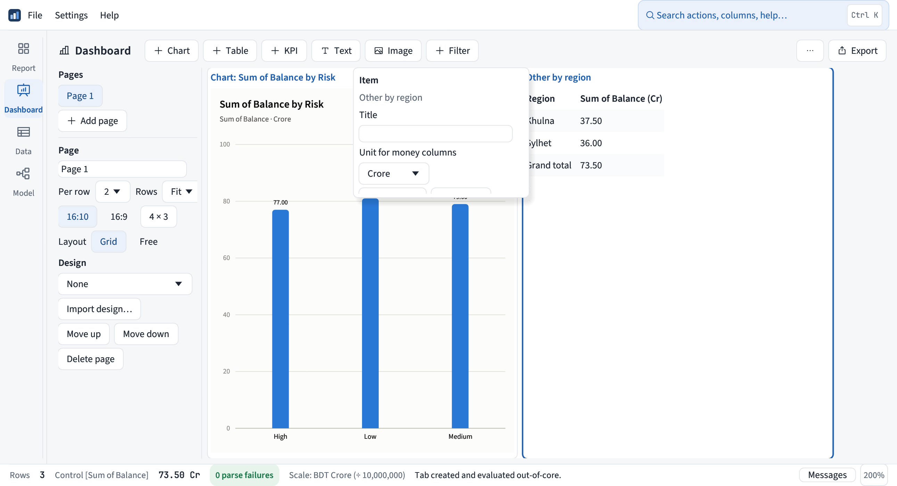
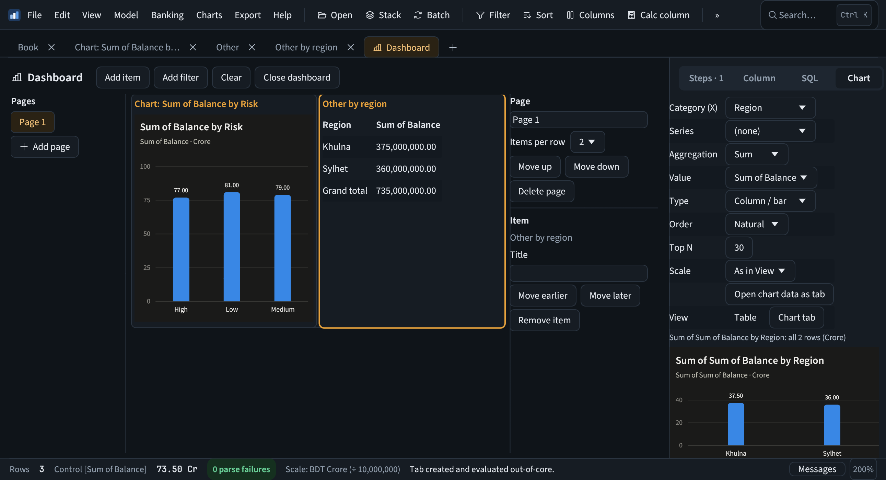
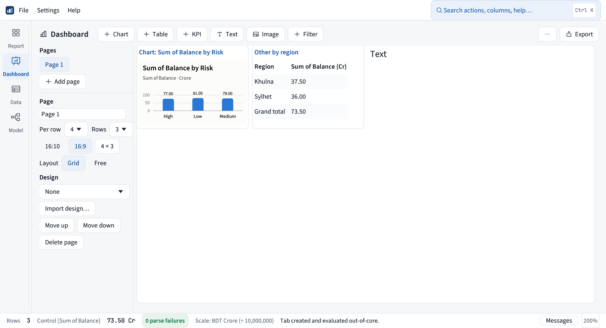
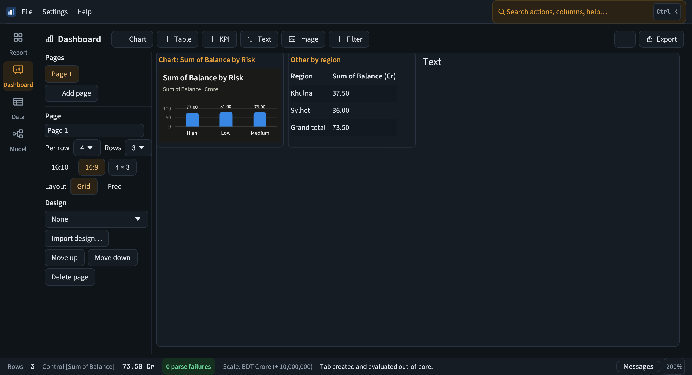

# Dashboards

## 1. What it does

A dashboard is one or more pages of charts, pivots and KPI cards that read the tabs of your project. Every item shows the numbers of its own tab, calculated by the same code as the tab itself, so a bar on the dashboard and the same chart on its tab never disagree. Page filters and a click on a bar change what the items show; the layout can be a grid or placed by hand. The dashboard belongs to the project and is saved with it.

## 2. When to use it

- The monthly ALCO page: deposits, advances, CASA ratio and the margin on one screen instead of five tabs.
- A pack you refresh every month: relink the files, open the dashboard, export it ([A monthly dashboard routine](monthly-dashboard-routine.md)).
- Showing one number to a colleague without handing over the whole project.

## 3. How to use it

1. Save or open a project first. A dashboard belongs to a project; outside one the Dashboard view says "Dashboards belong to a project. Save or open a project first."
2. Click **Dashboard** on the left rail (or Ctrl+K, "Dashboard"). The dashboard is a view of its own, beside Report, Data and Model, and has no tab strip.
3. **Add item** puts a chart tab or a pivot tab on the page; **KPI** adds a card ([KPI cards](dashboard-kpi-cards.md)); **Text** adds a text box (size, bold, left, centre or right) and **Image** a picture from a PNG or JPEG file (kept in the project, made smaller than 1600 px on its longest side). The first item lands in the first free place; the page's "Items per row" (1 to 4) sets the grid.
3a. **4 × 3** (next to Shape in the page's settings) sets a 16:9 landscape page with four items across and three rows: twelve places on one view. **Rows** and **Shape** (16:10 or 16:9) set them by hand.
4. Right-click an item and choose **Open in the main view** to go to the chart, pivot or table it reads. Click an item to change its title or place; **Remove item** takes it off the page. The tab it reads is not touched.
5. **Add page** makes another page; **Page earlier / Page later** orders them, **Delete page** asks first.
6. A pivot item has "Unit for money columns" (Crore, Lakh, Million, Thousand or Absolute). Crore is the default; counts and shares keep their own form.
7. **Add filter** and clicks: [Filters, clicks and drill](dashboard-filters-and-drill.md). **Layout** and **Design**: [Layouts](dashboard-layouts.md), [Designs](dashboard-templates.md). **Export…**: [HTML](export-html-report.md), [PowerPoint](export-pptx.md), [PDF](export-pdf-pages.md).

## 4. Example

A bar item "Balance by region" on a tab of eight accounts shows the sums of the tab's own chart: Ctg 100, Dhaka 180, Sylhet 45.

| Region | Sum of Balance |
| --- | ---: |
| Ctg | 100.00 |
| Dhaka | 180.00 |
| Sylhet | 45.00 |

Test: `d9_the_example_tables_of_the_notes_are_made_by_the_dashboards_own_calls`

## 5. What it refuses and why

- An item whose tab is gone (a tab closed, a file relinked wrongly) shows the reason in words in its place; it never shows an empty chart or a zero.
- A page cannot take an item that would run off it; a Free page that is full says so.
- Deleting the last page is allowed; the dashboard is then empty and Export says "Nothing to export."

## 6. Python export

A dashboard has no Python script. Each chart and pivot tab it reads still has its own ([Pivot](pivot.md), [Charts](charts.md)).

## 7. Saved in

- The project file (`.mpproj`), under `dashboard`: pages, items, filters, the click, drill paths and layout. A project saved before Phase 10 opens with no dashboard and is written the same as before until you make one.
- Not in macros or saved tool runs.
- Designs: `portable_data/dashboard_templates/` and a copy inside the project.

## 8. Related tools

[KPI cards](dashboard-kpi-cards.md), [Filters, clicks and drill](dashboard-filters-and-drill.md), [Layouts](dashboard-layouts.md), [Designs](dashboard-templates.md), [Projects](projects.md), [Pivot table](pivot.md), [Charts](charts.md).
