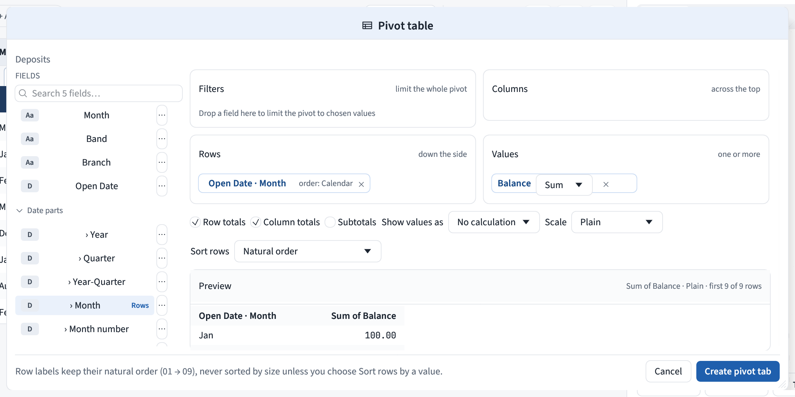
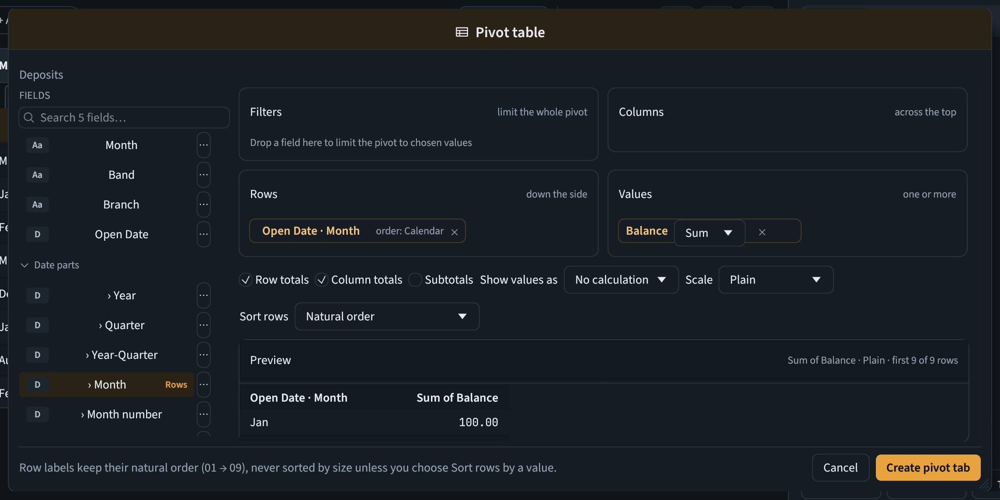
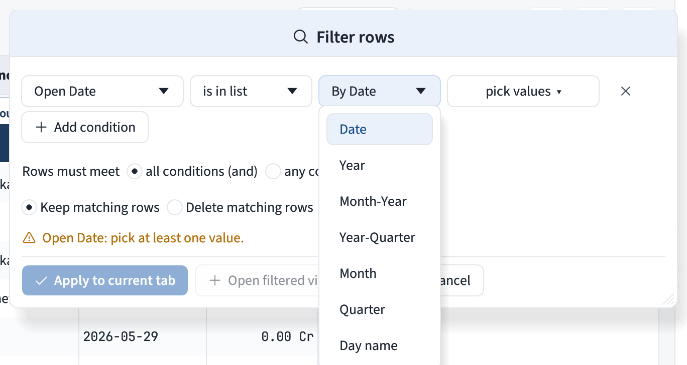
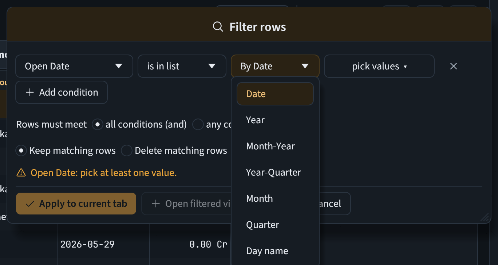

# Date grouping (no new columns)

## 1. What it does

Uses a part of a date (the year, the month, "Jan 2026", the day name …) as a pivot row or column, a chart category, series or panel, or a filter, without adding a column to the tab. It is the date hierarchy of Power BI: the same parts as [Split date](split-date.md), worked out when the pivot, chart or filter is calculated. Blank dates are one group called "(blank)", always last, so the groups always add up to the total.

## 2. When to use it

- A quick monthly or quarterly view of one pivot or chart. Use Split date when the part must stay in the tab (to export it, or use it in several places).
- A filter such as "Day name is Friday or Saturday" or "Month-Year from Aug 2025 to Jan 2026".

> **Balances are stocks.** A balance is a position on one day. Adding the month-end balances of January, February and March gives a number that means nothing: it is three times the balance. Group by Month-Year and read one month at a time. Closing balance and average balance are measures of Phase 9.

## 3. How to use it

1. **Pivot.** Open Pivot. In the field list a Date or Datetime column has an expander ("Date parts"). Open it and use the "…" menu of "› Month" to choose Add to Rows, Add to Columns or Add to Filters. A part is not offered for Values. The field is called "Open Date · Month".
2. **Chart.** In the Chart tab, open Category, Series or Panels. Under each date column the picker lists "Open Date › Year", "› Quarter", "› Month", "› Month-Year", "› Day name" and the rest.
3. **Filter.** In Filter, pick a Date column. The "By" choice shows Date (the dates themselves), Year, Month-Year, Year-Quarter, Month, Quarter or Day name, and stays when you change the condition. For comparisons see [Filter](filter.md).
4. Rows, columns and chart categories are listed in the part's own order (Jan to Dec, Q1 to Q4, Sat to Fri from the calendar's week start), not A to Z. Months of different years are in time order.

## 4. Example

Six month-end balances of fixed deposits, one with no date. Rows = Open Date · Month-Year, Values = Sum of Balance. The groups are in time order, the blank is last and the groups add up to the ungrouped total, 840.00.

| Open Date · Month-Year | Sum of Balance | Rows |
| --- | ---: | ---: |
| Jan 2026 | 350.00 | 2 |
| Feb 2026 | 100.00 | 1 |
| Mar 2026 | 350.00 | 2 |
| (blank) | 40.00 | 1 |
| Grand total | 840.00 | 6 |

Test: `w8_the_date_grouping_example_adds_up_to_the_ungrouped_total`

Do not add the three months of one deposit: the 100.00 held at the end of January, February and March is 100.00 of money, not 300.00.

## 5. What it refuses and why

- A text column: "'Open Date' is text. Set it to Date in Schema & Ingestion (D/M/Y) first."
- A table that already has a column called "Open Date · Month": "the table already has a column called … Rename that column, or use it instead of the date field."
- A date column that is no longer there (a step before removed it): "the date column 'Open Date' … was not found. Remove the field or pick another column."

## 6. Python export

The filter's "By" choice is translated (the same parts and week rules as the app). A pivot step is not translated, as before: the script stops with a clear message; run the pivot in MicroParquet or from a macro.

## 7. Saved in

- A pivot: its date fields, each with the calendar it was made with (macro, project, saved run).
- A chart: the part of its category, series and panels (saved charts, chart tabs, projects, chart books).
- A filter: the part on the condition (macro and project).
- Old pivots, charts and filters have no parts and load unchanged.

## 8. Related tools

[Split date](split-date.md) · [Calendar settings](calendar-settings.md) · [Pivot table](pivot.md) · [Chart](chart.md) · [Filter](filter.md) · [Custom sort lists](custom-sort-lists.md)
