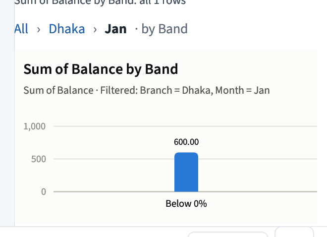
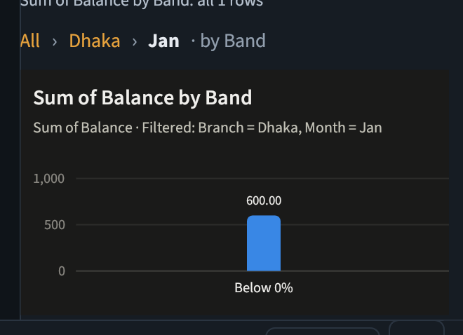
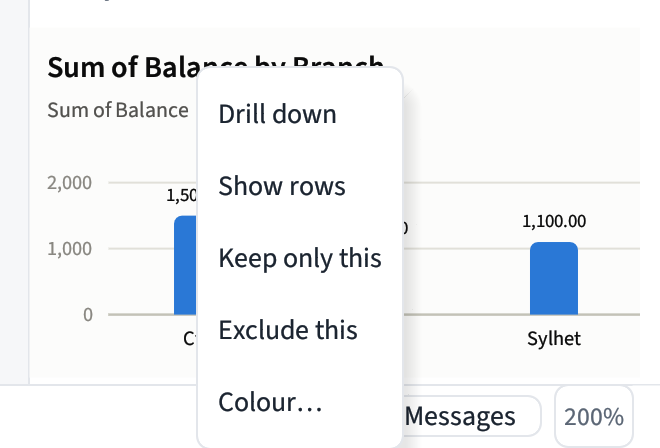
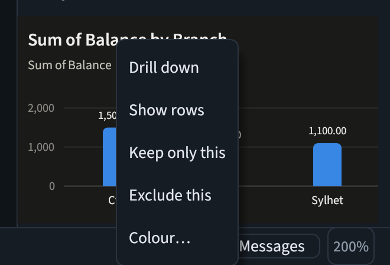

# Drill-down and Show rows

## 1. What it does

Lets you click a bar to see what is inside it. A chart can have **drill levels**: Deposit Type, then Branch, then Product. Clicking a mark goes one level down with the clicked value added to the path; a breadcrumb above the chart ("All › Dhaka › Jan") goes back up. "Show rows" opens a new tab with the rows behind a mark, and the same for a pivot cell. The numbers at each level add up to the mark you clicked.

## 2. When to use it

- ALCO asks "what is in the FDR bar?": click it and see the branches.
- Checking a number: Show rows gives the account-level rows whose sum is the mark.
- A date chart from Year to Quarter to Month to Day, in one click.

## 3. How to use it

1. In the Chart tab open "Drill levels" and add the columns, top first (move them up or down, or remove them). When the category is a date, one click offers "Year › Quarter › Month › Day". The chart's category is the top level; the chart always shows the level you are at.
2. Click a bar, column, line point, area point, donut part or heatmap cell. The tooltip says what a click does ("Click to drill into Month"; at the last level "Last level: a click does nothing").
3. The subtitle states the path ("Filtered: Branch = Dhaka, Month = Jan"). Click a name in the breadcrumb to go back to that level, or press Backspace (or Alt+Left) while the pointer is over the chart.
4. Right-click a mark for: **Drill down**, **Show rows**, **Keep only this** and **Exclude this**. Keep and Exclude add a filter to the chart, listed in "Filters on this chart", where you can remove it.
5. **Show rows** opens a tab named "Rows: Branch = Dhaka, Month = Jan" with the source's steps plus a filter for the path, the mark and (for a stacked or grouped chart) its series. Its row count and sum are the mark's.
6. In a pivot tab, double-click a value cell (totals included) or right-click it and choose "Show rows". It filters by every row and column field of that cell, date parts too, and by the pivot's own filters.

## 4. Example

Sum of Balance by Branch, with Month and Band below it. The top level, then Dhaka's months, then Dhaka's January by band. Each level adds up to the bar clicked above it: Dhaka 1,000.00 = 600.00 + 300.00 + 100.00, and Dhaka's January 600.00 is all in "Below 0%".

| Branch | Sum of Balance | Rows |
| --- | ---: | ---: |
| Ctg | 1,500.00 | 3 |
| Dhaka | 1,000.00 | 3 |
| Sylhet | 1,100.00 | 2 |

Test: `w8_the_drill_example_adds_up_at_every_level`

| Month | Sum of Balance | Rows |
| --- | ---: | ---: |
| Jan | 600.00 | 1 |
| Feb | 300.00 | 1 |
| Mar | 100.00 | 1 |

Test: `w8_the_drill_example_adds_up_at_every_level`

| Band | Sum of Balance | Rows |
| --- | ---: | ---: |
| Below 0% | 600.00 | 1 |

Test: `w8_the_drill_example_adds_up_at_every_level`

## 5. What it refuses and why

- A scatter, bubble, histogram, box plot or waterfall has no drill: the "Drill levels" section says why ("A waterfall draws steps that add up to a total, so a step is not a group to drill into.").
- "Other" (the values Top N puts together) cannot be drilled, kept, excluded or shown: "'Other' is the values that Top N puts together, not one value. Raise Top N … or filter the table first."
- A series or panel column cannot also be a drill level.
- A chart tab whose source tab is closed cannot calculate the next level; its menu is greyed with the reason.
- Show rows on a pivot is greyed, with the reason, when a later step renames, drops or rewrites a row field, or groups or pivots again.

## 6. Python export

"Copy as Python" draws the level you are on, with the path in the subtitle. The HTML page, the Excel workbook, the PDF and a chart book do the same.

## 7. Saved in

- The chart's levels and path are part of its spec: a saved chart, a chart tab, a project (a chart tab saved at level 2 reopens at level 2) and a chart book.
- Show rows makes an ordinary tab: its steps are the source's plus one filter.

## 8. Related tools

[Chart](chart.md) · [Pivot table](pivot.md) · [Filter](filter.md) · [Date grouping](date-grouping.md) · [Projects](projects.md) · [Colours](colours.md)
