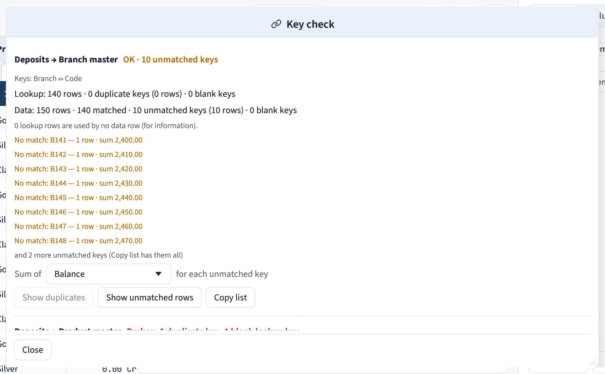
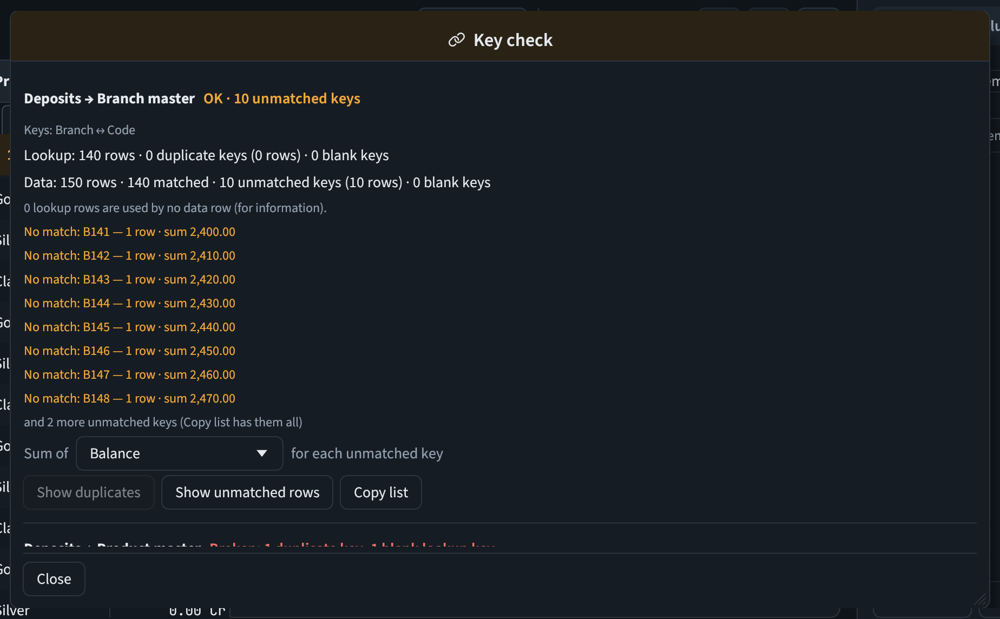

# Key check

## 1. What it does

Checks every link of the model and lists what a banker can fix at the source: lookup keys that appear twice, blank keys in the lookup, data keys with no lookup row (with their row counts and sums), blank keys in the data, and how many rows matched. The lists can be opened as tabs or copied, to send back to whoever keeps the master file.

## 2. When to use it

- After adding a link, and every month after the files are relinked.
- When a pivot says "(no match)" and you need to know which branch codes or products are missing.
- When a link is Broken and its fields are greyed.

## 3. How to use it

1. **Model ▸ Key check…** shows one section per link. It runs by itself when a link is made or edited, when the project opens, and when either tab's file or steps change.
2. Read the counts: duplicate keys, blank lookup keys, unmatched keys, blank data keys, matched rows, lookup rows no data row uses.
3. Choose the value column whose sum is shown beside each unmatched key (it is remembered for the link).
4. **Show duplicates** opens a tab of the lookup rows whose key repeats, sorted by key, with a "Times" column.
5. **Show unmatched rows** opens a tab of the data rows that have no match. **Copy list** copies the unmatched keys with counts and sums as text.
6. Fix the lookup file, relink it in the Sources dialog, and read the check again.

## 4. Example

A product master keyed by Wing and Product code has SB01 once in each wing, which is correct. Someone adds a second Conventional SB01 row ("Savings (old)"). The link becomes **Broken: 1 duplicate key**, and Show duplicates gives both rows:

| Wing | Code | Group | Times |
| --- | --- | --- | ---: |
| Conventional | SB01 | Savings | 2 |
| Conventional | SB01 | Savings (old) | 2 |

Test: `m0_a_product_master_keyed_by_wing_and_product_code_links_and_a_second_row_makes_it_broken_and_lists_both_rows`

The unmatched keys of the accounts, such as an XX99 with no product row, do not break the link: the status reads "OK · 1 unmatched key", and they show as "(no match)" in a pivot.

## 5. What it refuses and why

- Duplicate or blank keys in the lookup make the link Broken: a lookup field could not say which row is meant, so no number is given. The message says what to open: "'Product master' has 1 duplicate key. Open Model ▸ Key check to see it."
- A link whose column is gone says which column and which tab.
- A tab changed since the link was made says so instead of guessing.

## 6. Python export

Not applicable. The two lists can be exported as tabs (Excel, CSV) like any tab.

## 7. Saved in

The project keeps the link and the value column chosen for the sums. The check itself is not saved; it is run again when the project opens. The open line says it: "9 tabs opened; link 'Accounts → Branch master' is broken: 3 duplicate keys", and the status bar shows "Model: 4 links · 1 broken".

## 8. Related tools

[Links between tabs](model-links.md) · [Projects](projects.md) · [Join](join.md)
