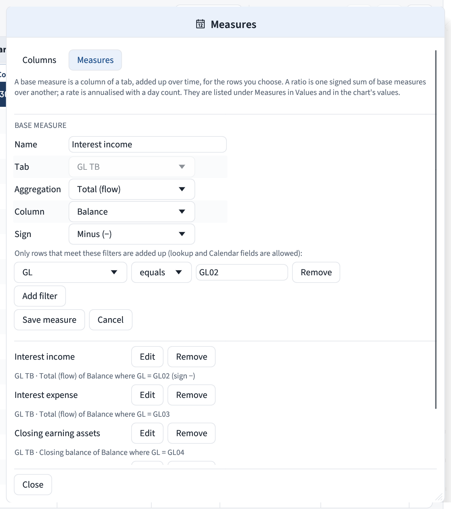
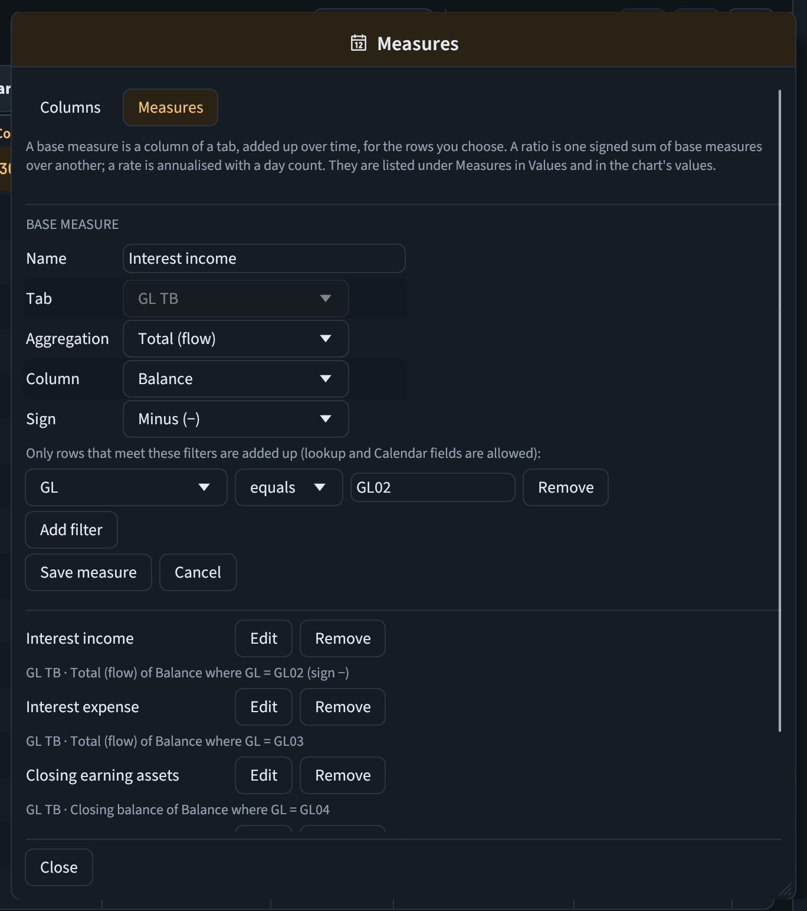
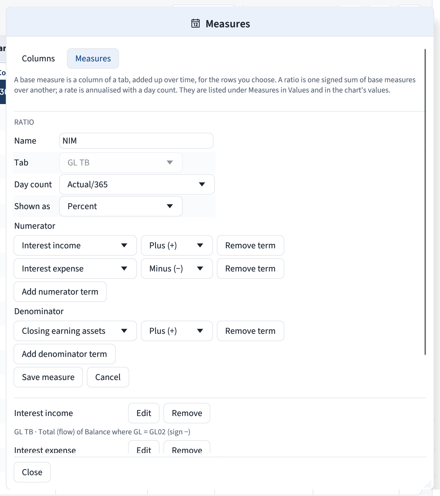
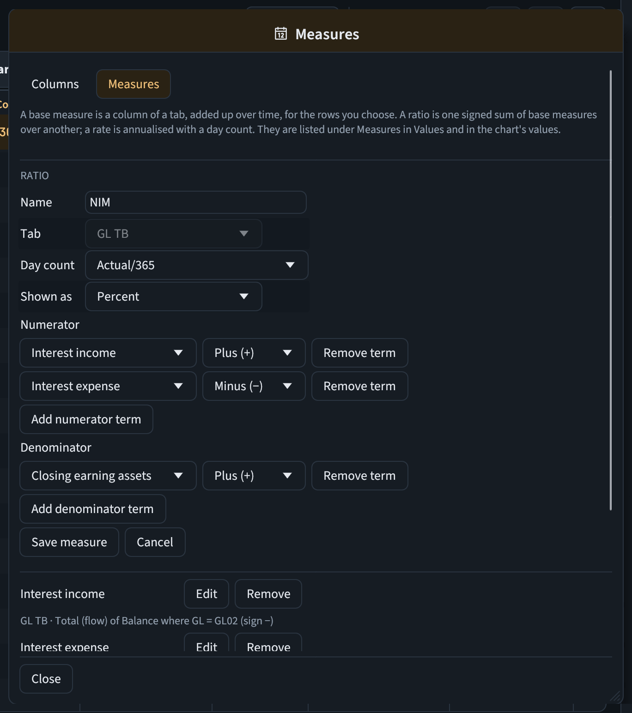
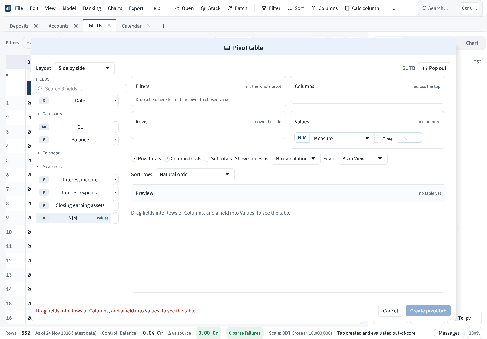
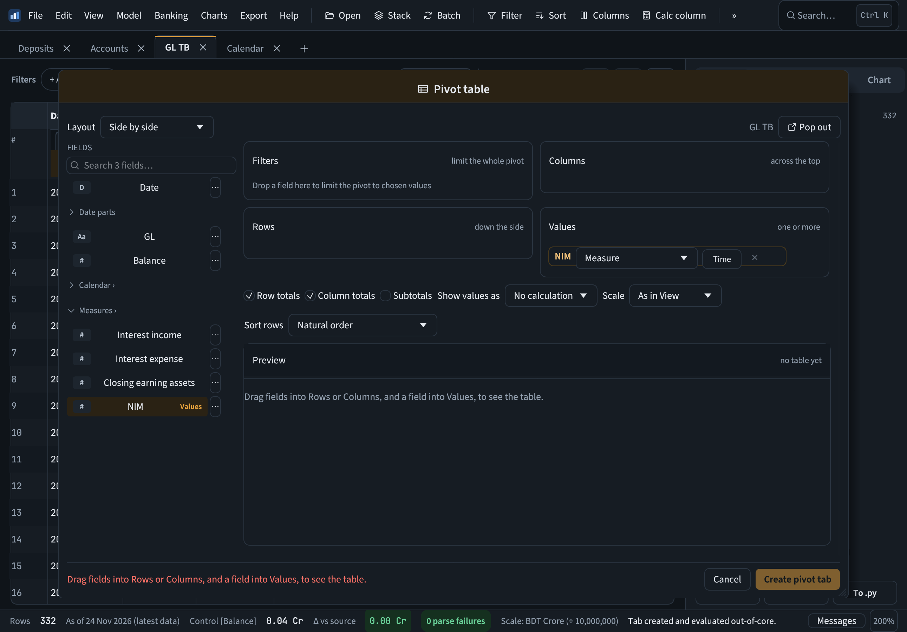
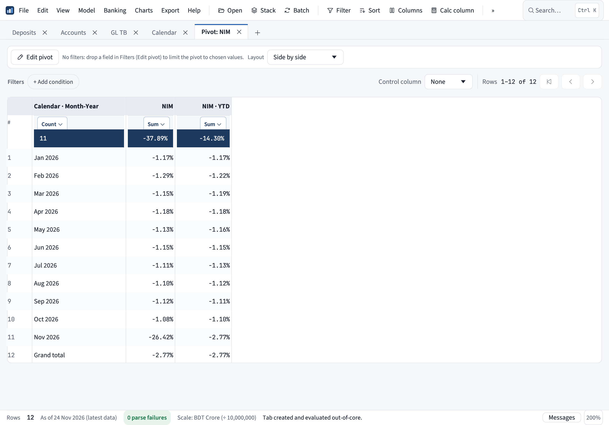
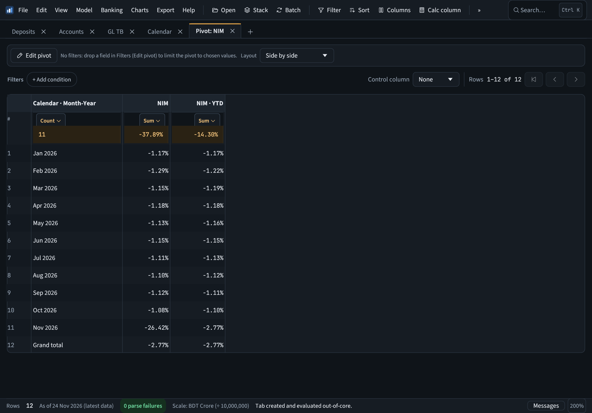

# Measures and ratios

## 1. What it does

Gives a calculation a name that every pivot and chart of its tab can use. A **base measure** is a column of one tab, added up over time (closing, average, a flow total, a YTD movement), for the rows you choose, such as "Loans closing" = the closing of Balance where Product master › Class is Loan. A **ratio** is one signed sum of base measures over another, a share or a rate: CASA ratio, ADR, yield on loans, cost of deposits, net interest margin (NIM). The window, shift and show of [Time intelligence](time-intelligence.md) apply to it, and a change in a ratio is in percentage points.

## 2. When to use it

- A figure that goes on every monthly page and must be worked the same way each time.
- A ratio whose subtotal and total must be the ratio of the group's own numbers: the CASA ratio of Dhaka is Dhaka's CASA over Dhaka's deposits, and the Grand total is all CASA over all deposits, never the average of the regions.

## 3. How to use it

1. **Model ▸ Measures… ▸ Measures**, then **Add base measure**: a name, the tab, the aggregation, the column, the **Sign** (Minus turns a credit-negative trial balance around), and any number of filters (equals, is not, contains) on a column, a lookup field or a Calendar field.
2. **Add ratio**: a name, the tab, the numerator and denominator (each a signed list of base measures of that tab), the **Day count** if it is a rate (Actual/365, Actual/360, Actual/Actual; or "Not annualised (a plain share)") and the format (percent or number).
3. **Annualising** multiplies the numerator by year days over the days of the window (capped at the as-of date). It works on flows and period amounts only. Year days are 365, 360, or the days of the fiscal year the window ends in (365 or 366).
4. In the Pivot dialog the tab's measures are in the group **Measures ›** of the field list, for Values only. In the chart studio they are in the Value list under "Measures". A pivot on another tab does not list them.
5. **Edit** a measure to change it. Its **name can be changed**: every ratio, pivot step (also saved ones), chart value and chart tab follows, with the same numbers. Its tab can't be changed; add a new measure and remove the old one.
6. **Remove** is refused while a ratio, pivot or chart uses the measure; the message lists them.
7. **Show rows** on the number of a measure is greyed, with the reason as its tooltip: "This number combines several filtered series. Use Show rows on a column value instead."

## 4. Example

**Yield by day count.** Interest income is 1 a day (a credit, so the sign is Minus) and the earning assets are 3,650 every day. January has 31 days: the income is 31 and the yield is 31 × 365 / 31 / 3,650 = 10.00% on Actual/365, 9.86% on Actual/360. January 2028 has a leap year: Actual/Actual uses 366 days and gives 10.03%.

| Month | Interest income | Average earning assets | Actual/365 | Actual/360 | Actual/Actual |
| --- | ---: | ---: | ---: | ---: | ---: |
| Jan 2026 | 31.00 | 3,650.00 | 10.00% | 9.86% | 10.00% |
| Jan 2028 | 31.00 | 3,650.00 | 10.00% | 9.86% | 10.03% |

Test: `m5_a_yield_is_the_income_of_the_month_annualised_over_the_average_earning_assets_by_day_count`

**A ratio's total.** CASA closing over deposits closing by region. Dhaka is 150 of 500 (30%) and Khulna 90 of 100 (90%). The Grand total is 240 of 600, 40%, not the 60% average of the two regions.

| Branch master · Region | CASA closing | Deposits closing | CASA ratio |
| --- | ---: | ---: | ---: |
| Dhaka | 150.00 | 500.00 | 30.00% |
| Khulna | 90.00 | 100.00 | 90.00% |
| Grand total | 240.00 | 600.00 | 40.00% |

Test: `m5_a_ratios_subtotal_and_total_come_from_its_own_numerator_and_denominator_not_the_average_of_the_regions`

## 5. What it refuses and why

- A name that is empty, or already used (case is ignored), or a column of the tab: "A measure called 'NIM' already exists. Names must be different."
- Annualising a numerator with a balance: "Only flows and period amounts can be annualised; 'Loans closing' is a balance."
- A ratio of ratios, or a term of another tab, or a term that does not exist.
- A blank term, or a denominator of 0, gives a blank cell with its reason, never 0: "The denominator of 'NIM' is 0 in …".
- A ratio with an average term on a month-end tab says so in the pivot's notes: "ADR: its average terms are averages of month-ends (the tab holds month-end data)."

## 6. Python export

Refused: "Python export can't follow links between tabs yet. Use the Join tool to copy the column, or export the result tab." A macro, pack or saved run that uses a measure needs the project; outside it: "This step uses the model of a project (link …). Open the project to run it."

## 7. Saved in

The project's model (`measures`, each Base or Ratio). The pivot and chart values refer to a measure by its name. Opening the project headless (`--project`) builds the model first, so a pivot tab gives the same numbers as the window.

## 8. Related tools

[Balances and flows](balances-and-flows.md) · [Time intelligence](time-intelligence.md) · [Links between tabs](model-links.md) · [A monthly model, start to finish](monthly-model.md) · [Pivot table](pivot.md) · [Chart](chart.md)
