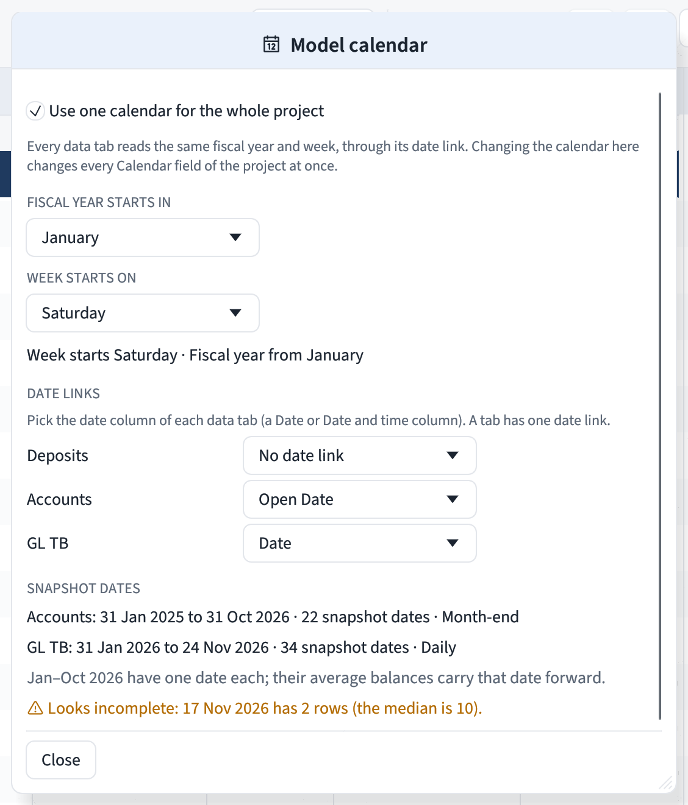
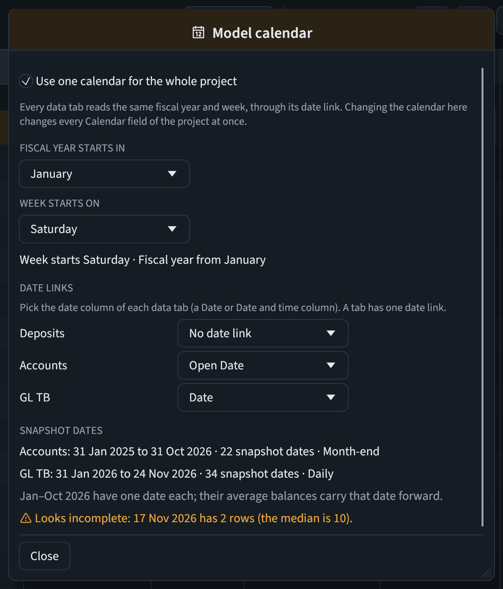
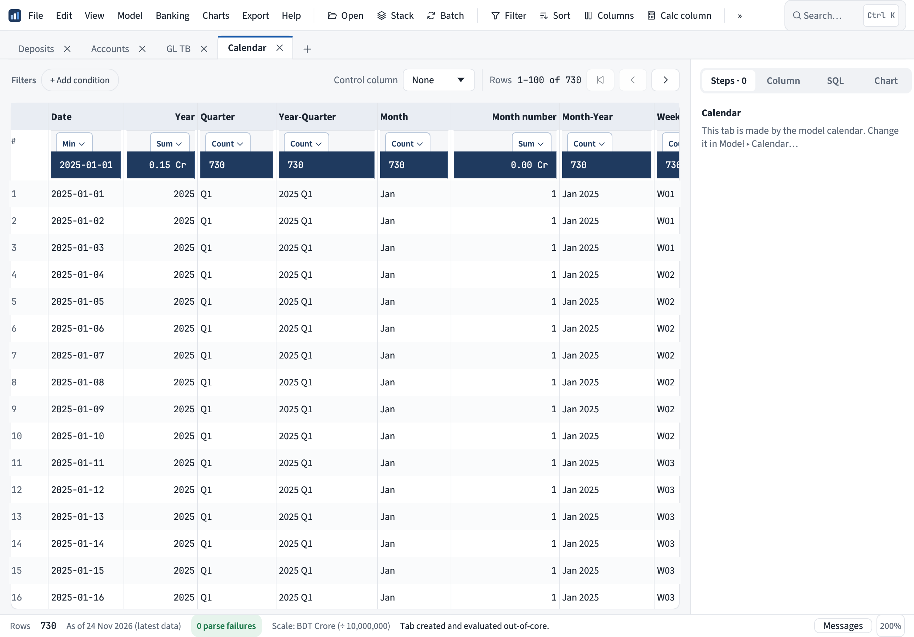
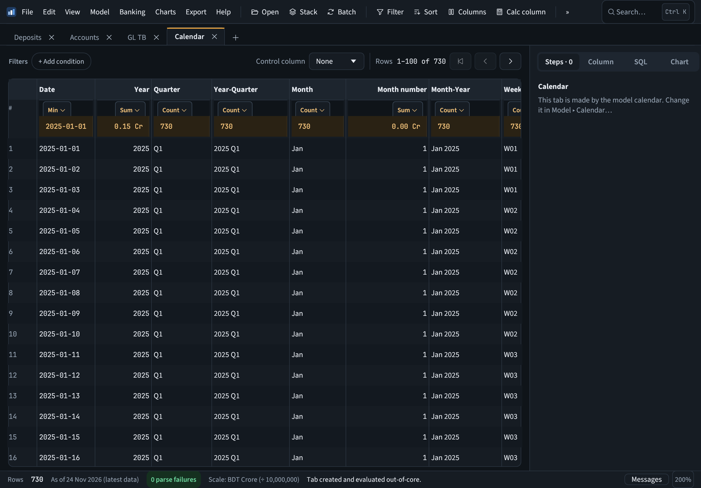
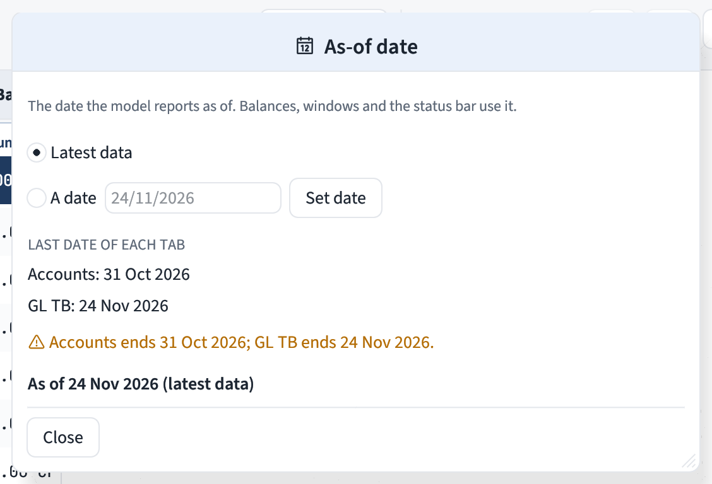
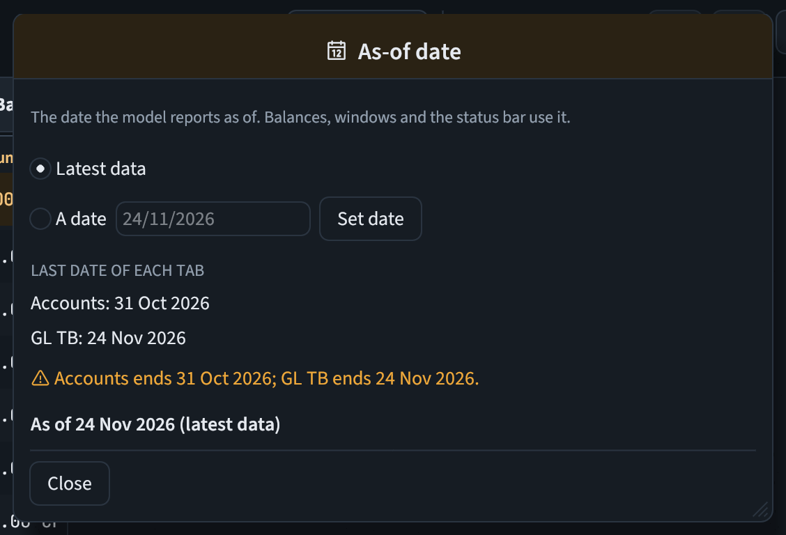

# Shared calendar, snapshot dates and as-of date

## 1. What it does

Gives every date-linked tab one calendar. Its fiscal-year start and week start are the project's, so a change reaches every Calendar field of every pivot and chart at once. For each date-linked tab it reads the snapshot dates, decides whether the tab holds month-end or daily data, flags dates that look incomplete, and sets the date every "to date" figure is read to: the as-of date.

## 2. When to use it

- Before any closing, average or year-to-date figure ([Balances and flows](balances-and-flows.md)).
- When two tabs (a month-end Accounts tab and a daily trial balance) must group by the same months and the same fiscal year.
- When the data of one tab ends later than another's and you must choose the month you report.

## 3. How to use it

1. **Model ▸ Calendar…** (in a project): turn the model calendar on. The week start and fiscal-year start are copied from the settings and can be changed for this project.
2. For each data tab, pick its date column. It must be a Date or Datetime column: a text column is refused with the Phase 8 message (set it to Date, D/M/Y, in Schema & Ingestion).
3. A tab "Calendar" appears: every day from 1 January of the first year to 31 December of the last year found in the linked dates, with every date part, "Month end" and "Days in month". It is made by the model; change it in Model ▸ Calendar….
4. Under each tab the dialog shows the first and last date, the number of snapshot dates and the **frequency**: Month-end (no month has more than one date) or Daily. A daily tab with months of one date lists them: "Jan–Oct 2025 have one date each; their average balances carry that date forward." A date whose row count is under half the tab's median is listed as **looks incomplete**.
5. **Model ▸ As-of date…**: "Latest data" (the default) or a date you type (D/M/Y, 2026-11-24 or 24 Nov 2026). When tabs end on different dates the dialog says so: "Accounts ends 31 Oct 2026; GL TB ends 24 Nov 2026." The status bar shows "As of 24 Nov 2026 (latest data)".
6. In the pivot, chart and filter, the fields "Calendar › Month-Year", "Calendar › Fiscal year" and the rest are listed on a date-linked tab, in calendar order.

## 4. Example

The same day, 31 October 2026, under a January and a July fiscal year. The calendar parts are the same; only the fiscal ones move.

| Fiscal year from | Year | Quarter | Month-Year | Year-Quarter | Fiscal year | Fiscal quarter | Fiscal month |
| --- | --- | --- | --- | --- | --- | --- | --- |
| January | 2026 | Q4 | Oct 2026 | 2026 Q4 | FY2026 | FQ4 | 10 |
| July | 2026 | Q4 | Oct 2026 | 2026 Q4 | FY2026-27 | FQ2 | 4 |

Test: `m6_the_calendar_example_is_what_the_calendar_core_gives`

Changing the fiscal start to July in the Calendar dialog changes "Fiscal year" on every date-linked tab at once.

## 5. What it refuses and why

- A text date column: set it to Date first.
- A tab with more than one date link: one date column per tab.
- A picked as-of date after every tab's data is accepted with a note, but a period that starts after the as-of date is blank.

## 6. Python export

Refused for a step that uses a Calendar field, as for lookup fields: "Python export can't follow links between tabs yet. Use the Join tool to copy the column, or export the result tab."

## 7. Saved in

The project's model: the calendar settings, the date links, and the as-of date (written only when you pick one). The Calendar tab is saved as a recipe, not as rows. The Phase 8 date parts of a pivot (Split date, "Open Date · Month") keep their own settings, as before.

## 8. Related tools

[Calendar settings](calendar-settings.md) · [Date grouping](date-grouping.md) · [Links between tabs](model-links.md) · [Balances and flows](balances-and-flows.md) · [Time intelligence](time-intelligence.md)
