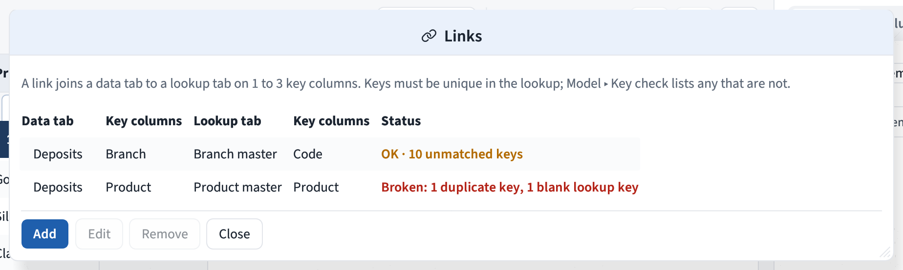
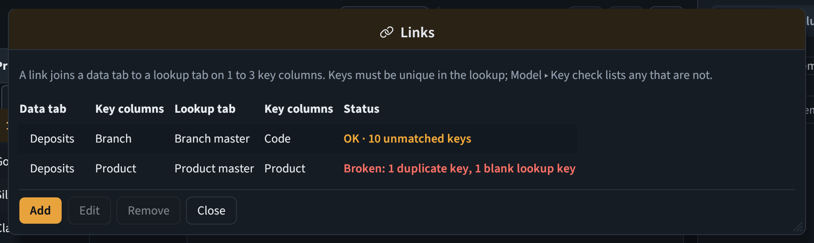
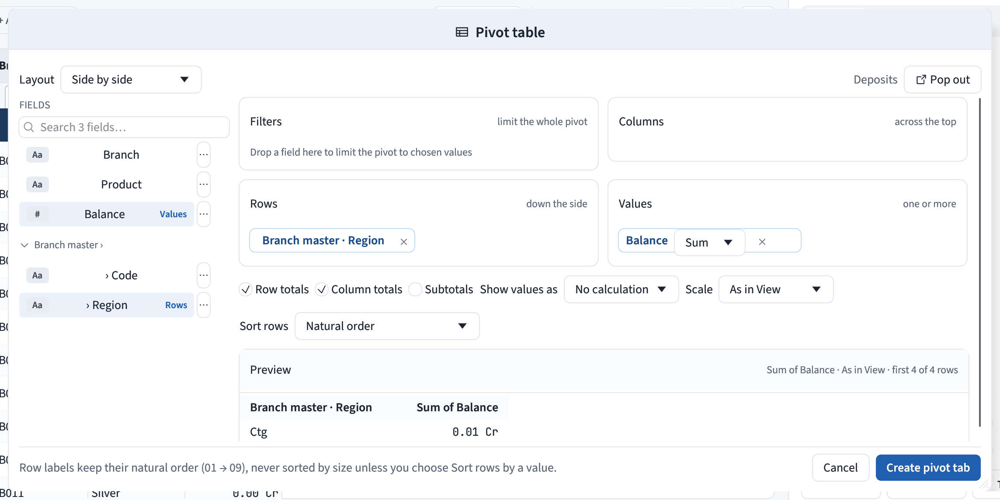
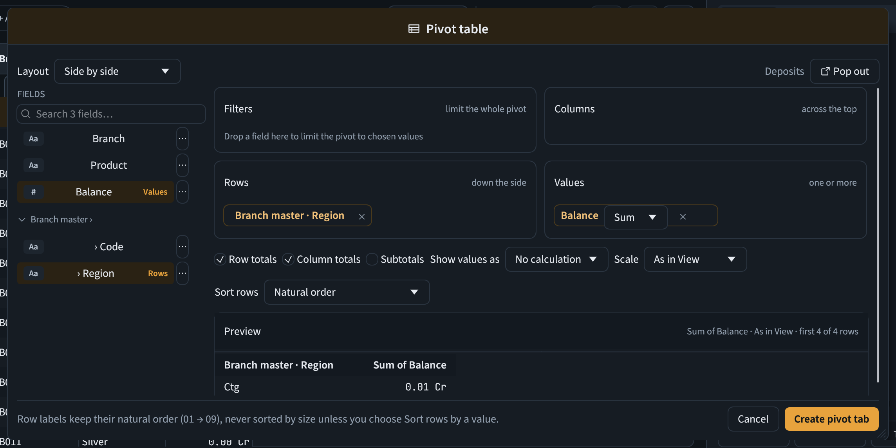

# Links between tabs (the model)

## 1. What it does

Links a data tab to a lookup tab, the way a database does: Accounts to the branch master, Accounts to the product master, GL TB to the GL map. After linking, every column of the lookup is a field of the data tab in the pivot, the chart and the filter ("Branch master › Region"). The data tab never changes: no column is added and no row is added or lost. Use the Join tool when you want the lookup's columns copied into the table for good.

## 2. When to use it

- A master file keeps the facts that belong to a branch, a product or a GL: region, product group, head. You want to group by them without copying them into every table.
- One lookup serves several data tabs (a branch master for deposits and for loans).

## 3. How to use it

1. Save the tabs as a project first. The model lives in the project. With no project open, Model ▸ Links… says "The model is part of a project. Save the tabs as a project first." and offers **Save project as…**.
2. **Model ▸ Links… ▸ Add.** Pick the data tab, the lookup tab, and one to three pairs of key columns. A product that exists in two wings needs two pairs: Wing and Product code.
3. The status of each link shows in the table: OK, "OK · 12 unmatched keys", or Broken. Read Key check before you trust a broken or unmatched link ([Key check](key-check.md)).
4. In the Pivot dialog, open the group "Branch master ›" under the tab's own columns. Its fields go to Rows, Columns, Filters and Values. The chart's category, series, panels and drill pickers list them the same way; the Filter dialog takes them too.
5. A lookup field never changes the tab it is on, and a filter on it never flows back to the lookup.

## 4. Example

Nine accounts; branch B9 is not in the branch master and two accounts have a blank branch. Rows = Branch master › Region, Values = Sum of Balance. Three labels are never merged: "(blank key)" is a data row whose key is blank, "(no match)" is a data row whose key has no lookup row, and "(blank)" would be a matched lookup row whose cell is blank. They sort last, in that order, and the total equals the unlinked tab's total.

| Branch master · Region | Sum of Balance |
| --- | ---: |
| Chattogram | 800.00 |
| Dhaka | 610.00 |
| Khulna | 400.00 |
| (blank key) | 30.00 |
| (no match) | 50.00 |
| Grand total | 1,890.00 |

Test: `m1_a_pivot_by_a_lookup_field_equals_the_join_tools_pivot_with_no_match_holding_the_unmatched_sum_and_the_total_is_the_ungrouped_total`

## 5. What it refuses and why

- A lookup can't have links of its own: "'Branch master' is a lookup; a lookup can't have links of its own".
- A second link between the same two tabs, a chart tab or a placeholder tab.
- A key pair of different types: "'Branch Code' is text in 'Accounts' and a number in 'Branch master'. Set both to text in Schema & Ingestion first."
- A broken link (duplicate or blank lookup keys): its fields are greyed and a saved pivot shows the reason instead of numbers: "'Branch master' has 3 duplicate keys. Open Model ▸ Key check to see them."
- A step that uses a lookup field, run outside a project: "This step uses the model of a project (link 'Accounts → Branch master'). Open the project to run it."

## 6. Python export

Refused: "Python export can't follow links between tabs yet. Use the Join tool to copy the column, or export the result tab."

## 7. Saved in

- The project: the `model` section, and project version 2. A project with no model is still version 1 and written as before.
- Pivots, charts and filters keep their lookup fields in their own steps. Old ones load unchanged.
- Version 1.8.0 refuses a version 2 project with its "newer app" message.

## 8. Related tools

[Key check](key-check.md) · [Shared calendar](model-calendar.md) · [Join](join.md) · [Pivot table](pivot.md) · [Projects](projects.md)
