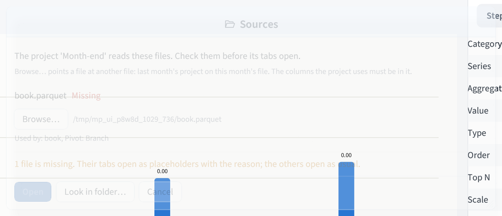
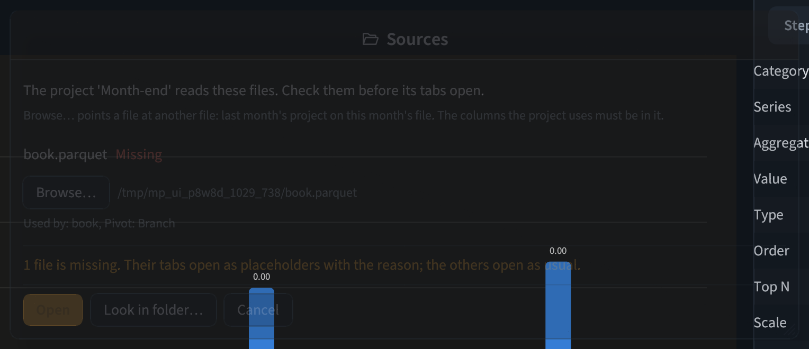
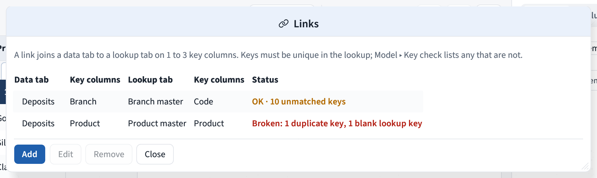
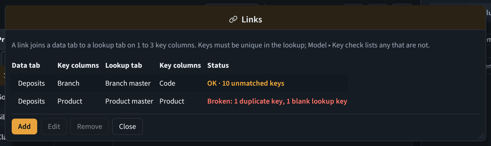

# A monthly model, start to finish

## 1. What it does

Walks through one synthetic project that has everything of the model: a month-end Accounts tab, a daily trial balance (GL TB), a branch master, a product master keyed by Wing and Product code, a GL map, the shared Calendar and the named measures of a monthly ALCO pack. The numbers below are read from the project in `tests/fixtures/phase9_model/`, opened and exported by the same code the window uses. Amounts are in Crore. The data run from January 2025 to October 2026, and the as-of date is 31 Oct 2026.

## 2. When to use it

- To learn the model on numbers that you can check by hand, before using your own files.
- As the pattern for your own month: the same five tabs, the same links, the same measures.

## 3. How to use it

The monthly routine:

1. **Open last month's project** (File ▸ Open project…). The Sources dialog lists each file with its place.
2. **Relink the files.** "Look in folder…" finds this month's files by name; "Browse…" relinks one. The columns are checked against the saved names ([Projects](projects.md)).
3. **Read Key check** (Model ▸ Key check…). Every link should say OK. A new branch code or product shows as unmatched with its rows and sum; fix the master, or add it, before you report.
4. **Check the as-of date** (Model ▸ As-of date…). "Latest data" is the latest date of all tabs. If Accounts ends 31 Oct and the trial balance ends 24 Nov, the dialog says so; set 31 Oct to report October.
5. Read the five pivot tabs below. Each is a pivot step on its tab, so they are built again from the new files.

The model of the project: Accounts → Branch master (Branch = Branch code), Accounts → Product master (Wing = Wing and Product code = Code), GL TB → GL map (GL), and Accounts and GL TB to the Calendar by their Date. The trial balance has no rows on Fridays and Saturdays except the last day of a month, so a month's average carries the Thursday balance over the weekend. Its income and expense GLs hold the amount since 1 January (income as a credit).

## 4. Example

**Deposit mix: CASA ratio by Month-Year,** with its change on the month before and on the same month last year, in percentage points. CASA ratio = CASA closing / deposits closing, where CASA is the Product master group "CASA" and deposits are the class "Deposit".

| Calendar · Month-Year | CASA ratio | CASA ratio · vs Prior period (pp) | CASA ratio · vs SPLY (pp) |
| --- | ---: | ---: | ---: |
| Aug 2026 | 37.76% | -0.14 pp | -2.01 pp |
| Sep 2026 | 37.62% | -0.14 pp | -1.96 pp |
| Oct 2026 | 37.48% | -0.14 pp | -1.91 pp |

Test: `m6_the_worked_example_gives_the_numbers_the_monthly_model_note_quotes`

**CASA ratio by region** in October 2026, with the two closings behind it. The Grand total is all CASA over all deposits (519.81 / 1,386.72), not the average of the regions.

| Branch master · Region | Oct 2026 \| CASA ratio | Oct 2026 \| CASA closing | Oct 2026 \| Deposits closing | Oct 2026 \| CASA ratio · vs SPLY (pp) |
| --- | ---: | ---: | ---: | ---: |
| Chattogram | 33.14% | 104.54 | 315.41 | -1.81 pp |
| Dhaka | 41.90% | 371.71 | 887.17 | -1.98 pp |
| Khulna | 23.66% | 43.56 | 184.14 | -1.49 pp |
| Grand total | 37.48% | 519.81 | 1,386.72 | -1.91 pp |

Test: `m6_the_worked_example_gives_the_numbers_the_monthly_model_note_quotes`

**Yield on loans, cost of deposits and NIM,** Actual/365, from the daily trial balance. The income of a month is the Period amount of its YTD balance, annualised; the denominator is the average balance. NIM = (loan interest + investment interest − deposit interest) / (average loans + average investments). The YTD column is January to the month's end. The data are made with a loan rate of 11% and a deposit rate of 6% in 2026, and that is what the table gives back.

| Calendar · Month-Year | Yield on loans | Cost of deposits | NIM | NIM · vs SPLY (pp) | NIM · YTD |
| --- | ---: | ---: | ---: | ---: | ---: |
| Aug 2026 | 11.00% | 6.00% | 4.06% | 0.08 pp | 4.02% |
| Sep 2026 | 11.00% | 6.00% | 4.05% | 0.06 pp | 4.03% |
| Oct 2026 | 11.00% | 6.00% | 4.06% | 0.06 pp | 4.03% |

Test: `m6_the_worked_example_gives_the_numbers_the_monthly_model_note_quotes`

**Loan portfolio growth:** closing loans by product group in October 2026, against October 2025 as a percentage change (a filter keeps the class "Loan").

| Product master · Group | Oct 2026 \| Loans closing | Oct 2026 \| Loans closing · vs SPLY % |
| --- | ---: | ---: |
| Investment (Islami) | 238.28 | 35.29% |
| Term loan | 542.79 | 28.35% |
| Working capital | 262.70 | 20.34% |
| Grand total | 1,043.77 | 27.70% |

Test: `m6_the_worked_example_gives_the_numbers_the_monthly_model_note_quotes`

**ADR** = loans closing / deposits closing, with its change against last year in percentage points.

| Calendar · Month-Year | ADR | ADR · vs SPLY (pp) |
| --- | ---: | ---: |
| Aug 2026 | 74.32% | 6.86 pp |
| Sep 2026 | 74.80% | 6.68 pp |
| Oct 2026 | 75.27% | 6.51 pp |

Test: `m6_the_worked_example_gives_the_numbers_the_monthly_model_note_quotes`

## 5. What it refuses and why

- A link with a duplicate key in a master is Broken and gives no numbers until it is fixed. Add a second Conventional SB01 row to the product master and every product field says so ([Key check](key-check.md)).
- A month with no balance before the as-of date is blank with its reason, never 0.
- Run outside the project, a macro that uses these fields is refused: "This step uses the model of a project (link 'Accounts → Branch master'). Open the project to run it."

## 6. Python export

Not available for steps that use links, the Calendar or measures. Export the result tab, or use the Join tool to copy a lookup column into the tab.

## 7. Saved in

The project `tests/fixtures/phase9_model/proj/monthly.mpproj` (project version 2): the five tabs by their files, the Calendar, the links, the date links, the tag of Balance on Accounts, the fourteen measures and the five pivot tabs. Headless: `MicroParquet --project <file> --export-dir <folder>` writes the same tables.

## 8. Related tools

[Links between tabs](model-links.md) · [Key check](key-check.md) · [Shared calendar](model-calendar.md) · [Balances and flows](balances-and-flows.md) · [Time intelligence](time-intelligence.md) · [Measures and ratios](measures-and-ratios.md) · [Projects](projects.md)
