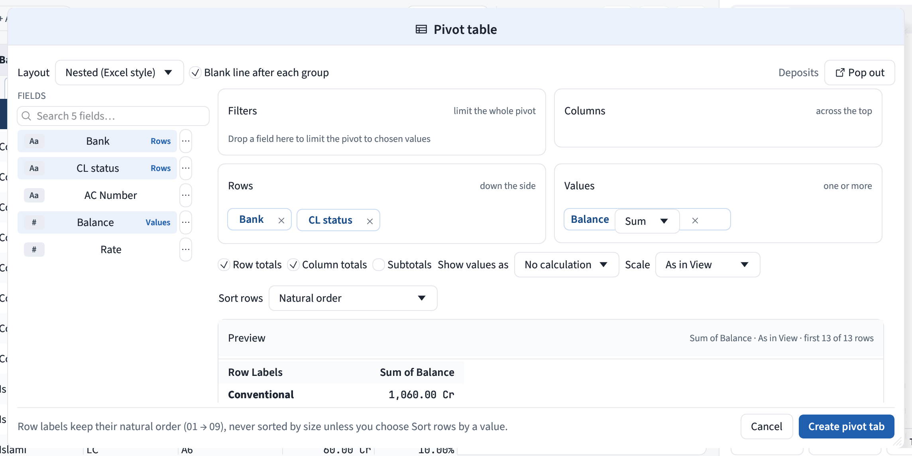
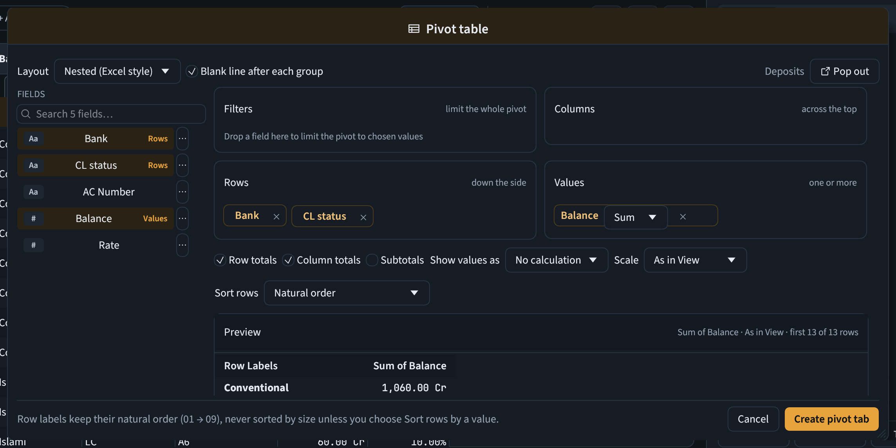
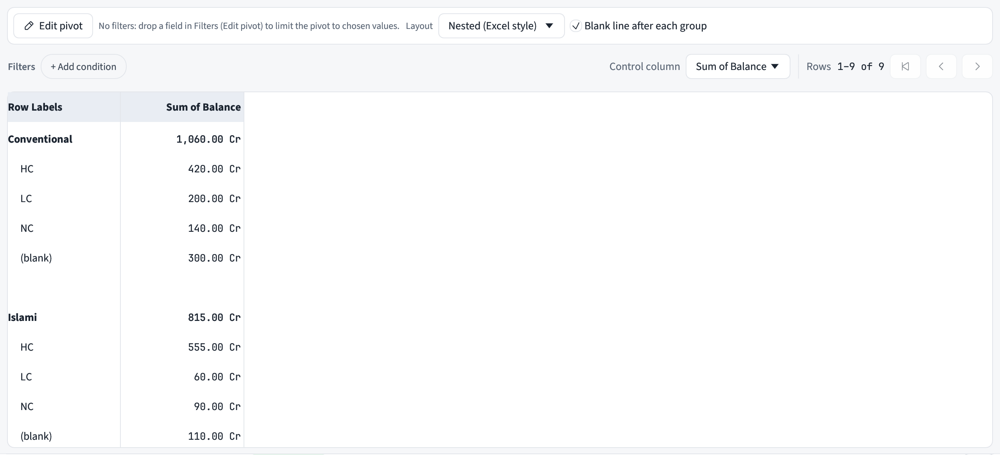
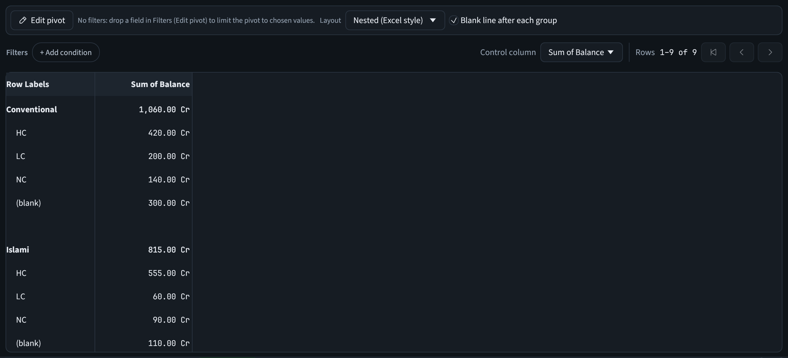

# Nested pivot layout (Excel style)

## 1. What it does

Shows a pivot with several Rows fields the way Excel's Compact form does: one "Row Labels" column, each parent line carrying its own subtotal in bold, its children indented under it, and the Grand total at the bottom. The numbers are the pivot's own: a parent's subtotal is worked out from the group's rows, never added up from its children. The table underneath (what later steps, charts, macros, CSV and Python see) is the same flat table as before, byte for byte.

## 2. When to use it

- A report where Bank, then CL status, then Branch should read as a tree, for the screen, an Excel sheet or a PDF.
- A pivot with a Count distinct, an Average or a W.Avg of a rate: the group's figure is not the sum or the average of its children's, so it must be calculated from the group.

## 3. How to use it

1. In the Pivot dialog (docked or in its own window), put two or more fields in Rows and pick **Layout ▸ Nested (Excel style)**. "Side by side" is the old layout and the default.
2. Tick **Blank line after each group** if you want an empty line after each top-level group.
3. Press Create pivot tab. The tab shows "Row Labels" with the parents in bold and the children indented one step a level.
4. To change the layout of a pivot tab that exists, use the Layout box in the bar above its table. Nothing is calculated again and Undo takes it back.
5. **Show rows** (double-click, or right-click ▸ Show rows) on a parent line opens every row of that group, with the pivot's filters. On a child or a value cell it works as before.

## 4. Example

Twelve accounts, some under two CL statuses. Rows = Bank › CL status; Values = Sum of Balance and Count distinct of AC Number. Conventional has six accounts, but its children add up to eight: an account in two statuses is counted once in the parent.

| Row Labels | Sum of Balance | Count distinct of AC Number |
| --- | ---: | ---: |
| Conventional | 1,060.00 | 6 |
|   HC | 420.00 | 3 |
|   LC | 200.00 | 2 |
|   NC | 140.00 | 2 |
|   (blank) | 300.00 | 1 |
| Islami | 815.00 | 6 |
|   HC | 555.00 | 3 |
|   LC | 60.00 | 1 |
|   NC | 90.00 | 1 |
|   (blank) | 110.00 | 2 |
| Grand total | 1,875.00 | 12 |

Test: `p2_every_subtotal_row_equals_a_pivot_by_bank_alone_and_a_distinct_count_is_not_the_sum_of_its_children`

## 5. What it refuses and why

- With steps after the pivot the tab shows the flat table and the note "Nested layout shows when the pivot is the tab's last step". Exports are flat then.
- A Nested pivot with more lines than an Excel sheet holds is listed on the export errors, not cut.
- One Rows field has no parents: the layout then has only leaves and the Grand total.

## 6. Python export

The script sees the flat table, whatever the layout. CSV and Parquet exports are flat too.

## 7. Saved in

- The pivot step (macro, project, saved run): `layout`. An old pivot has none and loads as Side by side.
- Excel and PDF exports of the tab draw the Nested layout: indent levels in the label cells (not spaces), bold parents and Grand total, the pivot's number formats, and the blank lines when chosen. The PDF indents 10 points a level.

## 8. Related tools

[Pivot table](pivot.md) · [Pivot builder in its own window](pivot-popout.md) · [Drill-down](drill-down.md) · [Export](split-export.md)
