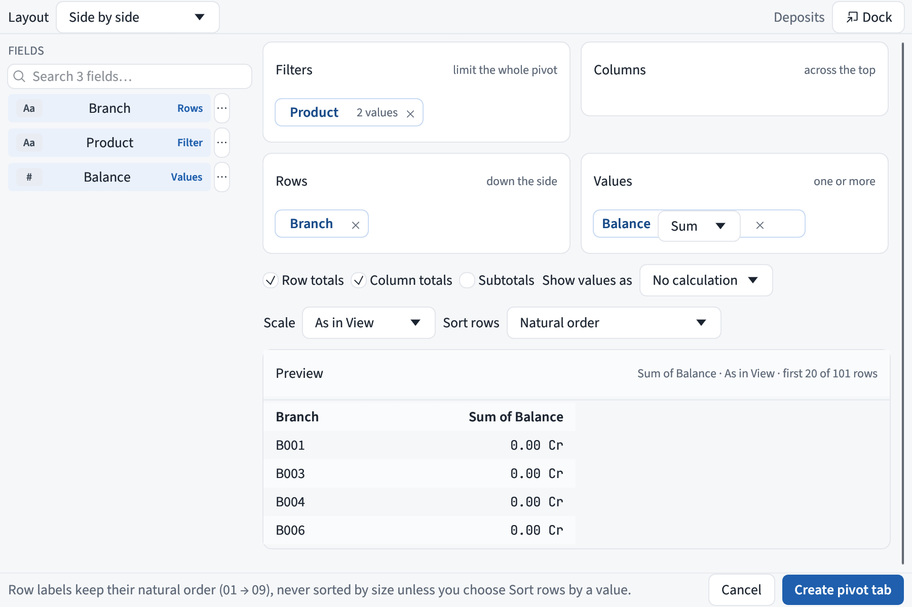
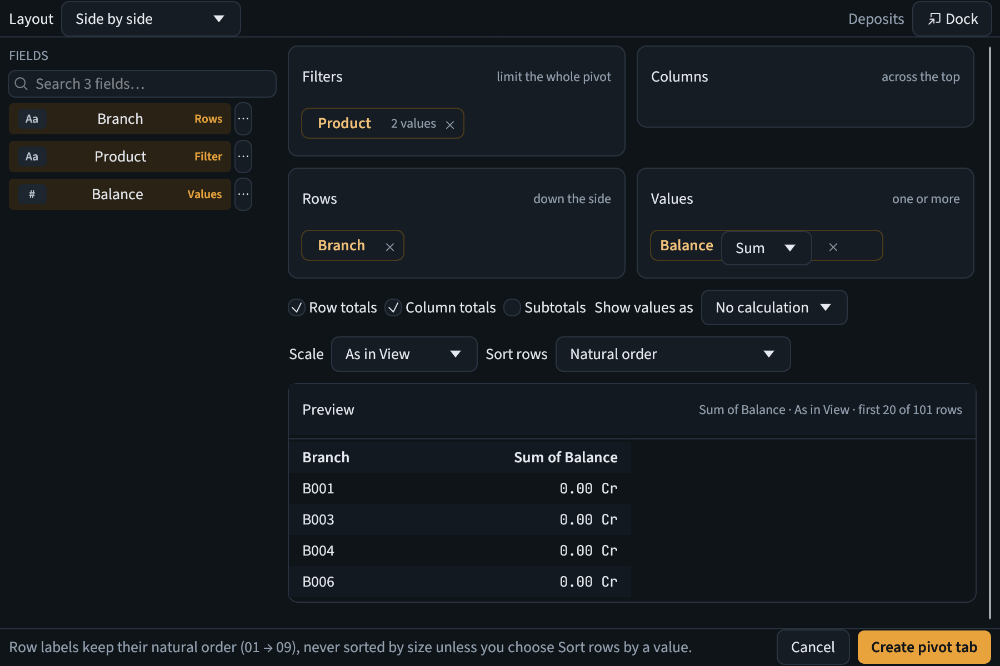

# Pivot builder in its own window

## 1. What it does

The pivot dialog can leave the app window and open in a window of its own, which you can make bigger or move to a second monitor. It is the same dialog, not a copy: the fields, values, filters, layout and every change you have not applied yet are one state, shown in the window instead of in the app. The preview fills the window's height and shows as many rows as fit, using the window's width for its columns.

## 2. When to use it

- A pivot with many fields, where the docked dialog is too small to see the field list, the four boxes and the preview at once.
- Checking a long result (every branch, every month) before you press Create pivot tab.
- Working with the pivot on one monitor and the data tab on another.

## 3. How to use it

1. Open the Pivot dialog as usual (a new pivot, or the pivot step of a tab).
2. Click **Pop out** in the title row (the line with the tab's name). The window opens, titled "Pivot builder – <tab>". The app window shows a note, "The pivot builder is in its own window", with a **Dock** button. The dialog is never drawn twice.
3. Build the pivot in the window: Rows, Columns, Values, Filters, Layout, Scale. The preview updates as in the docked dialog.
4. Press **Create pivot tab** (or Apply, when you edit a step) to make the step, or **Cancel**. Esc is Cancel, unless a list or a text box has it.
5. **Dock**, or the window's close button, puts the builder back in the app window exactly as it was, unapplied changes included.

The window remembers its size and place. The next time it opens there, if that place is on a monitor the app can see; otherwise it is centred on the app window.

## 4. Example

The same clicks in the docked dialog and in the window make the same step. The pivot "Wing by Sum of Balance" on nine accounts gives this table in both:

| Wing | Sum of Balance |
| --- | ---: |
| Conventional | 775.00 |
| Islami | 1,115.00 |
| Grand total | 1,890.00 |

Test: `p1_pop_out_by_a_real_click_edits_the_same_state_and_apply_makes_the_step_the_docked_dialog_makes`

The sum of both wings, 775.00 + 1,115.00, is the Grand total of 1,890.00, which is the sum of the nine rows.

## 5. What it refuses and why

- It is not offered where the system cannot open a second window (some remote desktops). The dialog stays docked and nothing is lost.
- A window left on a monitor that is no longer there is not used: the window is centred on the app window.
- Closing the tab the pivot is made from, or the app, with the window open follows the same rule as the docked dialog for that case.

## 6. Python export

A pivot step is not translated to Python, with or without the window; the script stops with a clear message, as before.

## 7. Saved in

- The window's rectangle: `settings.json` (`pivot_popout_rect`). An old settings file has none.
- The pivot itself is saved as before (macro, project, saved run). Nothing about the window is in them.

## 8. Related tools

[Pivot table](pivot.md) · [Nested pivot layout](pivot-nested.md) · [Projects](projects.md)
