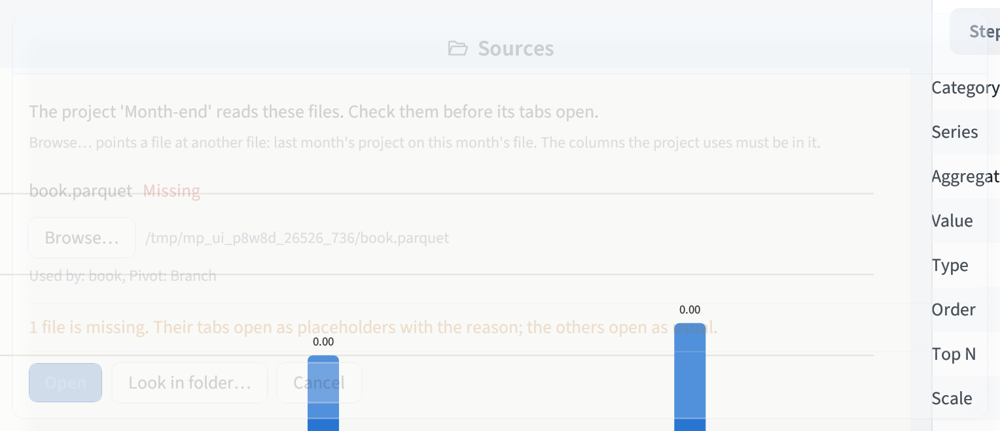
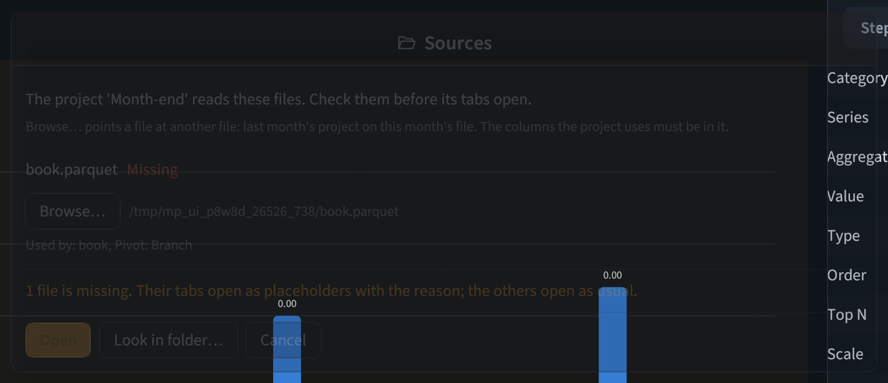

# Projects (.mpproj)

## 1. What it does

Saves a working session: the tabs in their order, how each was built (file, steps, join, pivot, banking tool, chart), their formats, summary rows, control column and chart choices, and the tab you were on. Opening the project later rebuilds the tabs from the files. A project holds **no row data**; it holds the recipe, plus what you typed into steps (filter values, SQL text, labels).

## 2. When to use it

- The month-end pack: open last month's project, point it at this month's files, and every pivot, gap ladder and chart is rebuilt.
- Stopping on Friday and carrying on on Monday with the same tabs.
- Handing the method (not the data) to a colleague.

## 3. How to use it

1. Open your files and build the tabs.
2. File ▸ "Save project as…" and choose a name. The default folder is `portable_data/projects/`. The file is written whole or not at all. The status bar shows "Hashing Loans.csv 40%" while the app fingerprints the files; the window stays usable.
3. A tab that cannot be rebuilt (for example a SQL result tab) is listed in the dialog and left out, with the reason ("SQL result tab: save its query as a step first").
4. Later: File ▸ "Open project…" (or "Open recent project", the last 8). The **Sources** dialog comes first, one row per file with its saved path and a status: **Found** (same size and date), **Changed** (the file is there but its size or date differs; both dates are shown) or **Missing**.
5. "Browse…" relinks one file; "Look in folder…" relinks every missing file by its file name. Relinking to a different file is the monthly workflow. The file's columns are checked against the saved names: an extra column is fine; a missing one refuses that file and lists the columns.
6. Click "Open". The tabs rebuild on the worker ("Opening 4 of 9: Gap ladder"). A tab that fails opens as a placeholder showing the reason; the others open and your recipe is kept, so saving again does not lose it.
7. File ▸ "Save project" saves again. The window title reads "MicroParquet v1.8.0 — Month-end — Loans.csv" and a "•" marks unsaved changes. Closing, opening another project or "New project" with unsaved changes asks Save / Don't save / Cancel.

## 4. Example

After opening, one line says what happened. With nine tabs and a file that lost a column:

| Tabs that opened | Tabs that failed | The line you read afterwards |
| --- | --- | --- |
| 9 | none | 9 tabs opened. |
| 8 | Gap ladder | 8 tabs opened, 1 failed: Gap ladder — the file has no 'MATDAT' column |

Test: `w8_the_project_line_is_the_one_the_app_writes`

A project of six kinds of tab (a file, a file with steps, a join, a pivot, a gap ladder and a chart) opens to tabs whose rows are identical to the originals, in the same order, with the same formats and chart choices. After the file's own hash is checked, a changed file says so: "Loans.csv changed since the project was saved (saved 31 Oct, file 30 Nov)".

## 5. What it refuses and why

- A project saved by a newer version: "This project was saved by a newer MicroParquet (v2). Update the app to open it." Unknown fields are ignored.
- A file with a missing column: refused, with the list of columns, and the tabs built on it do not open. Nothing is guessed.
- A second Save while one is running: "The project is being saved. Wait for it to finish."
- **Privacy.** Treat a `.mpproj` like a macro file: it can contain filter values and SQL. Keep it out of folders the data itself may not go to.

## 6. Python export

None. A project is not a script; use "Copy as Python" on a tab, or a macro, for that.

## 7. Saved in

- The `.mpproj` file (JSON, `"project_version": 1`), written where you choose, with a path relative to the project so a project and its files can be moved together.
- `settings.json`: the last 8 projects.
- Headless: `MicroParquet --project <file> --export-dir <folder>` opens the project (no relinking: a missing or short file stops the run, naming it) and writes every tab as Parquet. If any tab fails, nothing is written.

## 8. Related tools

[Saved tool runs](saved-tool-runs.md) · [Report packs](report-packs.md) · [Chart](chart.md) · [Batch](batch.md) · [Join](join.md) · [Pivot table](pivot.md)
