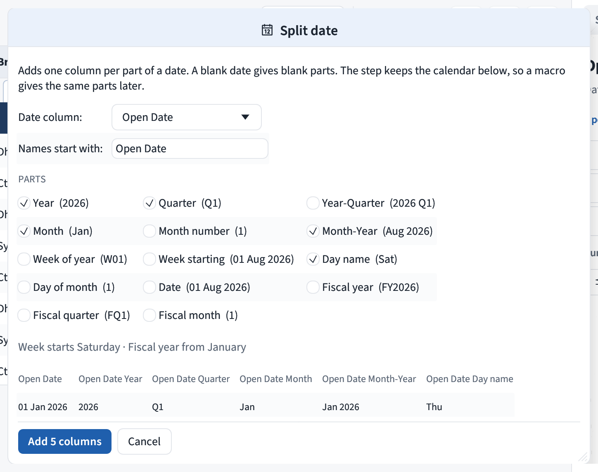
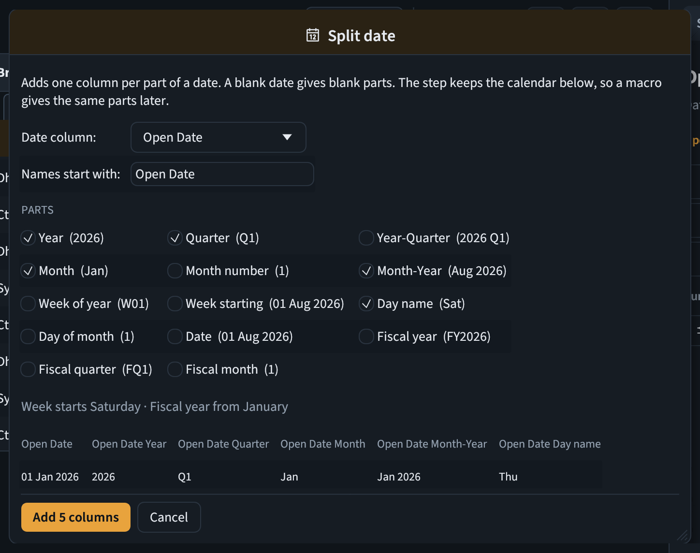

# Split date

## 1. What it does

Adds one column for each part of a date: the year, the quarter, the month, "Jan 2026", the day name and so on. The new columns are ordinary columns, so you can filter, sort, pivot and chart on them. A blank date gives blank parts: never "Unknown", never 0 and never a made-up date. The step keeps the calendar it was made with (the week start and the first month of the fiscal year), so a saved macro gives the same columns next month even if you later change View ▸ Calendar….

## 2. When to use it

- A month-by-month view of deposits or advances from an "Open Date" or "Value Date".
- Quarter and fiscal-year columns for an ALCO pack.
- Day name for a weekday pattern (for example the Friday and Saturday rows).
- You want the parts as real columns that stay in the tab. To use a part in one pivot or chart without adding columns, see [Date grouping](date-grouping.md).

## 3. How to use it

1. Open the tab. The date column must be a Date or Datetime. If it is text, set it to Date (D/M/Y) in Schema & Ingestion first.
2. Choose Edit ▸ "Split date…" (or Ctrl+K and type "split date"). In the Column panel, a Date column also has a "Split date…" button.
3. Pick the "Date column". Text columns are listed under "Not dates" and refused.
4. Tick the parts. The default ticks are Year, Quarter, Month, Month-Year and Day name. The other nine are Year-Quarter, Month number, Week of year, Week starting, Day of month, Date, Fiscal year, Fiscal quarter and Fiscal month.
5. Check "Names start with": the new columns are called "<prefix> <Part>", for example "Open Date Year". The prefix starts as the column's name.
6. Look at the preview (five rows of the page you are on) and the line "Week starts Saturday · Fiscal year from January".
7. Click "Add 5 columns". The Steps panel shows "Split date: Open Date → 5 columns". To change it later, edit the step and click "Save step".

## 4. Example

Three dates, with the default calendar (the week starts on Saturday, the fiscal year on 1 January). 15 January 2026 is a Thursday; its week started on Saturday 10 January and is the third week of the year. 1 January falls in W01, whose week started on 27 December 2025.

| Open Date | Year | Quarter | Month | Month-Year | Day name | Week starting | Week of year |
| --- | --- | --- | --- | --- | --- | --- | --- |
| 2026-01-15 | 2026 | Q1 | Jan | Jan 2026 | Thu | 2026-01-10 | W03 |
| 2026-01-01 | 2026 | Q1 | Jan | Jan 2026 | Thu | 2025-12-27 | W01 |
| (blank) | (blank) | (blank) | (blank) | (blank) | (blank) | (blank) | (blank) |

Test: `w8_the_split_date_example_is_what_the_calendar_core_gives`

A pivot of "Open Date Month" lists Jan, Feb, Mar … in calendar order, and "Open Date Day name" lists Sat, Sun, Mon … Fri, because the step tells the pivot the order of the columns it writes.

## 5. What it refuses and why

- "'Open Date' is text. Set it to Date in Schema & Ingestion (D/M/Y) first." Nothing is guessed from text, because 03/04 is 3 April in one bank file and 4 March in another.
- "'Balance' is a number, not a date. …" The same fix: set the column to Date.
- "Split date: a column 'Open Date Year' already exists. Change the prefix in the Split date dialog, or rename that column first." A new column never overwrites one.
- No part ticked: "Split date: tick at least one part (Year, Quarter, Month …)." The step does not run.

## 6. Python export

The step is written into the Python script as columns made by a small function that gives the same labels and week rules as the app. It is checked against all rows of the test tab. The script does not use pandas.

## 7. Saved in

- A macro: the step with its parts, prefix and its own copy of the calendar.
- A project: as a step of the tab.
- Settings (`settings.json`): only the calendar the next step will copy; the step itself keeps its own.

## 8. Related tools

[Calendar settings](calendar-settings.md) · [Date grouping](date-grouping.md) · [Pivot table](pivot.md) · [Filter](filter.md) · [Custom sort lists](custom-sort-lists.md) (the Calendar order) · [Schema & Ingestion](schema-ingestion.md)
