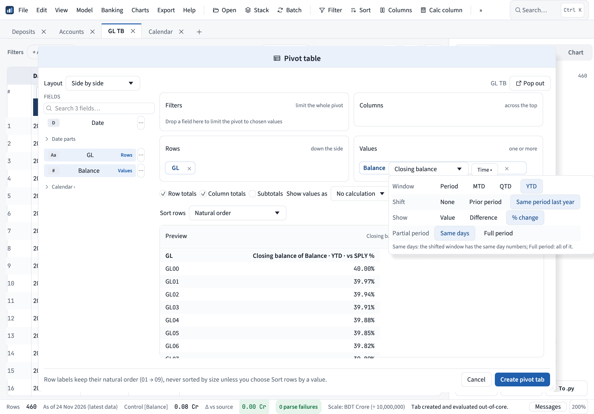
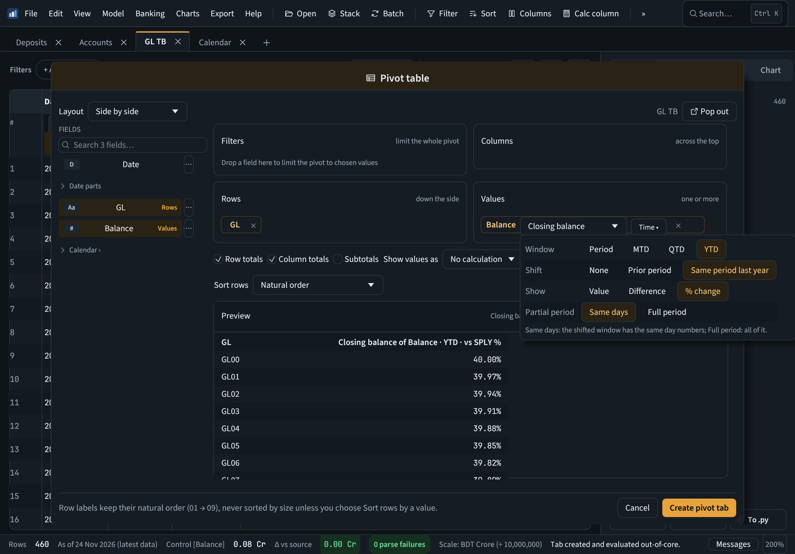
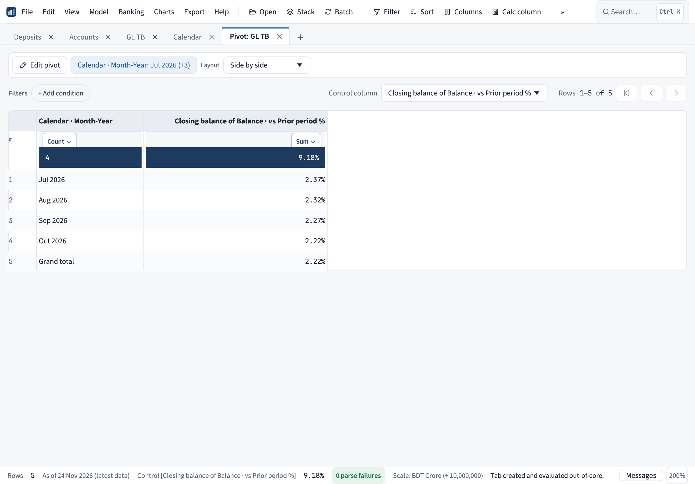
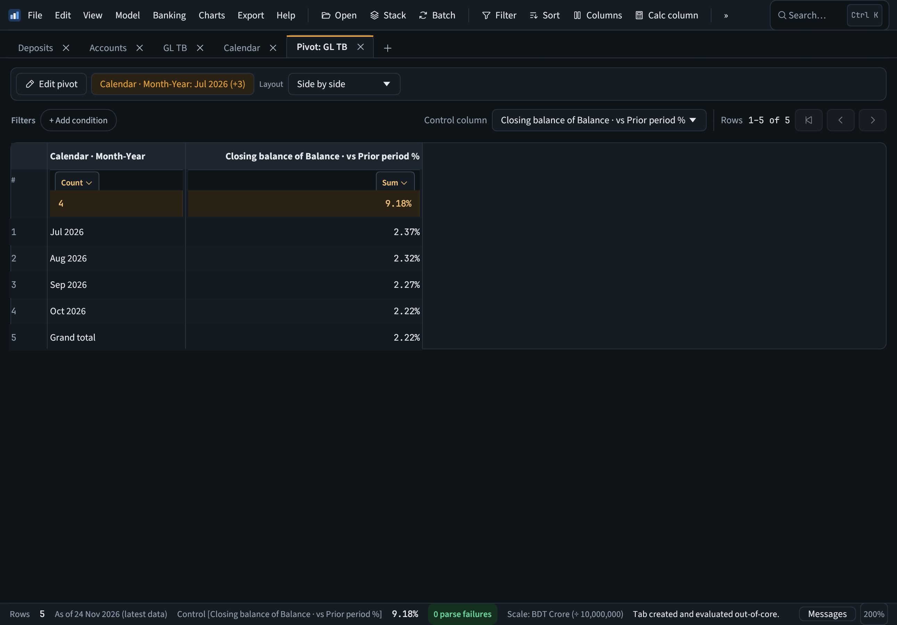
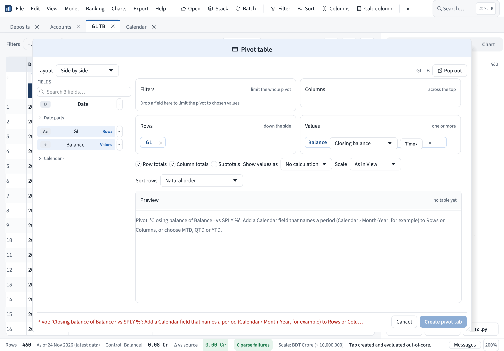
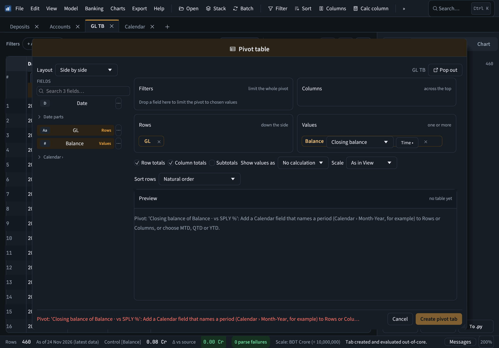
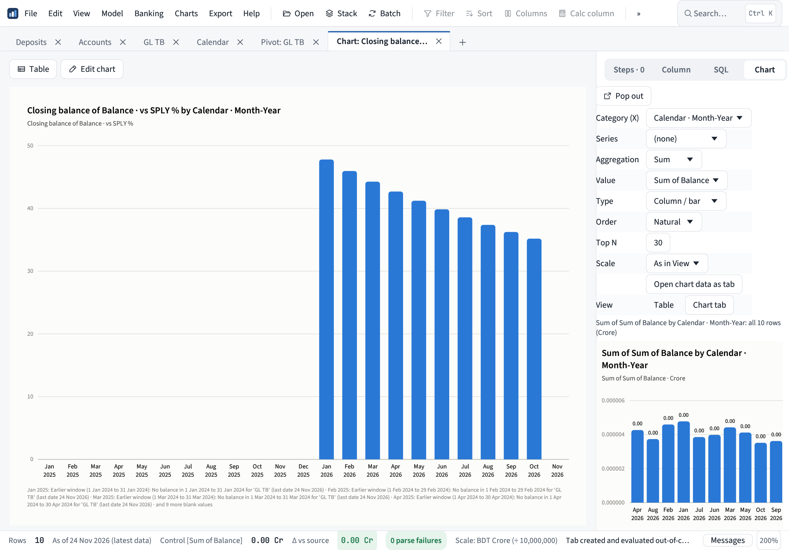
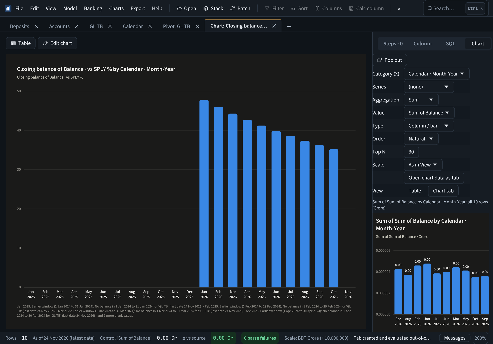

# Time intelligence (MTD, QTD, YTD, prior period, same period last year)

## 1. What it does

Adds four choices to any time value in a pivot or chart: the **window** (the cell's own period, month to date, quarter to date, year to date), the **shift** (none, prior period, same period last year), what it **shows** (the value, the difference, the percent change) and, for a window cut by the as-of date, the **partial period** (the same days, or the full period). The heading names the choices: "Total of Interest · MTD · SPLY".

## 2. When to use it

- "Interest this month so far against the same days last year."
- "Closing deposits against the same month last year, as a percentage" (the ALCO page).
- "Year to date against last year's year to date, to the same day."

## 3. How to use it

1. Link the tab's date column and check the as-of date ([Shared calendar](model-calendar.md)). Every "to date" window is read up to the as-of date.
2. In the Pivot dialog, on a value of a date-linked tab, press **Time** on its chip. Four rows of choices open: Window, Shift, Show, Partial period. Difference and % change are greyed until you choose a shift.
3. For **Period**, put a Calendar field that names one period in Rows or Columns: Year, Year-Quarter, Month-Year, Week starting, Date or Fiscal year. Each cell's period is that field's.
4. For MTD, QTD or YTD no such field is needed: the anchor is the as-of date. With a period field the anchor is the end of the cell's period (capped at the as-of date).
5. In the chart studio the same four choices are rows under the aggregation.
6. **Same days** (the default) moves a window that the as-of date has cut by the same day numbers: 1–24 Nov 2026 goes back to 1–24 Nov 2025. **Full period** takes all of Nov 2025. A window that is not cut gives the same either way.

Rules the shift follows: prior period moves back one of its own unit (a month for MTD, a quarter for QTD, a year for YTD, a Period by its field's unit); same period last year moves back one year. A day number that the earlier month does not have is clamped to its last day: 1–31 Mar 2026 goes back to 1–28 Feb 2026, and 29 Feb 2028 to 28 Feb 2027. A change is (this − before) / |before|, and blank when before is 0 or blank. A change in a ratio is in percentage points ("pp").

## 4. Example

One branch with a daily tab to 24 Nov 2026. Interest is 2 a day in 2025 and 1 a day in 2026; the balance is the number of days since 31 Dec 2024. The window is MTD, as of 24 Nov 2026.

| Value as of 24 Nov 2026 | B1 |
| --- | ---: |
| Total of Interest · MTD | 24.00 |
| Total of Interest · MTD · SPLY | 48.00 |
| Total of Interest · MTD · SPLY · full period | 60.00 |
| Closing balance of Balance · MTD | 693.00 |
| Closing balance of Balance · MTD · SPLY | 328.00 |
| Closing balance of Balance · MTD · vs SPLY % | 111.28% |

Test: `m4_mtd_and_sply_use_the_same_days_by_default_and_the_whole_period_when_asked`

1–24 Nov 2026 is 24; the same days last year are 48, but the whole of November 2025 is 60. The balance of 24 Nov 2026 is 693 against 328, up 111.28%.

## 5. What it refuses and why

- A Period window with no period field: "Add a Calendar field that names a period (Calendar › Month-Year, for example) to Rows or Columns, or choose MTD, QTD or YTD."
- A field that mixes years: "'Calendar › Month' mixes years. Use Month-Year."
- A plain value with no Calendar field and no shift keeps its whole-data number, and the notes say the span it covers ("whole data, 1 Jan 2025 – 24 Nov 2026 (as of 24 Nov 2026)"). A shift on it is refused.
- A period that starts after the as-of date is blank, with its reason. A shifted window with no data is blank, never 0.

## 6. Python export

Refused: "Python export can't follow links between tabs yet. Use the Join tool to copy the column, or export the result tab."

## 7. Saved in

The four choices are part of the pivot or chart value (macro, project, saved chart); the as-of date is in the project's model. A value that uses none of them writes none, so old files are unchanged.

## 8. Related tools

[Balances and flows](balances-and-flows.md) · [Shared calendar](model-calendar.md) · [Measures and ratios](measures-and-ratios.md) · [Pivot table](pivot.md) · [Chart](chart.md)
